# 🚀 AI Engineering Hub: Практическая энциклопедия современной AI-инженерии

> **Ссылка на репозиторий:** [https://github.com/patchy631/ai-engineering-hub](https://github.com/patchy631/ai-engineering-hub)  
> **Автор:** Rishabh Srivastava (patchy631)  
> **Категория:** `00_strategy_and_roadmaps`  
> **Звёзды GitHub:** 39,700+ ★ (#3 Daily в мировых трендах GitHub, +625 ★ за сутки)  
> **Формат:** 80+ сквозных интерактивных Jupyter-ноутбуков с продакшен-кодом  
> **Стек:** Python 3.11+, LangChain, LlamaIndex, LiteLLM, Qdrant, Neo4j, FastMCP, DSPy  
> **Лицензия:** MIT  

---

## 🎯 1. В чем главная ценность AI Engineering Hub?

В индустрии машинного обучения образовался гигантский разрыв:
* **Академические курсы** обучают математике обратного распространения ошибки (backprop), обучению трансформеров и расчетам матричных умножений на CUDA, но не дают понимания, как строить реальные продукты.
* **Маркетинговые туториалы** показывают банальные вызовы `OpenAI().chat.completions.create` на 10 строк, умалчивая о проблемах стоимости, задержек, галлюцинаций, дрейфа контекста и безопасности.

**AI Engineering Hub стал де-факто открытым стандартом подготовки прикладных AI-инженеров:**
Он охватывает полный жизненный цикл создания масштабируемых систем: от выбора архитектуры векторизации данных до построения графового RAG, многоагентных роев и мониторинга затрат.

```mermaid
flowchart LR
    subgraph Level1["1. Фундамент RAG & Chunking"]
        C1["Semantic Chunking"]
        C2["Hybrid Search: Dense + BM25"]
        C3["Re-ranking (Cohere / BGE)"]
    end

    subgraph Level2["2. Продвинутые архитектуры контекста"]
        A1["GraphRAG (Neo4j / NetworkX)"]
        A2["Corrective RAG (CRAG)"]
        A3["Self-RAG & Adaptive Retrieval"]
    end

    subgraph Level3["3. Агентные системы & MCP"]
        M1["Model Context Protocol (FastMCP)"]
        M2["Multi-Agent Swarms & Supervisor"]
        M3["Human-in-the-Loop Workflows"]
    end

    subgraph Level4["4. Оценка & Оптимизация (LLMOps)"]
        O1["RAG Triad (Ragas / TruLens)"]
        O2["DSPy Prompt Optimization"]
        O3["Token Caching & Cost Routing"]
    end

    Level1 --> Level2 --> Level3 --> Level4
```

---

## 📚 2. Ключевые архитектурные разделы репозитория

### 1. Продвинутые техники RAG (Retrieval-Augmented Generation)
* **Семантическое разбиение (Semantic Chunking):** Разбиение документов по смысловым границам предложений на основе косинусного сходства соседних эмбеддингов, исключающее разрыв контекста.
* **Гибридный поиск и Reciprocal Rank Fusion (RRF):** Объединение преимуществ полнотекстового поиска (BM25) для точных названий/кодов и векторного поиска по смыслу.
* **GraphRAG:** Извлечение сущностей и связей из сырого текста, построение графа знаний и поиск глобальных смысловых сообществ через алгоритмы кластеризации Лейдена.

### 2. Мультиагентные паттерны
* **Маршрутизатор с супервизором (Supervisor Pattern):** Центральный агент-дирижер, распределяющий специализированные запросы между узкопрофильными исполнителями.
* **Иерархические команды (Hierarchical Multi-Agent):** Разделение на планировщиков высокого уровня и изолированных воркеров.
* **Интеграция протокола MCP (Model Context Protocol):** Построение стандартизированных локальных и удаленных серверов инструментов для Claude Code, Cursor и агентных фреймворков.

### 3. Оптимизация промптов и компиляция через DSPy
* Отказ от ручного «шаманства» с текстом промптов в пользу алгоритмической оптимизации сигнатур и автоматического подбора Few-Shot примеров под целевые метрики валидации.

---

## 💡 3. Главные инженерные выводы

1. **RAG без реранкера не работает в проде:** Добавление кросс-энкодера (Cohere Re-ranker или BGE-Reranker) повышает точность выдачи релевантных кусков на 35–50% при минимальных затратах времени.
2. **Графовые связи спасают глобальные запросы:** Обычный векторный RAG слеп к глобальным вопросам вида «Каковы ключевые тренды во всем документе?», тогда как GraphRAG решает эту проблему через суммаризацию сообществ графа.
3. **Стандартизация через MCP неизбежна:** Протокол Model Context Protocol стал общепринятым стандартом для расширения возможностей LLM внешними инструментами.
