# 🛠️ DevOps Exercises: Энциклопедия практического траблшутинга и SRE

> **Ссылка на репозиторий:** [https://github.com/bregman-arie/devops-exercises](https://github.com/bregman-arie/devops-exercises)  
> **Автор:** Arie Bregman  
> **Категория:** `00_strategy_and_roadmaps`  
> **Звёзды GitHub:** 86,200+ ★ (#24 Daily в мировых трендах GitHub, +265 ★ за сутки)  
> **Объем:** 2,624 практических вопроса, задачи и аварийных сценария  
> **Стек:** Linux, Kubernetes, Terraform, Prometheus, Docker, Ansible, Git, AWS/GCP, Python, Bash  
> **Лицензия:** CC BY-SA 4.0  

---

## 🎯 1. В чем уникальность DevOps Exercises?

В отличие от теоретических учебников, репозиторий Arie Bregman сфокусирован на **реальной производственной инженерии надежности (Production SRE)**:
* Как ведет себя ядро Linux при исчерпании файловых дескрипторов или OOM (Out of Memory)?
* Как отладить сетевую аварию, когда пакеты теряются на уровне iptables или eBPF фильтров?
* Каковы паттерны восстановления кворума в etcd при сбое мастер-нод Kubernetes?

```mermaid
flowchart LR
    subgraph CoreInfra["1. Низкоуровневый фундамент"]
        L["Linux Internals & Syscalls"]
        N["Networking: TCP/IP, BGP, DNS, eBPF"]
        S["Security & Linux Capabilities"]
    end

    subgraph ContainerCloud["2. Контейнеризация и Cloud"]
        D["Docker / containerd / cgroups"]
        K["Kubernetes Operators & Networking (CNI)"]
        T["Terraform & Cloud IaC (AWS/GCP/Azure)"]
    end

    subgraph Reliability["3. Эксплуатация & SRE"]
        M["Prometheus, Grafana, OpenTelemetry"]
        C["CI/CD Pipelines (GitLab, Actions)"]
        TR["Troubleshooting Real Incidents"]
    end

    CoreInfra --> ContainerCloud --> Reliability
```

---

## 📚 2. Ключевые тематические блоки

1. **Linux & Системные вызовы:** Управление памятью, процессные пространства имен (namespaces), cgroups v2, файловые системы и анализ системных вызовов через `strace`/`perf`.
2. **Kubernetes в продакшене:** Внутренности kube-apiserver, планировщика, контроллеров, разбор CNI-плагинов (Cilium, Calico) и восстановление после сетевых изоляций (split-brain).
3. **Наблюдаемость (Observability):** Построение метрик по стандартам RED/USE, написание сложных PromQL-запросов и мониторинг насыщения систем.

---

## 💡 3. Главные инженерные выводы

1. **Инфраструктурная глубина решает все:** В эпоху AI-генерации кода преимущество получают инженеры, точно понимающие поведение ядра ОС и сетей под пиковой нагрузкой.
