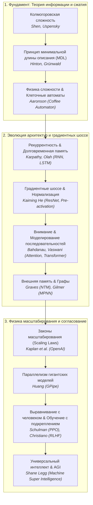
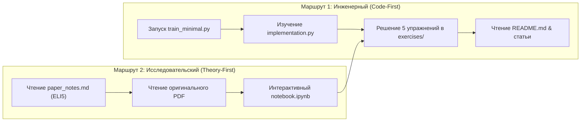

# 🧠 30u30: Master Ilya's 30 Foundational AI Papers in 30 Days

> **Ссылка на репозиторий:** [https://github.com/Ojhaharsh/30u30](https://github.com/Ojhaharsh/30u30)  
> **Интерактивный портал курса:** [https://ojhaharsh.github.io/30u30/](https://ojhaharsh.github.io/30u30/)  
> **Автор проекта:** Харш Оджа (Harsh Ojha / Ojhaharsh)  
> **Вдохновитель списка:** Илья Суцкевер (сооснователь OpenAI и Safe Superintelligence Inc. / SSI)  
> **Культовая цитата:** *«If you really learn all of these, you'll know 90% of what matters today»* — Ilya Sutskever (в напутствии Джону Кармаку)  
> **Формат:** 30 дней · 6 тематических блоков · 100% реализаций с нуля на чистом NumPy/PyTorch (CPU-friendly) · 150+ упражнений с решениями · Интерактивные визуализации и Jupyter Notebooks  
> **Звёзды GitHub:** 800+ ★ (#14 в мировом Daily топе Trendshift)  
> **Лицензия:** CC BY-NC-ND 4.0  

---

## 🎯 1. В чем миссия 30u30 и откуда взялся список Ильи Суцкевера?

Современный ландшафт машинного обучения перегружен инфошумом: каждый день выходят сотни препринтов на arXiv, тысячи постов в X (Twitter) об очередных обертках над API и маркетинговые заявления. Большинство инженеров застревают на уровне вызова библиотек (`import transformers`), не понимая фундаментальных законов, на которых держится глубокое обучение.

Когда легендарный программист **Джон Кармак** (создатель *Doom* и *Quake*, пионер 3D-графики и VR) решил полностью посвятить себя исследованиям AGI, он обратился к **Илье Суцкеверу** с вопросом: *что именно нужно изучить, чтобы фундаментально понять современный искусственный интеллект без траты лет на чтение второстепенных статей?*

Суцкевер составил для Кармака персональный список примерно из 30 фундаментальных публикаций и произнес ставшую легендарной фразу:
> **«Если вы по-настоящему глубоко разберетесь во всех этих статьях — вы поймете 90% того, что действительно имеет значение в современном AI сегодня».**

Долгое время этот список циркулировал в академических кругах как неформальный «канон Суцкевера». Но просто читать академические PDF-файлы тяжело и неэффективно без практического закрепления.

**Проект `30u30` Харша Оджи превращает знаменитый список Ильи в «Rustlings для Deep Learning»**:
1. **Каждый день — одна фундаментальная статья.**
2. **Никаких черных ящиков:** реализация математики и архитектур пишется с нуля на чистом Python/NumPy/PyTorch.
3. **Легковесность:** весь код оптимизирован для запуска на обычном CPU за секунды или минуты.
4. **Инженерный тренажер:** каждый модуль содержит 5 прогрессивных упражнений с автотестами и решениями.
5. **Многоуровневое объяснение:** от метафорического конспекта **ELI5** (*«Explain Like I'm 5»*) до строгих дифференциальных и теоретико-информационных выкладок.

---

## 🧭 2. Философия Ильи: почему эти статьи, а не 500 новых работ по LLM?

Взгляд Ильи Суцкевера на искусственный интеллект радикально отличается от стандартного подхода инженеров-прикладников. В списке Суцкевера почти нет узких оптимизаций или модных фреймворков. Его выбор основан на трех краеугольных принципах:



### Три столпа мышления Суцкевера:
1. **Сжатие = Интеллект (Compression = Intelligence):**
   Предсказание следующего токена — это не просто статистическая авторегрессия. Чтобы сжать терабайты текста в матрицу весов фиксированного размера и с минимальной энтропией предсказывать будущее, модель вынуждена выучить причинно-следственные связи и законы окружающего мира. Это прямое следствие алгоритмической теории информации (Соломонофф, Колмогоров, принцип минимальной длины описания Hinton & Grünwald).
2. **Градиентные шоссе (Gradient Highways):**
   Ключевая проблема нейросетей — затухание и взрыв градиентов при увеличении глубины. Все революционные архитектуры (LSTM с аддитивной каруселью ошибок, ResNet с Identity Mappings, Transformer с Residual Connections) решают одну и ту же задачу: создание беспрепятственного линейного пути для прохождения градиента сквозь сотни слоев.
3. **Эмпирическая физика масштабирования (Scaling Laws):**
   Интеллект предсказуемо масштабируется степенным законом (Power Law) при совместном увеличении вычислительной мощности ($C$), параметров модели ($N$) и объема данных ($D$).

---

## 🗺️ 3. Детальный разбор 6 юнитов и 30 учебных дней

Курс разбит на 6 логически выверенных модулей, ведущих студента от теории сложности и рекуррентных ячеек 1990-х годов к современному пайплайну Alignment и RLHF:

### 📦 Unit 1: The Foundations — Рекуррентность, Память и Теория сжатия (Дни 1–7)
*Фундамент понимания того, почему предсказание последовательностей порождает интеллект.*

* **День 1: *The Unreasonable Effectiveness of Recurrent Neural Networks* (Andrej Karpathy, 2015)**
  * *Суть:* Почему посимвольное предсказание текста заставляет скрытое состояние модели неявно моделировать вложенные скобки, синтаксис языка Си, состояние markdown-документов и контекст.
  * *Практика:* Полноценный Character-level RNN с нуля на чистом NumPy (Forward/Backward propagation, обрезка градиентов BPTT, семплирование с температурой).
* **День 2: *Understanding LSTM Networks* (Christopher Olah, 2015)**
  * *Суть:* Анатомия 4 гейтов LSTM (Forget Gate, Input Gate, Candidate State, Output Gate). Как постоянная аддитивная ячейка памяти (Constant Error Carousel) защищает сигнал от экспоненциального затухания.
  * *Практика:* Реализация LSTM-ячейки с визуализацией активности гейтов и пошаговым сравнением с GRU.
* **День 3: *Recurrent Neural Network Regularization* (Wojciech Zaremba, Ilya Sutskever et al., 2014)**
  * *Суть:* Почему наивный Dropout разрушает память рекуррентной сети при применении ко времени, и как корректно дропаут применять только к межслойным (feedforward) связям, сохраняя рекуррентный поток нетронутым.
  * *Практика:* Пайплайн регуляризации: Dropout, Layer Norm, Weight Decay, Early Stopping.
* **День 4: *Keeping Neural Networks Simple by Minimizing the Description Length of the Weights* (Geoffrey Hinton, Drew van Camp, 1993)**
  * *Суть:* Исток теории «Сжатие = Интеллект». Обучение сети как поиск баланса между ошибкой реконструкции данных и объемом информации, необходимым для описания весов (Noisy Weights / Bayesian NN).
  * *Практика:* Стохастические веса с добавлением шума, расчет штрафа MDL, построение границы Парето (точность против сжатия).
* **День 5: *A Tutorial Introduction to the Minimum Description Length Principle* (Peter Grünwald, 2004)**
  * *Суть:* Строгий математический аппарат MDL: двухчастные коды (Two-Part Codes), преквенциальный (последовательный) MDL, нормализованная максимальная сложность (NML). Сравнение MDL с критериями AIC и BIC.
  * *Практика:* Кодирование распределений, байесовский выбор моделей через оценку сжатия.
* **День 6: *The First Law of Complexodynamics* (Scott Aaronson, 2011)**
  * *Суть:* Физика сложности: в замкнутой системе энтропия растет монотонно, но *сложность* сначала равна нулю (идеальный кристалл), достигает максимума в промежуточном состоянии и снова падает до нуля (равномерно рассеянный тепловой газ).
  * *Практика:* Симулятор эволюции сложности клеточных систем с визуализацией фазовых переходов.
* **День 7: *Quantifying the Rise and Fall of Complexity in Closed Systems: The Coffee Automaton* (Scott Aaronson et al., 2014)**
  * *Суть:* Модель «кофе и молока»: почему биологическая жизнь и вычислительный интеллект возможны только на границе порядка и хаоса в среднем термодинамическом возрасте Вселенной.
  * *Практика:* Клеточный автомат с анализом потока информации, показателей Ляпунова и перехода порядка в хаос.

---

### 📦 Unit 2: Deep Learning Explosion — Зрение, Глубина и Регуляризация (Дни 8–12)
*Технологии, вызвавшие революцию 2012–2016 годов и решившие проблему обучения сверхглубоких сетей.*

* **День 8: *ImageNet Classification with Deep CNNs (AlexNet)* (Alex Krizhevsky, Ilya Sutskever, Geoffrey Hinton, 2012)**
  * *Суть:* Историческая точка рождения современного Deep Learning. Утилизация параллелизма GPU, функции активации ReLU вместо сигмоиды, локальная нормализация отклика (LRN), агрессивная аугментация и Dropout.
  * *Практика:* Реализация ключевых блоков AlexNet, замеры скорости ReLU vs Sigmoid, анализ градиентов.
* **День 9: *Deep Residual Learning for Image Recognition (ResNet)* (Kaiming He et al., 2015)**
  * *Суть:* Открытие Skip Connections (остаточных связей). Вместо аппроксимации полной функции $\mathcal{H}(\mathbf{x})$, слой учит только дельту $\mathcal{F}(\mathbf{x}) = \mathcal{H}(\mathbf{x}) - \mathbf{x}$. Это позволило обучать сети в 100+ слоев без деградации точности.
  * *Практика:* Сборка Residual Block, абляция наличия skip-связей, визуализация градиентного потока в глубину.
* **День 10: *Identity Mappings in Deep Residual Networks (ResNet v2)* (Kaiming He et al., 2016)**
  * *Суть:* Архитектура Pre-Activation (BN $\rightarrow$ ReLU $\rightarrow$ Conv вместо Conv $\rightarrow$ BN $\rightarrow$ ReLU). Создание абсолютно беспрепятственного пути передачи сигнала $\mathbf{x}_L = \mathbf{x}_l + \sum \mathcal{F}(\mathbf{x}_i)$, открывшего дорогу сетям глубже 1000 слоев.
  * *Практика:* Сравнительный бенчмарк Post-activation vs Pre-activation на сетях предельной глубины.
* **День 11: *Multi-Scale Context Aggregation by Dilated Convolutions* (Fisher Yu, Vladlen Koltun, 2015)**
  * *Суть:* Расширенные (атрофические / dilated) свертки. Экспоненциальный рост рецептивного поля без потери пространственного разрешения и без операций агрессивного пулинга (основа WaveNet и современных dense-моделей).
  * *Практика:* Расчет рецептивных полей, сборка контекстного модуля и применение для плотных предсказаний.
* **День 12: *Dropout: A Simple Way to Prevent Overfitting* (Nitish Srivastava et al., 2014)**
  * *Суть:* Разрыв кооперативной адаптации нейронов путем стохастического обнуления активаций с вероятностью $p$. Интерпретация Dropout как приближенного ансамблирования $2^N$ различных подсетей; метод Monte-Carlo Dropout для оценки эпистемической неопределенности модели.
  * *Практика:* Inverted Dropout с нуля, реализация MC-Dropout инференса для доверительных интервалов.

---

### 📦 Unit 3: The Transformer Era — Внимание и Трансформеры (Дни 13–16)
*Архитектурный сдвиг, определивший вектор развития всей AI-индустрии на десятилетие вперед.*

* **День 13: *Attention Is All You Need* (Ashish Vaswani et al., 2017)**
  * *Суть:* Полный отказ от рекуррентности и сверток в пользу механизма Scaled Dot-Product Attention и Multi-Head Self-Attention. Параллелизация обучения по всей длине контекста, позиционное кодирование.
  * *Практика:* Математика Attention с нуля: $\text{Softmax}\left(\frac{QK^T}{\sqrt{d_k}}\right)V$, реализация маскирования causal mask, позиционные эмбеддинги.
* **День 14: *The Annotated Transformer* (Alexander Rush, 2018)**
  * *Суть:* Эталонная инженерная декомпозиция Трансформера: от чистых математических абстракций до продакшн-кода на PyTorch с правильной обработкой батчей, масок, расписания темпа обучения (Noam Scheduler) и генератора луча (Beam Search).
  * *Практика:* Построение энкодер-декодер архитектуры с нуля, пошаговая отладка форм тензоров.
* **День 15: *Neural Machine Translation by Jointly Learning to Align and Translate* (Dzmitry Bahdanau, Kyunghyun Cho, Yoshua Bengio, 2014)**
  * *Суть:* Первое в истории появление механизма внимания (Additive Attention / Bahdanau Attention). Решение проблемы сжатия предложения произвольной длины в единый вектор фиксированной размерности.
  * *Практика:* Двунаправленный GRU-энкодер + аддитивное выравнивание + построение тепловой карты матриц внимания (Alignment Matrix).
* **День 16: *Order Matters: Sequence to Sequence for Sets* (Oriol Vinyals et al., 2015)**
  * *Суть:* Обработка множеств, не имеющих естественного порядка элементов. Парадигма Read-Process-Write и Pointer Attention: модель учится сама определять оптимальный порядок перебора элементов при решении комбинаторных задач.
  * *Практика:* Реализация set-энкодера, задачи сортировки и вычисления выпуклой оболочки множества точек.

---

### 📦 Unit 4: Specialized Architectures — Память, Графы и Рассуждения (Дни 17–22)
*Специализированные индуктивные смещения: дифференцируемая память, рассуждения над объектами и графовые нейросети.*

* **День 17: *Neural Turing Machines* (Alex Graves, Greg Wayne, Ivo Danihelka, 2014)**
  * *Суть:* Компьютерная архитектура фон Неймана, ставшая полностью дифференцируемой. Контроллер (нейросеть) взаимодействует с внешней матрицей памяти через механизмы мягкой адресации (Content-based addressing) и относительного сдвига (Location-based addressing).
  * *Практика:* Контроллер чтения/записи, кольцевая свертка (Circular Convolution), циклы памяти, задача копирования произвольной последовательности.
* **День 18: *Pointer Networks* (Oriol Vinyals, Meire Fortunato, Navdeep Jaitly, 2015)**
  * *Суть:* Архитектура, где словарь выходных токенов не фиксирован, а динамически формируется из позиций элементов входной последовательности с помощью механизма внимания. Идеально для NP-трудных геометрических и комбинаторных задач (задача коммивояжера TSP, триангуляция Делоне).
  * *Практика:* Pointer-декодер, решение задачи Traveling Salesperson Problem (TSP) на случайных графах.
* **День 19: *A Simple Neural Network Module for Relational Reasoning* (Adam Santoro et al., DeepMind, 2017)**
  * *Суть:* Модули $g_\theta$ и $f_\phi$ для реляционного мышления. Модель явно рассматривает комбинации всех пар объектов в сцене: $\text{RN}(O) = f_\phi\left(\sum_{i,j} g_\theta(o_i, o_j)\right)$, решая задачи Visual Question Answering (VQA).
  * *Практика:* Реализация парных модулей, бенчмарк на синтетическом датасете Sort-of-CLEVR.
* **День 20: *Relational Recurrent Neural Networks* (Adam Santoro et al., DeepMind, 2018)**
  * *Суть:* Интеграция Multi-Head Dot-Product Attention внутрь рекуррентной ячейки памяти (Relational Memory Core). Слоты памяти взаимодействуют друг с другом на каждом временном шаге через механизм внимания.
  * *Практика:* Сборка Relational Memory Core, моделирование сложных причинно-следственных зависимостей в последовательностях.
* **День 21: *Neural Message Passing for Quantum Chemistry* (Justin Gilmer et al., 2017)**
  * *Суть:* Унифицирующий фреймворк MPNN (Message Passing Neural Networks) для работы с графовыми структурами. Обобщает GCN, GAT и молекулярные сети в три фазы: отправка сообщений (Message), обновление узлов (Update) и агрегация графа (Readout).
  * *Практика:* Реализация графовой свертки, предсказание физико-химических свойств молекул датасета QM9.
* **День 22: *Deep Speech 2: End-to-End Speech Recognition* (Dario Amodei et al., Baidu, 2015)**
  * *Суть:* Отказ от сложных традиционных конвейеров HMM-GMM в пользу сквозного (End-to-End) глубокого обучения речи: сверточные слои + двунаправленные GRU + функция потерь Connectionist Temporal Classification (CTC Loss) + техника SortaGrad (сортировка батчей по длине).
  * *Практика:* Спектрограммы звука, CTC Loss изнутри, CTC Greedy & Beam Search декодирование.

---

### 📦 Unit 5: Generative Models & Physics of Scaling — Генерация, Сложность и Масштабирование (Дни 23–28)
*От математической теории информации и колмогоровской сложности до аппаратных законов масштабирования гигантских моделей.*

* **День 23: *Variational Lossy Autoencoder* (Xi Chen, Diederik P. Kingma, Tim Salimans, Ilya Sutskever, 2016)**
  * *Суть:* Решение проблемы «коллапса апостериорного распределения» (Posterior Collapse) в вариационных автоэнкодерах (VAE) при использовании мощных авторегрессионных декодеров. Применение инверсных авторегрессионных потоков (Inverse Autoregressive Flows, IAF) и ограничение рецептивного поля декодера.
  * *Практика:* Маскированные свертки PixelCNN, реализация потоков IAF, устранение коллапса латентного пространства.
* **День 24: *GPipe: Efficient Training of Giant Neural Networks with Pipeline Parallelism* (Yanping Huang et al., Google, 2019)**
  * *Суть:* Обучение моделей, превышающих объем памяти одного GPU. Пайплайн-параллелизм с разделением батча на микро-батчи (Micro-batching) и сохранением промежуточных чекпоинтов активаций (Activation Checkpointing), снижающим затраты памяти с $O(L)$ до $O(\sqrt{L})$ или $O(L/K)$.
  * *Практика:* Симулятор конвейера micro-batches, оценка времени простоя (Bubble time), чекпоинтинг градиентов.
* **День 25: *Scaling Laws for Neural Language Models* (Jared Kaplan et al., OpenAI, 2020)**
  * *Суть:* «Физика AI». Доказательство того, что функция потерь трансформеров степенным образом зависит от масштаба:
    $$L(N) \approx \left(\frac{N_c}{N}\right)^{\alpha_N}, \quad L(D) \approx \left(\frac{D_c}{D}\right)^{\alpha_D}, \quad L(C) \approx \left(\frac{C_c}{C}\right)^{\alpha_C}$$
    Закон предсказывает производительность еще не обученных моделей и задает оптимальное распределение вычислительного бюджета.
  * *Практика:* Подгонка степенных кривых (Power Law Fitting), расчет оптимума compute-optimal аллокации.
* **День 26: *Kolmogorov Complexity and Algorithmic Randomness* (А. Шень, В. А. Успенский, Н. В. Верещагин)**
  * *Суть:* Фундаментальный математический базис сжатия. Колмогоровская сложность объекта как длина кратчайшей программы на универсальной машине Тьюринга, порождающей этот объект. Невычислимость абсолютной сложности и её практические аппроксимации (компрессия gzip/bz2, NCD — Normalized Compression Distance).
  * *Практика:* Алгоритмы сжатия Хаффмана и арифметическое кодирование с нуля, кластеризация текстов и геномов через NCD без единого обучаемого параметра.
* **День 27: *Machine Super Intelligence* (Shane Legg, 2008 — Докторская диссертация сооснователя DeepMind под руководством Маркуса Хуттера)**
  * *Суть:* Математическая формализация Универсального Интеллекта:
    $$\Upsilon(\pi) = \sum_{\mu \in E} 2^{-K(\mu)} V_\mu^\pi$$
    Интеллект агента $\pi$ определяется как взвешенная сумма его ожидаемого вознаграждения $V_\mu^\pi$ во всех вычислимых средах $\mu$, где вес среды экспоненциально убывает с ростом её Колмогоровской сложности $K(\mu)$.
  * *Практика:* Бенчмаркинг случайного агента, Q-learning агента и марковского предиктора в средах с разной алгоритмической сложностью.
* **День 28: *CS231n: Convolutional Neural Networks for Visual Recognition* (Andrej Karpathy, Fei-Fei Li, Stanford)**
  * *Суть:* Канонический курс, сформировавший золотой стандарт преподавания Deep Learning в мире. Векторизация операций свертки через `im2col` и `col2im`, пошаговый вывод аналитического градиента обратного распространения, архитектурный разбор VGGNet-16.
  * *Практика:* Полная реализация Conv-слоя через матричное умножение `im2col`, расчет градиентов по весам и входам.

---

### 📦 Unit 6: Reinforcement Learning & Alignment — Выравнивание и RLHF (Дни 29–30)
*Финальный аккорд: как превратить предобученную авторегрессионную модель в полезного, безопасного и предсказуемого ассистента.*

* **День 29: *Proximal Policy Optimization Algorithms (PPO)* (John Schulman et al., OpenAI, 2017)**
  * *Суть:* Рабочая лошадка современного RL и выравнивания LLM. Замена нестабильного Trust Region Policy Optimization (TRPO) на простое клиппирование отношения вероятностей (Clipped Surrogate Objective):
    $$L^{\text{CLIP}}(\theta) = \hat{\mathbb{E}}_t \left[ \min\left(r_t(\theta)\hat{A}_t, \, \text{clip}(r_t(\theta), 1-\epsilon, 1+\epsilon)\hat{A}_t\right) \right]$$
    Предотвращает разрушительно большие шаги обновления политики policy collapse.
  * *Практика:* Реализация алгоритма PPO-Clip, оценка преимуществ GAE (Generalized Advantage Estimation), стабилизация обучения.
* **День 30: *Deep Reinforcement Learning from Human Feedback (RLHF)* (Paul Christiano, Jan Leike et al., OpenAI / DeepMind, 2017)**
  * *Суть:* Рождение концепции человеческого предпочтения как функции полезности. Парадигма обучения модели наград (Reward Model) через бинарные сравнения пар результатов с использованием функции потерь Брэдли-Терри (Bradley-Terry preference model), с последующей оптимизацией политики агента через PPO со штрафом за дивергенцию Кульбака-Лейблера ($D_{\text{KL}}$) от базовой модели.
  * *Практика:* Полный сквозной цикл RLHF: генерация пар гипотез синтетическим оракулом, обучение Reward-модели, выравнивание агента через PPO с KL-пенальти.

---

### 🌟 Bonus Papers: The Language Model Revolution
*Пять дополнительных бонусных разборов, закрывающих мост от классических статей к современным сверхбольшим LLM:*
* **Bonus 1: *BERT* (Jacob Devlin et al., Google, 2018)** — двунаправленный маскированный язык (Masked Language Modeling, MLM).
* **Bonus 2: *GPT-2* (Alec Radford et al., OpenAI, 2019)** — возникновение Zero-Shot способностей при росте масштаба неразмеченных данных.
* **Bonus 3: *GPT-3* (Tom Brown et al., OpenAI, 2020)** — Few-Shot In-Context Learning (175 миллиардов параметров).
* **Bonus 4: *Chinchilla* (Jordan Hoffmann et al., DeepMind, 2022)** — оптимальное соотношение вычислений: модели были перепараметризованы и недообучены по объему токенов.
* **Bonus 5: *Outrageously Large Neural Networks: The MoE Layer* (Noam Shazeer et al., 2017)** — разреженная активация экспертов (Mixture-of-Experts), лежащая в основе GPT-4, Mixtral и DeepSeek V3.

---

## 🔬 4. Внутренняя архитектура каждого учебного дня в 30u30

Каждая папка репозитория (`papers/01_...` — `papers/30_...`) спроектирована как автономный учебный микромодуль с эталонной структурой:

```
papers/04_Minimizing_Description_Length/
├── README.md               # Исчерпывающий разбор: мотивация, контекст, математика
├── paper_notes.md          # Краткие выжимки, инсайты и метафорический блок ELI5
├── CHEATSHEET.md           # Шпаргалка: ключевые формулы, алгоритмы и инварианты
├── implementation.py       # Чистая реализация математики с нуля на Python/NumPy
├── train_minimal.py        # Минимальный скрипт обучения, отрабатывающий за секунды
├── visualization.py        # Скрипт визуализации (функции потерь, графики, границы Парето)
├── notebook.ipynb          # Интерактивный Jupyter Notebook для пошагового исследования
├── requirements.txt        # Минимальные зависимости (обычно numpy, matplotlib, torch)
└── exercises/              # 5 прогрессивных задач для самостоятельного кодинга
    ├── exercise_1.py       # Постановка задачи с заглушками TODO и валидационными ассертами
    ├── solutions/          # Авторские эталонные решения
    └── tests/              # Автоматизированный запуск проверки правильности
```

### Формат подачи материала (на примере Дня 27 — Machine Super Intelligence):
1. **Метафора ELI5 («Тест на универсального атлета»):**
   *Если вы хотите найти лучшего спортсмена мира, тестирование только в баскетболе найдет лучшего баскетболиста. Если протестировать по 10 видам спорта — результат лучше, но всё еще смещен. Универсальный тест тестирует атлета во всех возможных играх, которые только можно изобрести, но с весами: простые игры (бег по прямой) весят больше, чем абсурдно сложные (4D-шахматы во время декламации стихов). Универсальный интеллект Шейна Легга — это способность агента побеждать в любой вычислимой среде, где вес среды определяется простотой ее порождающей программы.*
2. **Строгая математика:** точный вывод формул, связь с алгоритмической вероятностью Соломонова $M(x) = \sum 2^{-l(p)}$.
3. **Чистый код:** отсутствие высокоуровневых абстракций — создание окружений с разной сложностью и замер эффективности политик агентов напрямую.

---

## 💡 5. Ключевые концептуальные интуиции курса (Deep Dive)

### Интуиция 1: «Compression = Intelligence» (Почему предсказание порождает понимание)
Многие начинающие разработчики считают, что авторегрессионные языковые модели — это просто «стохастические попугаи», комбинирующие статистику n-грамм. Разбор статей Hinton (1993), Grünwald (2004) и Shen/Uspensky (День 4, 5, 26) разрушает это заблуждение:
* Чтобы идеально сжать текст книги о квантовой физике или детективного романа, алгоритм не может просто запомнить буквы — емкость матрицы параметров $N$ на порядки меньше объема обучающего корпуса $D$.
* Единственный способ сжать данные — **найти скрытые порождающие законы (инварианты)**. В случае детектива — понять, кто убийца; в случае шахматной нотации — выучить правила шахмат и стратегию; в случае кода — построить абстрактное синтаксическое дерево и модель исполнения.
* Таким образом, минимизация ошибки предсказания следующего токена тождественна нахождению кратчайшей программы, моделирующей реальность.

### Интуиция 2: Градиентные шоссе (Gradient Highway)
При переходе от 20 слоев к 100+ слоям в глубоких сетях градиент при обратном распространении ошибки экспоненциально стремится к нулю из-за цепного правила дифференцирования:
$$\frac{\partial \mathcal{E}}{\partial \mathbf{x}_0} = \prod_{i=0}^{L-1} \mathbf{W}_i \cdot \frac{\partial \mathcal{E}}{\partial \mathbf{x}_L}$$
Если собственные значения матриц $\mathbf{W}_i$ меньше 1, сигнал исчезает.
Решения в статьях Каймана Хэ (ResNet v1 и v2, Дни 9-10) и Олаха (LSTM, День 2):
$$\mathbf{x}_{l+1} = \mathbf{x}_l + \mathcal{F}(\mathbf{x}_l) \implies \frac{\partial \mathbf{x}_{l+1}}{\partial \mathbf{x}_l} = \mathbf{I} + \frac{\partial \mathcal{F}}{\partial \mathbf{x}_l}$$
Слагаемое **$\mathbf{I}$ (единичная матрица)** создает градиентное шоссе: даже если градиенты нелинейного блока $\frac{\partial \mathcal{F}}{\partial \mathbf{x}_l}$ обратятся в ноль, сигнал все равно пройдет через единичную связку назад сквозь 1000 слоев без искажений.

---

## 🛠️ 6. Практическое руководство: как эффективно проходить 30u30

Для максимально продуктивного прохождения репозитория рекомендуется один из трех маршрутов:



### Быстрый старт:
```bash
# Клонирование репозитория
git clone https://github.com/Ojhaharsh/30u30.git
cd 30u30

# Переход к интересующему дню (например, День 13: Transformer Attention)
cd papers/13_attention

# Установка легковесных зависимостей
pip install -r requirements.txt

# Быстрый запуск минимального обучения с нуля
python train_minimal.py

# Запуск интерактивной визуализации
python visualization.py

# Переход к упражнениям
cd exercises
python exercise_1.py
```

---

## 💎 7. Синергия с базой знаний (100-я юбилейная заметка)

Появление `30u30` знаменует достижение отметки в **100 структурированных заметок** в нашей инженерной базе знаний и замыкает ключевые концептуальные мосты между другими разделами:

| Направление в базе знаний | Связанные заметки | Какую концептуальную дыру закрывает `30u30` |
|:---|:---|:---|
| **Архитектура LLM с нуля** | [`LLMs-from-scratch.md`](file:///home/blackzeshi/Documents/Notes/01_llm_architecture_and_training/LLMs-from-scratch.md), [`dive-into-llms.md`](file:///home/blackzeshi/Documents/Notes/01_llm_architecture_and_training/dive-into-llms.md) | Дает фундаментальный базис, почему эти архитектуры возникли именно в таком виде (от LSTM и Pointer Networks до современных трансформеров). |
| **Рассуждения и RL** | [`reasoning-from-scratch.md`](file:///home/blackzeshi/Documents/Notes/01_llm_architecture_and_training/reasoning-from-scratch.md), [`clm.md`](file:///home/blackzeshi/Documents/Notes/01_llm_architecture_and_training/clm.md) | Объясняет происхождение алгоритмов PPO и RLHF (Дни 29–30), на которых построены современные модели рассуждения DeepSeek-R1 и GRPO. |
| **Дифференцируемый софт** | [`handwired.md`](file:///home/blackzeshi/Documents/Notes/01_llm_architecture_and_training/handwired.md) | Перекликается с Neural Turing Machines (День 17) и теорией алгоритмической сложности Колмогорова (День 26) о компиляции вычислений в непрерывные тензорные графы. |
| **Стратегия & Собеседования** | [`capstone-engineering-roadmap.md`](file:///home/blackzeshi/Documents/Notes/00_strategy_and_roadmaps/capstone-engineering-roadmap.md), [`ai-engineering-interviews.md`](file:///home/blackzeshi/Documents/Notes/00_strategy_and_roadmaps/ai-engineering-interviews.md) | Формирует фундамент сеньорского архитектурного кругозора: умение обосновать выбор компонентов на фундаментальных принципах физики масштабирования и теории информации. |

---
*Конспект подготовлен для базы знаний Antigravity Notes • Дата фиксации: 17 октября 2026*
