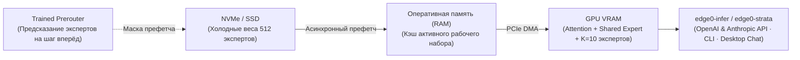

# ⚡ Edge0: Стриминговый MoE-инференс с предсказанием роутинга и Latent-MoE

> **Ссылка на репозиторий:** [https://github.com/Edge0-AI/Edge0](https://github.com/Edge0-AI/Edge0)  
> **Технический отчёт:** [arXiv:2609.18063 — *The Other Half of the Memory Wall*](https://arxiv.org/abs/2609.18063)  
> **Категория:** `01_llm_architecture_and_training`  
> **Звёзды GitHub:** 10,200+ ★ (+473 ★ за сутки)  
> **Стек:** C++ / Python, GGML (`edge0-infer`), `edge0-strata` (форк Strata), CUDA 13, Metal, Vulkan  
> **Лицензия:** Apache-2.0 (код фреймворка) · MIT (`edge0-strata`) · Edge0 Community Model License 1.0 (веса моделей)

---

## 🎯 1. В чём прорыв: «Вторая половина стены памяти» (Memory Wall)

Крупные Mixture-of-Experts (MoE) модели активируют лишь малую долю параметров на токен, но традиционные рантаймы всё равно вынуждены держать **все** веса экспертов в VRAM или оперативной памяти. **Edge0** решает эту проблему на уровне архитектуры моделей и движка исполнения:

1. **Стриминг весов с SSD + Trained Routing Prediction (Prerouter):**  
   Модель уровня **35B MoE** работает в лимите **~2.5 GB RAM** на обычных потребительских устройствах (macOS, iOS, Android, Linux, Windows). Вместо реактивной подгрузки нужных экспертов в момент вычисления слоя, обученный прероутер предсказывает траекторию экспертов на шаг вперёд, перекрывая задержки чтения с NVMe/SSD вычислениями.
2. **Семейство Latent-MoE (`edge0-145b` и `edge0-120b`, релиз 13 ноября 2026):**  
   Модели на базе `Qwen3.8-Flash-Next`, обученные нативно в **4 бита** (выпущены в профилях `Q3_K` и `NVFP4`). Latent MoE сжимает входы экспертов до латентной ширины (**1792** для 145B и **1280** для 120B), сохраняя полную ширину attention-слоёв. Каждый из **48 слоёв** содержит **512 экспертов** (`K=10` активных + 1 shared expert).



---

## 🏗️ 2. Архитектура движков и поддерживаемые платформы

Edge0 предоставляет единую точку входа **`edge0-infer`** (CLI `serve`, `chat`, локальный OpenAI/Anthropic-совместимый сервер и приложение Edge0 Chat), которая автоматически выбирает бэкенд по метаданным в `model.json`:

| Профиль моделей | Движок | Поддерживаемые ОС и ускорители | Ключевая особенность |
| :--- | :--- | :--- | :--- |
| **`edge0-145b` / `edge0-120b`** (`Q3_K`, `NVFP4`) | **`edge0-strata`** (форк Strata) | Linux, Windows (NVIDIA GPU, CUDA 13) | Latent-MoE на одной потребительской GPU (24 GB VRAM + RAM/SSD offload) |
| **`edge0-35b` / `edge0-8b`** | **`edge0-infer`** (на базе GGML) | macOS & iOS (Metal), Windows (Vulkan/CPU), Linux & Android (CPU) | Стриминг с SSD + единый C++ API для десктопа и мобильных устройств |

### Резидентность памяти для 145B и 120B (на RTX 5090 D 24 GB)
* **Edge0-145B Q3_K** (40.81 GiB весов): размещается в `23.14 GiB VRAM + 31.28 GiB RAM` (непересекающиеся наборы экспертов), либо в жёстком cgroup-лимите `16 GiB VRAM + 20 GiB RAM`.
* **Edge0-120B Q3_K** (27.98 GiB весов): `22.93 GiB VRAM + 18.40 GiB RAM`.

---

## 📊 3. Скорость и качество в агентных бенчмарках

### Производительность `Edge0-145B` и `Edge0-120B` (tok/s)

| Оборудование | Модель / Квантизация | 4K Prefill | 16K Prefill | Chat Decode | Agent Decode |
| :--- | :--- | :---: | :---: | :---: | :---: |
| **RTX 5090 D (24 GB)** | `145B Q3_K` | 2169.9 | 3554.9 | 99.7 | **121.2** |
| **RTX 5090 D (24 GB)** | `120B Q3_K` | 3236.7 | 4576.5 | 130.2 | **144.6** |
| **RTX 4090 (24 GB)** | `145B Q3_K` | 2042.0 | 3179.4 | 69.9 | **91.7** |
| **16 GiB VRAM + 20 GiB RAM** | `145B Q3_K` | 249.0 | 335.0 | 36.8 | **44.9** |
| **16 GiB VRAM + 20 GiB RAM** | `120B Q3_K` | 430.0 | 778.0 | 62.4 | **73.3** |

### Качество на кодинг- и reasoning-бенчмарках

| Модель | DeepSWE 1.1 | Terminal-Bench 2.1 | GPQA-Diamond | IFBench | HLE |
| :--- | :---: | :---: | :---: | :---: | :---: |
| **Edge0-145B** | **64.6** | **86.5** | 90.4 | 80.6 | 35.4 |
| **Qwen3.8-Flash-Next** | 58.7 | 83.3 | **91.7** | **81.3** | 35.9 |
| **Claude-Opus-4.6 (Max)** | — | 78.2 | 91.3 | 62.5 | **40.0** |

---

## 💻 4. Быстрый старт и дорожная карта Q4 2026

```bash
# Сборка движка edge0-infer (CPU/GGML) и запуск тестов без весов
cd edge0-infer
cmake --preset cpu && cmake --build --preset cpu
ctest --preset cpu -L "L0|L1"

# Запуск локального OpenAI- и Anthropic-совместимого сервера для 145B
build/cpu/bin/edge0-infer serve --model /path/to/Edge0-145B-q3k

# Интерактивная сессия в терминале
build/cpu/bin/edge0-infer chat --model /path/to/Edge0-145B-q3k
```

### Вектор развития (Q4 2026 Roadmap)
1. **Гибридный linear attention (`GDN + QSA`) и N-gram таблицы:** состояние $O(1)$ предотвращает раздувание KV-cache при длинном reasoning, а N-gram таблицы естественно стримятся по запросу с SSD.
2. **Batched Expert Pre-Prediction:** переход от предсказания экспертов на каждый токен к предсказанию **раз на целый блок** рассуждений + кросс-блочный префетч, чтобы объём подгрузок с диска не рос пропорционально глубине reasoning-цикла.

---

## 💡 5. Главные инженерные выводы

1. **Сжатие латентной ширины MoE + нативный 4-bit тренинг** позволяют поместить 145B-модель уровня топовых облачных агентов на одну потребительскую видеокарту со скоростью >120 tok/s.
2. **Прероутер превращает SSD-offload из узкого места в управляемый конвейер**, скрывая латентность чтения весов за вычислениями предыдущего слоя.
3. **Разделение лицензий:** код фреймворка полностью открыт под Apache-2.0, но для коммерческих хостинг-сервисов и независимых коммерческих AI-ассистентов на весах Edge0 требуется отдельное разрешение правообладателя.
