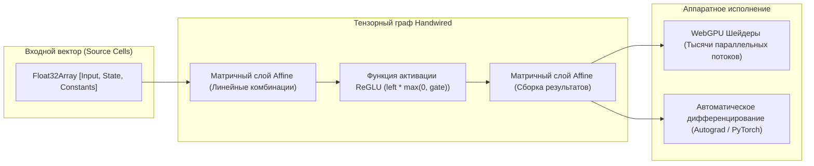

# 🧠 Handwired: Превращение обычного кода на JavaScript в точные, дифференцируемые нейросети без обучения

> **Ссылка на репозиторий:** [https://github.com/chenglou/handwired](https://github.com/chenglou/handwired)  
> **Автор:** Чэн Лоу (Cheng Lou, создатель ReasonML, ключевой контрибьютор React, автор chenguini)  
> **Демо-стенд:** [https://chenglou.me/handwired](https://chenglou.me/handwired)  
> **Слоган:** *«Turn your regular JavaScript code into a neural net; no training, exact, yet also fully differentiable!»*  
> **Звёзды GitHub:** 1,400+ ★ (#13 в мировом Daily топе Trendshift)  
> **Стек:** TypeScript · WebGPU · Float32Array · ReGLU / ReLU · Bun / Node.js  
> **Лицензия:** MIT  

---

## 🎯 1. Фундаментальная идея: мост между классическим кодом и тензорным инференсом

Традиционно между классическим программированием и глубоким обучением существовала непреодолимая концептуальная пропасть:
* **Классический софт (Software 1.0):** императивная логика, ветвления (`if/else`), конечные автоматы, мутабельное состояние, дискретная арифметика. Такой код **недифференцируем** — к нему невозможно применить метод обратного распространения ошибки (Backpropagation) и градиентный спуск.
* **Нейросети (Software 2.0):** гигантские плотные матрицы весов, непрерывные пространства активаций, дифференцируемые функции потерь. Но поведение нейросетей стохастично, их сложно контролировать на строгих граничных условиях.

**Handwired доказывает фундаментальную теорему:** любую дискретную программу на JavaScript (с циклами, ветвлениями и стейтом) можно **точно и без потерь скомпилировать в эквивалентное матричное умножение (MatMul) и функцию активации ReGLU over FP32**.

В результате программа:
1. Выдает **абсолютно идентичный результат**, бит-в-бит совпадающий с оригинальным кодом на JS.
2. Не требует обучения весов — веса выводятся математически при компиляции AST.
3. Становится **полностью дифференцируемой** — сквозь бизнес-логику и UI можно пробрасывать градиенты!

---

## 📐 2. Математический базис: как логика превращается в матрицы

Любая условная конструкция в программе выражается через элементарную геометрию и функцию активации **ReLU** (`Math.max(0, x)`).

### Пример ветвления:
Возьмем классическое условие:
```typescript
const a = 5;
const result = (a > 4) ? 10 : 12;
```

В Handwired это транслируется в чистую непрерывную арифметику:
```typescript
const a = 5;

// Math.max(0, x) — это стандартный ReLU.
// Для целого числа 'a' выражение (max(0, a - 4) - max(0, a - 5)) 
// дает ровно 1 при a > 4 и ровно 0 при a <= 4.
const above4 = Math.max(0, a - 4) - Math.max(0, a - 5);

// Вычисляются обе ветви, а булева маска 'above4' мультипликативно выбирает нужную:
const result = above4 * 10 + (1 - above4) * 12;
// При a = 5: 1 * 10 + (1 - 1) * 12 = 10.
```

### Сведение к двум базовым примитивам виртуальной машины:
Вся виртуальная машина Handwired строится всего на двух тензорных операциях:
1. **`affine(left)`:** линейная комбинация `values[wire] * coefficient + bias` (матричное умножение FP32).
2. **`reglu(left, gate)`:** прямоугольный гейтированный блок `left * Math.max(0, gate)`.
3. **`boolean(score)`:** точное округление в булев фрактал через смещение мантиссы FP32: `f(f(f(score) + 8_388_609) - 8_388_609)`.



---

## ⚡ 3. Что это открывает: нетривиальные сценарии использования

### 3.1. Разморозка и дообучение классического софта (Trained Software)
Так как веса скомпилированной программы детерминированы, но дифференцируемы, их можно **«разморозить» (Unfreeze)** и начать обучать градиентным спуском под конкретный датасет или целевую метрику:
* Оптимизация параметров физических симуляций, эвристик сжатия или алгоритмов отрисовки под пользовательское поведение без ручного тюнинга констант разработчиком.

### 3.2. Сквозное соединение с LLM (End-to-End Neural Integration)
* Скомпилированную Handwired-программу (например, валидатор JSON, калькулятор скидок или конечный автомат верстки) можно «пришить» как постоянный зафиксированный тензорный слой к трансформерной модели (вроде nanoGPT или LLaMA).
* Модель и детерминированная логика обучаются и исполняются в едином вычислительном графе без вызова внешних интерпретаторов и без задержек на IPC.

### 3.3. Параллелизм уровня GPU для обычного однопоточного кода
* Обычный код обхода деревьев или поиска по JSON, написанный в традиционном последовательном стиле, после компиляции в Handwired превращается в матричную операцию и **выполняется на WebGPU параллельно по тысячам ядер графического ускорителя**.
* В авторском бенчмарке Handwired выполняет параллельный семантический фильтр по **100,000 JSON-документов за единицы миллисекунд** прямо в браузере.

---

## 🛠️ 4. Архитектурная модель вычислений (Execution Model)

Программа в Handwired компилируется в концепцию **Circuit (Схема)**:
* **Source Cells:** массив `Float32Array` фиксированной длины, куда записываются входящие события (клики мыши, координаты тачскрина, таймстампы, константы).
* **Wires (Провода):** строго типизированный индекс `Wire` в массиве ячеек, исключающий передачу некорректных чисел вместо адресов ячеек.
* **Строгая детерминированность FP32:** все вычисления нормализуются через `Math.fround()`, что гарантирует побитовое совпадение результатов между CPU-интерпретатором, WebGL и нативным шейдером WebGPU.

---

## 💡 5. Выводы и значение для исследований

1. **Революция в парадигме Differentiable Programming:**  
   Чэн Лоу показал, что для получения дифференцируемости не нужно переписывать систему на JAX, Julia или PyTorch. Любую бизнес-логику на понятном TypeScript можно превратить в нейросетевые слои.
2. **Стирание границы между кодом и весами:**  
   Программы становятся тензорами, а тензоры — программами. Это ключевой кирпич в фундаменте будущих гибридных архитектур (System-1 + System-2), где рассуждающая LLM плавно переходит в детерминированные вычисления без смены рантайма.
