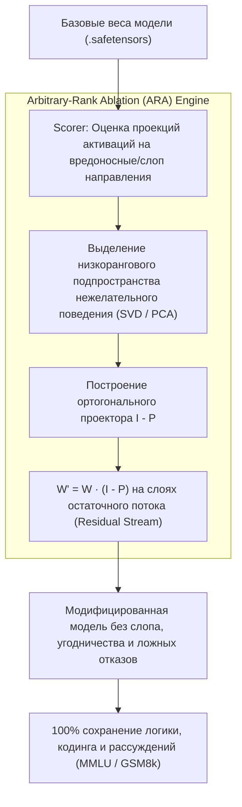

# ⚔️ Heretic: Модификация весов языковых моделей без дообучения (Training-Free Weight Surgery)

> **Ссылка на репозиторий:** [https://github.com/p-e-w/heretic](https://github.com/p-e-w/heretic)  
> **Официальный сайт:** [https://heretic-project.org](https://heretic-project.org)  
> **Автор:** p-e-w  
> **Категория:** `01_llm_architecture_and_training`  
> **Звёзды GitHub:** 38,600+ ★ (+533 ★ за сутки)  
> **Стек:** Python, PyTorch, Hugging Face `transformers`, `safetensors`, CLI (`pip install heretic-llm`)  
> **Лицензия:** GPL-3.0  

---

## 🎯 1. В чем проблема классического Alignment (RLHF / DPO)?

Коммерческие и базовые открытые LLM (Llama, Mistral, Qwen) после классического выравнивания (RLHF, DPO) страдают от трех системных дефектов:
1. **False Refusals (Ложные отказы):** Модель отказывается отвечать на легитимные вопросы по кибербезопасности, анализу шеллкодов или биоинформатике из-за триггеров цензуры.
2. **AI Slop & Tone Inflation:** Навязчивые дисклеймеры («Как языковая модель искусственного интеллекта...»), фальшивая вежливость и пустопорожние вводные фразы, тратящие контекстное окно.
3. **Sycophancy (Угодничество):** Модель соглашается с неверными утверждениями пользователя ради избегания конфликта.

Традиционное решение — тонкая донастройка (SFT / LoRA), требующая дорогих GPU-кластеров, датасетов и рискующая вызвать **Catastrophic Forgetting** (катастрофическое забывание базовых математических и кодинговых способностей).

**Heretic решает проблему за считанные секунды на обычном ноутбуке:** прямое математическое хирургическое вмешательство в матрицы весов `safetensors` без единого шага градиентного спуска.



---

## ⚡ 2. От ранней аблитерации к Arbitrary-Rank Ablation (ARA)

Исторический метод «abliteration» (ортогонализация одного вектора отказа) часто приводил к деградации языка, если вектор захватывал смежные семантические признаки.

В **Heretic 2.0** представлен метод **Arbitrary-Rank Ablation (ARA)**:
* **Многомерное подавление:** Вместо одномерной проекции строится подпространство ранга $k$ ($k \ge 1$), точно изолирующее сложные поведенческие паттерны (например, стиль извинений или паттерны угодничества).
* **Модульная архитектура плагинов:** Разделение на **Modifiers** (как менять веса) и **Scorers** (как измерять нежелательное поведение).
* **Поддержка любых форматов:** Прямая запись в `safetensors` и совместимость с квантованными форматами GGUF / EXL2.

---

## 🚀 3. Быстрый старт и примеры использования

```bash
# Установка фреймворка
pip install heretic-llm

# Автоматическое снятие цензуры с модели из Hugging Face
heretic modify meta-llama/Llama-3.1-8B-Instruct \
  --output ./Llama-3.1-8B-Heretic \
  --preset uncensor-ara

# Подавление AI-слопа и вводных штампов
heretic modify Qwen/Qwen2.5-Coder-7B-Instruct \
  --output ./Qwen-Coder-AntiSlop \
  --preset suppress-slop \
  --rank 4

# Снижение угодничества (Sycophancy Reduction)
heretic modify mistralai/Mistral-7B-Instruct-v0.3 \
  --output ./Mistral-Honest \
  --preset anti-sycophancy
```

---

## 💡 4. Главные инженерные выводы

1. **Веса нейросетей — это пластичный код:** Heretic доказывает, что поведение модели определяется геометрией скрытых представлений. Управляя геометрией напрямую, мы получаем точечный контроль над характером и ограничениями модели за минуты, а не недели обучения.
2. **Экономия ресурсов на порядки:** Забудьте про аренду кластеров H100 для снятия цензуры или очистки слопа — весовая хирургия выполняется локально на CPU/MacBook за 3–5 минут.
