# 🖥️ Vercel Agent Desktop: Надежный Computer Use через Accessibility Trees на Rust

> **Ссылка на репозиторий:** [https://github.com/vercel-labs/agent-desktop](https://github.com/vercel-labs/agent-desktop)  
> **Разработчик:** Vercel Labs  
> **Категория:** `02_agent_runtimes_and_harnesses`  
> **Звёзды GitHub:** 12,000+ ★ (+2,581 ★ за сутки)  
> **Стек:** Rust, C Library, CLI (`npm install -g agent-desktop`), macOS Accessibility API, Linux AT-SPI2, Windows UI Automation  
> **Лицензия:** Apache-2.0  

---

## 🎯 1. В чем фундаментальный тупик Pixel-Based Computer Use?

Классический подход к «Computer Use» (Anthropic Claude Computer Use, различные VLM-агенты) строится на анализе скриншотов:
1. Агент делает снимок экрана с разрешением 1920×1080.
2. Картинка скармливается Vision-модели для угадывания пиксельных координат `(X, Y)` кнопки или поля ввода.
3. Эмулируется аппаратный клик мыши и ввод с клавиатуры.

**Почему этот подход терпит крах в реальной работе:**
* **Огромный расход токенов и задержка:** Отправка 4K-скриншотов на каждом шаге сжигает миллионы токенов и занимает 3–6 секунд на действие.
* **Хрупкость:** Смена масштаба дисплея (Retina/HiDPI), перекрытие всплывающим окном или рендеринг субпиксельных шрифтов приводят к промахам курсора.
* **Блокировка пользователя:** Движение физической мыши и перехват фокуса окна делают невозможным использование компьютера человеком во время работы агента.

**Революционное решение Vercel Labs:** Агент взаимодействует не с пикселями, а напрямую с **семантическим деревом доступности операционной системы (Accessibility Tree)**.

```mermaid
flowchart TD
    subgraph Traditional["Классический Pixel-Based подход (Медленно & Хрупко)"]
        Scr["Скриншот экрана (МБ данных)"] --> VLM["Vision-модель (Гадание по координатам X,Y)"]
        VLM --> MouseHijack["Захват физического курсора мыши"]
    end
    
    subgraph VercelApproach["Vercel Agent Desktop (Детерминированно & Быстро)"]
        OSTree["Системное дерево ОС (macOS AX / Linux AT-SPI2 / Win UIA)"] --> RustCore["Rust Core Engine (Ядро на чистом Rust)"]
        RustCore --> Skeleton["Скелетон-снапшот JSON (Экономия 90% токенов)"]
        Skeleton --> StableRefs["Стабильные ссылки элементов: ref: 'btn_save_42'"]
        StableRefs --> BackgroundAction["Программное действие без кражи фокуса и мыши!"]
    end
```



---

## ⚡ 2. Ключевые архитектурные достоинства

* **Стабильные ссылки (`refs`):** Каждому интерактивному узлу (кнопка, строка таблицы, меню) присваивается устойчивый идентификатор. Если окно сдвинулось или изменился размер шрифта, ссылка `ref` остается неизменной. Действия безопасны для автоматических повторов (Retries).
* **Скелетон-снапшоты (Skeleton Snapshots):** Оконное дерево реального приложения содержит тысячи невидимых контейнеров. `agent-desktop` сжимает дерево, оставляя только интерактивные и семантически значимые узлы. Это сокращает размер контекста для LLM с 50k токенов до 500 токенов.
* **Фоновые действия без перехвата мыши:** Программные вызовы `press`, `setValue`, `select` выполняются напрямую через системные API доступности. Пользователь может продолжать писать код или смотреть видео — агент работает параллельно в фоне.
* **Нативная C-библиотека:** Кроме CLI, инструмент поставляется в виде скомпилированной динамической C-библиотеки, доступной для прямого in-process подключения из Python, Go, Swift, Ruby и Node.js.

---

## 🚀 3. Быстрый старт и примеры команд CLI

```bash
# Глобальная установка CLI через npm
npm install -g agent-desktop

# Получение компактного дерева UI активного приложения
agent-desktop snapshot --app "Visual Studio Code" --skeleton

# Клик по стабильной ссылке элемента
agent-desktop action click --ref "btn_run_tests_3"

# Ввод текста в поле без клика мыши
agent-desktop action input --ref "input_search_query" --text "handle_auth_token"

# Запуск встроенного навыка для Claude Code / Cursor
agent-desktop skills get desktop
```

---

## 💡 4. Главные инженерные выводы

1. **Accessibility API как идеальный интерфейс для ИИ:** Технологии, изначально разработанные для экранных дикторов и пользователей с ограниченными возможностями, оказались идеальным формализованным языком взаимодействия автономных агентов с операционной системой.
2. **Rust как стандарт агентной инфраструктуры:** Написанный на Rust без оверхеда таймаутов, инструмент демонстрирует время отклика ядра < 15 миллисекунд, устраняя задержки при автоматизации сложных десктопных сценариев.
