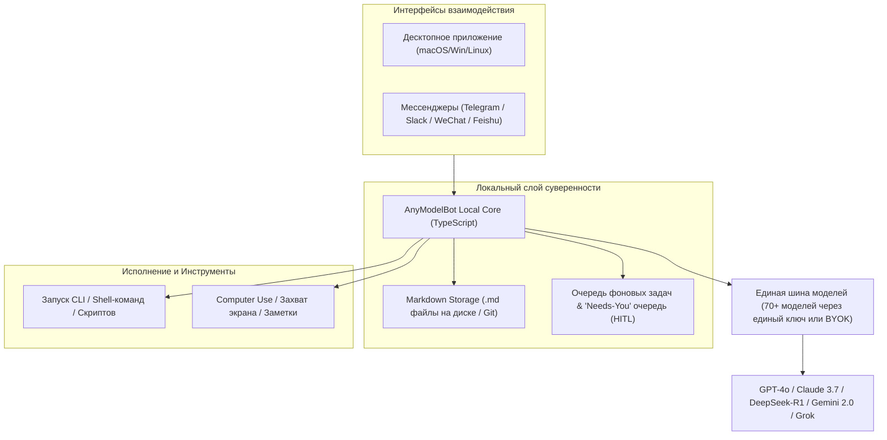

# 🤖 AnyModelBot: Персональный мультимодельный ассистент с хранением памяти в Markdown

> **Ссылка на репозиторий:** [https://github.com/modelflare-ai/AnyModelBot](https://github.com/modelflare-ai/AnyModelBot)  
> **Разработчик:** Modelflare AI  
> **Категория:** `02_agent_runtimes_and_harnesses`  
> **Звёзды GitHub:** 2,340+ ★ (+1,013 ★ за сутки)  
> **Стек:** TypeScript, Node.js, Electron / Docker, Markdown Storage, Telegram / Slack / WeChat / Feishu API  
> **Лицензия:** MIT  

---

## 🎯 1. В чем проблема коммерческих AI-ботов (Grok Bot, Claude Duet, ChatGPT)?

Пользователи коммерческих экосистем сталкиваются с тремя барьерами:
1. **Множественные подписки и Vendor Lock-in:** Приходится платить $20/мес за ChatGPT Plus, $20/мес за Claude Pro, подписку за Grok и отдельный аккаунт за DeepSeek, при этом переключаясь между вкладками браузера.
2. **Черный ящик памяти (Proprietary Siloed Memory):** Истории диалогов и профили памяти заперты в закрытых облачных БД компаний. Их невозможно экспортировать, отредактировать руками или засинхронизировать через Git.
3. **Изолированность от рабочих каналов связи:** Бот живет в браузере и не может напрямую получать задачи из ваших рабочих чатов (Telegram, Slack, Feishu) или выполнять фоновые системные сценарии.

**AnyModelBot предлагает локально-суверенную альтернативу:**
* Один API-ключ (Modelflare Gateway или собственные прямые ключи провайдеров) открывает доступ к **70+ ведущим моделям** (GPT-4o, Claude 3.7 Sonnet, DeepSeek-V3/R1, Gemini 2.0, Grok-2, Kimi, GLM) по модели Pay-per-use без фиксированных подписок.
* **100% Local-first:** Память и контекст хранятся в открытом виде как обычные `.md`-файлы на вашем жестком диске.
* **Интеграция с мессенджерами:** Бот подключается как контакт в Telegram, Slack, Discord, WeChat или Feishu.



---

## ⚡ 2. Ключевые архитектурные достоинства

* **Прозрачная память в Markdown:** Никаких тяжелых векторных БД. Долговременная память организована в виде древовидных папок с Markdown-файлами. Вы можете в любой момент открыть заметку в Obsidian или Neovim, отредактировать факт или удалить устаревшую информацию.
* **Очередь подтверждений «Needs-You»:** Когда агент выполняет фоновую задачу (Background Automation) и сталкивается с неоднозначностью или деструктивным действием (удаление файлов, отправка email), он отправляет карточку запроса подтверждения в мессенджер с кнопками `[Разрешить] / [Отклонить]`.
* **Фоновые агенты (Background Daemons):** Ассистент умеет просыпаться по расписанию (cron), мониторить RSS/GitHub-репозитории и присылать краткую выжимку в ваш чат.

---

## 🚀 3. Быстрый старт и развертывание

```bash
# Клонирование и локальный запуск
git clone https://github.com/modelflare-ai/AnyModelBot.git
cd AnyModelBot
npm install

# Настройка переменных окружения (.env)
MODELFLARE_API_KEY="mf-..."
TELEGRAM_BOT_TOKEN="123456:ABC..."
STORAGE_DIR="~/Documents/AnyModelMemory"

# Запуск локального демона
npm run start:daemon

# Или запуск через Docker
docker compose up -d
```

---

## 💡 4. Главные инженерные выводы

1. **Разделение интерфейса и интеллекта:** AnyModelBot показывает, что эпоха привязки к интерфейсу одного вендора уходит в прошлое. Пользователю нужен один удобный канал (любимый мессенджер или хоткей на десктопе), а модель за кулисами выбирается динамически под задачу и бюджет.
2. **Текстовые файлы как вечный фундамент:** Хранение памяти в Markdown защищает пользователя от банкротства стартапов и смены форматов данных — данные принадлежат только владельцу машины.
