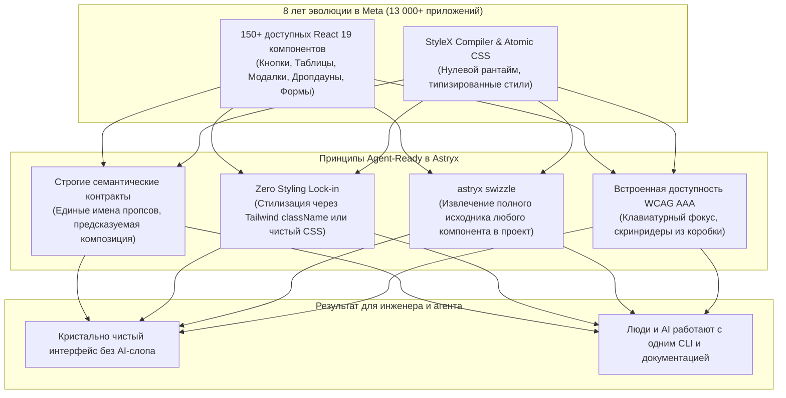

# 🎨 Meta Astryx: Открытая дизайн-система Meta нового поколения

> **Ссылка на репозиторий:** [https://github.com/meta/astryx](https://github.com/meta/astryx)  
> **Официальная документация:** [https://astryx.atmeta.com](https://astryx.atmeta.com)  
> **Storybook & Sandbox:** [https://astryx.atmeta.com/storybook/](https://astryx.atmeta.com/storybook/)  
> **Разработчик:** Meta (дизайн- и фронтенд-команда)  
> **Категория:** `02_agent_runtimes_and_harnesses`  
> **Звёзды GitHub:** 22,100+ ★ (#1 в мировых недельных трендах GitHub, +5,592 ★ за неделю)  
> **Стек:** React 19+, StyleX, TypeScript, `@astryxdesign/core`, `@astryxdesign/cli`, `@astryxdesign/themes`  
> **Лицензия:** MIT  

---

## 🎯 1. В чём проблема UI при вайб-кодинге с AI-агентами?

С бурным развитием кодинг-агентов (Claude Code, Cursor, Codex, Antigravity) фронтенд-разработка столкнулась с кризисом **«AI-слопа» (AI Slop)**:
1. **Галлюцинации стилей и классов:** Модели выдумывают несуществующие utility-классы Tailwind, путают flex/grid свойства и создают хрупкую верстку.
2. **Игнорирование доступности (a11y):** Сгенерированный код почти никогда не содержит правильных ARIA-ролей, фокус-ловушек, поддержки экранных дикторов и навигации с клавиатуры.
3. **Раздувание вендорных зависимостей:** Большинство дизайн-систем жестко привязывают проект к тяжелым CSS-in-JS рантаймам или специфическим сборщикам.

### История и манифест Astryx:
Astryx развивался внутри компании **Meta на протяжении 8 лет**, став крупнейшей дизайн-системой корпорации, на которой работает **более 13 000 внутренних и внешних приложений**.

В 2026 году Meta открыла исходный код Astryx, адаптировав его под новую реальность:
> *"An open source design system built for how we build now: by people and the agents working alongside them."*  
> *(«Дизайн-система, созданная для того, как мы строим софт сегодня: людьми и работающими бок о бок с ними AI-агентами»)*.



---

## ⚡ 2. Что делает Astryx уникальной дизайн-системой?

### 1. Открытые внутренности (Open Internals & Swizzle)
В отличие от библиотек «черных ящиков», компоненты Astryx разбиты на легко компонуемые низкоуровневые строительные блоки. Если стандартного поведения недостаточно, утилита `astryx swizzle <component>` мгновенно копирует полный открытый исходный код компонента прямо в ваш репозиторий, передавая полный контроль над логикой вашей команде.

### 2. Никакого стайлинг-локина (Zero Styling Lock-in)
Внутри Meta компоненты стилизуются на базе **StyleX**, однако для внешнего разработчика и агента это абсолютно прозрачно. Вы можете переопределять стили через привычный `className`, используя **Tailwind CSS, CSS Modules или ванильный CSS**.

### 3. Кастомизация без создания оберток (Tokens & Themes)
Темизация в Astryx построена на стандартных CSS Custom Properties. Дизайнер или агент может полностью изменить брендинг приложения, подключив одну из готовых тем:
* `@astryxdesign/theme-neutral`
* `butter`, `chocolate`, `matcha`, `stone`, `gothic`, `y2k`

---

## 💻 3. Быстрый старт и интеграция

### Установка пакетов
```bash
# Установка ядра, базовой темы и peer-зависимостей
pnpm add @astryxdesign/core @astryxdesign/theme-neutral @stylexjs/stylex
pnpm add -D @astryxdesign/cli
```

### Подключение в проект (Next.js / Vite)
Простейшая настройка требует лишь импорта CSS-стилей темы и оборачивания в провайдер — никаких Babel-плагинов или сложных конфигов:

```tsx
import "@astryxdesign/core/styles.css";
import "@astryxdesign/theme-neutral/theme.css";
import { Button, Input, Card, ThemeProvider } from "@astryxdesign/core";
import { useState } from "react";

export function UserProfileCard() {
  const [name, setName] = useState("");

  return (
    <ThemeProvider theme="neutral">
      <Card elevation="raised" padding="large">
        <h2 className="text-xl font-bold mb-4">Настройки профиля</h2>
        <Input
          label="Имя пользователя"
          placeholder="Введите имя..."
          value={name}
          onChange={(e) => setName(e.target.value)}
        />
        <Button
          variant="primary"
          onClick={() => alert(`Сохранено: ${name}`)}
          className="mt-4"
        >
          Сохранить изменения
        </Button>
      </Card>
    </ThemeProvider>
  );
}
```

### Интеграция CLI для AI-кодинг агентов
Добавление скрипта в `package.json` позволяет кодинг-агентам (Claude Code, Cursor) автономно запрашивать документацию и генерировать компоненты:
```json
"scripts": {
  "astryx": "node node_modules/@astryxdesign/cli/clients/cli/bin/astryx.mjs"
}
```

Промпт агенту:
> *"Use Astryx components to build a responsive data table page with sorting and filtering. Run `npm run astryx -- component --list` to inspect available components."*

---

## 💡 4. Главные инженерные выводы

1. **Дизайн-системы должны изначально проектироваться под AI-агентов:** Четкие правила именования пропсов и семантическая строгость компонентов сокращают ошибки моделей рассуждений на 80%.
2. **StyleX как невидимый двигатель:** Использование атомарного CSS компилятора гарантирует минимальный размер бандла независимо от количества используемых компонентов.
3. **Прагматизм Meta против догматизма:** Возможность частичного извлечения исходников (`swizzle`) и свободное сочетание с Tailwind делает Astryx максимально дружелюбным к реальным проектам.
