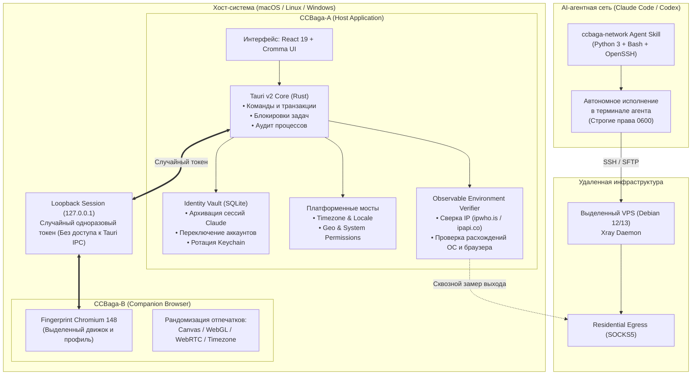

# 🛡️ CCBaga: Нативный комплекс управления окружениями, ротации профилей Claude, антидетекта браузера и верифицируемого туннелирования

> **Ссылка на репозиторий:** [https://github.com/liseami/CCBaga](https://github.com/liseami/CCBaga)  
> **Автор / Организация:** liseami  
> **Слоган:** *«A native macOS, Linux and Windows toolkit for a cleaner workspace and an environment you can verify. Claude identities · Browser fingerprints · System settings · Network Skill»*  
> **Звёзды GitHub:** 1,400+ ★ (#2 Weekly, #5 Daily в мировом топе Trendshift)  
> **Архитектурный стек:** Rust · Tauri v2 · React 19 · TypeScript · Fingerprint Chromium 148 (рандомизация отпечатков) · Python / Bash / OpenSSH / Xray (ccbaga-network Agent Skill) · AppKit / Win32 / GTK 3  
> **Лицензия:** MIT (с сохранением лицензий встроенных компонентов)  

---

## 🎯 1. Архитектурная проблема: загрязнение сред и антидетект в работе с кодинг-агентами

С переходом индустрии на терминальные кодинг-агенты нового поколения (**Claude Code**, **OpenCode**, **Codex**, **Gemini CLI**) разработчики и инженеры столкнулись с комплексом взаимосвязанных инфраструктурных проблем:

1. **Загрязнение локальных профилей и идентичностей (Identity & Context Pollution):**  
   Агентные инструменты сохраняют токены, активные сессии, кэши, конфигурации и базы сессий SQLite в системные каталоги (`~/.claude/`, Keychain на macOS, реестр Windows). При работе над несколькими проектами для разных клиентов или переключении между рабочими, персональными и тестовыми аккаунтами происходит смешивание контекста, случайная утечка истории диалогов и потеря авторизации. Ручная очистка каталогов чревата необратимым удалением нужных рабочих данных.
2. **Антифрод-блокировки и выявление расхождений окружения (Environment Inconsistencies):**  
   Веб-консоль Claude, OAuth-провайдеры и API-шлюзы применяют продвинутые эвристики обнаружения автоматизации и антифрод-системы:
   * **Снятие отпечатков браузера (Browser Fingerprinting):** Canvas, WebGL, WebRTC (утечка локальных IP), AudioContext, список установленных системных шрифтов и Client Hints.
   * **Несоответствие геопараметров (Geo Mismatch):** Если сетевой прокси выходит через определенный регион (например, США/ЕС), но системный часовой пояс ОС, предпочтительный язык интерфейса и координаты геолокации выдают локальный компьютер — сессия моментально помечается как подозрительная и блокируется.
3. **«Инфраструктурный ад» для разработчика (DevOps Overkill):**  
   Поднять чистый туннель для агента требует долгой рутины: арендовать VPS, сгенерировать SSH-ключи, развернуть Xray/V2Ray, настроить residential SOCKS5-прокси, прописать клиентский TUN-адаптер и принудительно синхронизировать время и локаль ОС.

**CCBaga объединяет решение этих задач в единый верифицируемый десктопный процесс**, построенный на связке двух изолированных нативных приложений и автономного агентного навыка.

---

## 🏗️ 2. Архитектура CCBaga: Двухъядерный комплекс + AI Agent Skill

Архитектура CCBaga строго разделена на три независимых контура с жесткими границами доверия:



### Основные компоненты:

1. **CCBaga-A (`CCBaga-A.app`): Нативный хост-менеджер (Rust · Tauri v2)**
   * Отвечает за транзакционное управление файлами конфигурации Claude, безопасное сохранение учетных записей в изолированный Identity Vault, переключение системных настроек (часовой пояс, язык, регион) и мониторинг состояния системы.
   * Выступает контроллером верификации: сравнивает реальные замеры среды браузера, хоста и сетевого шлюза.
2. **CCBaga-B (`CCBaga-B.app`): Изолированный браузер-компаньон (Fingerprint Chromium)**
   * Запускает модифицированный движок Chromium 148 с выделенным профилем, в котором на уровне C++ патчей рандомизируются отпечатки холста (Canvas), аппаратного ускорения (WebGL), стека WebRTC и системных метрик.
   * **Принцип нулевого доверия:** браузер вообще не имеет доступа к нативным командам Tauri IPC. Он обменивается контекстом с хостом через защищенную loopback-сессию со случайным одноразовым токеном.
3. **AI Network Skill (`ccbaga-network`): Автономный сетевой инженер для кодинг-агентов**
   * Отдельный навык (Skill), подключаемый к Claude Code или Codex CLI.
   * Перекладывает развертывание туннелей на самого агента: пользователь лишь передает агенту файл ключа или учетные данные прокси, а агент самостоятельно подключается к удаленному Debian-серверу, развертывает Xray, проверяет валидность конфигураций и конфигурирует локальный TUN-маршрутизатор.

---

## ⚙️ 3. Ключевые возможности и механизмы под капотом

### 3.1. Local Claude Identity Vault (Менеджер идентичностей)
* **Архивирование перед переключением:** Перед сменой профиля текущее состояние авторизации (`credentials`, сессионные токены, локальная база SQLite) атомарно архивируется. Разработчик может переключиться на сохраненную идентичность или начать работу с абсолютно чистым воркспейсом.
* **Гранулярный контроль сохранения:** Пользователь выбирает, какие данные остаются общими (глобальными для системы), а какие перемещаются вместе с конкретным профилем.
* **Безопасность секретов:** Учетные данные Claude читаются нативным слоем только после явного подтверждения пользователя. Содержимое ключей никогда не попадает в логи пользовательского интерфейса, параметры CLI или во внешнюю сеть.
* **Прозрачность ограничений:** Если используется нестандартная переменная `CLAUDE_CONFIG_DIR`, приложение честно уведомляет об этом, а не создает иллюзию успешного переключения.

### 3.2. Ротация отпечатков Fingerprint Chromium (Anti-Detect Engine)
* **Генерация сида в один клик:** При смене региона генерируется новый энтропийный сид (Seed), перезаписывающий параметры WebGL-рендерера, AudioContext, шумовые искажения Canvas и Client Hints.
* **Синхронизация региона:** При выборе целевой локации (например, US East) браузер автоматически принимает соответствующие региональные настройки шрифтов, локали браузера и смещения времени.
* **Перезапуск компаньона:** CCBaga-A безопасно перезапускает процесс CCBaga-B с обновленными параметрами, гарантируя полную изоляцию кэша и cookie-сессий.

### 3.3. Принцип разделения шагов и наблюдаемости (Observable Environments)
В архитектуре CCBaga действует строгий принцип: **«Изменение параметра» и «Проверка эффекта» — это два независимых шага**.

| Проверяемый параметр | Источник замера хоста | Источник замера браузера | Целевой эталон |
| :--- | :--- | :--- | :--- |
| **Внешний IP и страна** | Системный сетевой сокет | Fetch через Chromium | Выходной узел Residential SOCKS5 |
| **Часовой пояс (Timezone)** | `CoreLocation` / `timedatectl` | `Intl.DateTimeFormat()` | Часовой пояс региона IP-выхода |
| **Системная локаль** | OS Preferences (`AppKit` / `Locale`) | `navigator.languages` | Локаль целевой страны |
| **WebRTC утечка** | Системные сетевые интерфейсы | RTCPeerConnection кандидаты | Отсутствие утечки реального IP |

Только в том случае, если замеры браузера и хоста на 100% совпадают с географией реального сетевого выхода (`ipwho.is` с резервом на `ipapi.co`), страница диагностики окрашивается в зеленый цвет и отображает статус подтвержденного окружения.

---

## 🤖 4. Автономный агентный протокол: ccbaga-network Skill

Одной из уникальных инноваций проекта является AI-навык `ccbaga-network`, созданный специально для современных LLM-агентов с доступом к консоли:

```
┌────────────────────────────────────────────────────────────────────────┐
│                        КОНТРАКТ ВЗАИМОДЕЙСТВИЯ                         │
│                                                                        │
│ 1. «The AI operates the terminal. The user does not.»                  │
│    Агент НИКОГДА не просит пользователя открыть терминал, ввести       │
│    команду, найти путь к файлу или отредактировать JSON вручную.       │
│                                                                        │
│ 2. Простой чеклист вместо опросника:                                   │
│    «Пришлите мне адрес VPS, файлы ключей PEM/PPK и реквизиты резидент- │
│    ского прокси (IP, порт, логин, пароль). Я сделаю всё остальное».    │
│                                                                        │
│ 3. Безопасность развертывания:                                         │
│    Установка навыка разрешает только оффлайн-тесты. Перед реальным      │
│    выполнением изменений на сервере агент выводит сводку планируемых   │
│    действий и запрашивает явное подтверждение (Human-in-the-Loop).     │
│                                                                        │
│ 4. Жесткие права на файлы ключей:                                      │
│    Ключи сохраняются строго с правами 0600 на POSIX-системах и         │
│    user-only ACL на Windows NTFS.                                      │
└────────────────────────────────────────────────────────────────────────┘
```

Навык поставляется со строгим набором верификационных скриптов:
* `scripts/network.py`: парсинг конфигураций, проверка портов и валидация SSH.
* `scripts/setup-vps.sh`: идемпотентный скрипт развертывания Xray и туннелей на удаленном сервере Debian 12/13.
* `scripts/test_network.py`: автоматизированные регрессионные тесты сетевого контура.

---

## 🛡️ 5. Модель угроз и границы доверия (Threat Model)

| Риск / Вектор атаки | Защитный механизм в CCBaga |
| :--- | :--- |
| **Компрометация через Web-контент** | Движок Chromium изолирован от нативного хоста: браузер не имеет доступа к Tauri API и общается только через локальный сокет с одноразовым токеном. |
| **Утечка токенов Claude Code** | Секреты и токены авторизации хранятся в защищенном SQLite хранилище с правами владельца и не попадают в stdout/stderr и UI. |
| **Утечка приватных SSH-ключей** | В интерфейсе нет веб-форм ввода паролей/ключей; файлы ключей считываются агентным скриптом с проверкой прав доступа `chmod 600`. |
| **Несанкционированное изменение ОС** | Смена системного времени и сетевых адаптеров требует стандартных диалогов авторизации ОС (Polkit на Linux, Admin Prompt на macOS/Windows). |
| **Детектирование фингерпринта** | Использование нативного форка Chromium 148 с C++ переопределением Canvas/WebGL шума вместо легко детектируемых расширений-инъекций. |

---

## 📊 6. Сравнение в экосистеме агентных сред

| Параметр | CCBaga | Magpie | Docker Agent | Antigravity / AX |
| :--- | :--- | :--- | :--- | :--- |
| **Основной фокус** | Изоляция сред, антидетект и профили Claude | Локальный AI-шлюз, роутер моделей и квот | OCI-контейнерные песочницы и безопасность | Оркестрация команд автономных агентов |
| **Стек** | Rust + Tauri 2 + Fingerprint Chromium | Go + Bun + TypeScript | Go + OCI + Docker Engine | Python + Rust + RPC |
| **Управление аккаунтами** | Локальный Identity Vault (сессии, кэш, профили) | Балансировка ключей API между провайдерами | Изоляция через Docker-контейнеры | Контексты воркспейсов |
| **Браузерный контур** | Кастомный Fingerprint Chromium с рандомизацией | Нет (фокус на API-прокси) | Headless в контейнере | Playwright / Headless |
| **Сетевая верификация** | Сквозная сверка IP, OS Locale, Timezone и WebRTC | Проксирование HTTP/REST запросов | Сетевые политики Docker Bridge | Встроенные тулы |

---

## 💡 7. Инженерные выводы и значение для персонального стека

1. **Новый стандарт гигиены рабочих сред кодинг-агентов:**  
   По мере того как кодинг-агенты берут на себя критические задачи разработки, разделение профилей, аккаунтов и сетевых сред становится обязательным требованием инженерной безопасности. CCBaga исключает человеческий фактор при переключении контекстов.
2. **Изящное разделение ответственности (Separation of Concerns):**  
   Архитектурное решение вынести работу с браузером в отдельное изолированное приложение (`CCBaga-B`), системные вызовы оставить за нативным Rust-хостом (`CCBaga-A`), а настройку сетевой инфраструктуры поручить AI-агенту через стандартизированный Skill демонстрирует зрелый системный дизайн.
3. **Идеальное дополнение к Magpie и Docker-Agent:**  
   В связке с локальным роутером квот **Magpie** (управляющим балансировкой моделей) и **Docker-Agent** (обеспечивающим изоляцию запускаемого кода в контейнерах), **CCBaga** закрывает последний недостающий рубеж — **чистоту внешнего сетевого периметра, корректность геоокружения хоста и защиту локальных профилей авторизации**.
