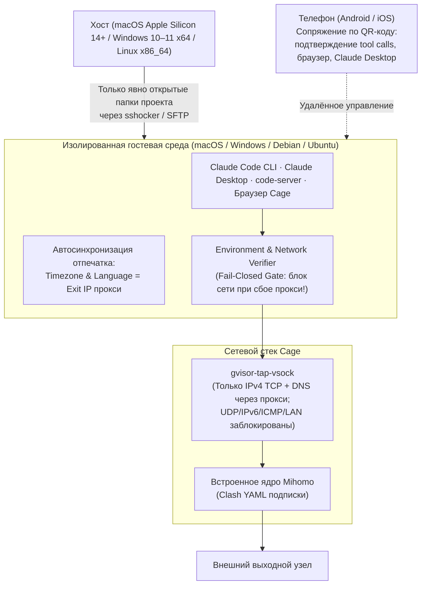

# 🛡️ Claude Cage: Изолированная VM-среда для Claude Code и Claude Desktop без сетевых утечек

> **Ссылка на репозиторий:** [https://github.com/Lee-xeo/Claude-Cage](https://github.com/Lee-xeo/Claude-Cage)  
> **Происхождение:** Форк / развитие [`agent-vm`](https://github.com/sylvinus/agent-vm)  
> **Категория:** `02_agent_runtimes_and_harnesses`  
> **Звёзды GitHub:** 4,700+ ★ (+1,546 ★ за сутки)  
> **Стек:** Go, Lima (Linux VM), `gvisor-tap-vsock`, Mihomo (Clash YAML), `sshocker` / SFTP, `noVNC`, `code-server`, Tailscale  
> **Лицензия:** MIT (встроенный бинарник Mihomo — GPL-3.0)

---

## 🎯 1. Решаемая проблема: Баны, утечки окружения и «зоопарк» аккаунтов

Пользователи **Claude Code** и **Claude Desktop** в регионах с ограничениями или при работе с несколькими аккаунтами вынуждены вручную настраивать VPS, антидетект-браузеры, резидентские прокси и системные локали. Любое расхождение (утечка локального DNS, WebRTC, несовпадение таймзоны ОС с выходным IP прокси, общий `~/.claude`) приводит к потере сессии или блокировке аккаунта.

**Claude Cage** упаковывает весь рабочий стек (терминал с Claude Code, изолированный браузер Cage, редактор `code-server` и официальный Claude Desktop) внутрь единого настольного приложения с жёсткой изоляцией сети и отпечатков.

---

## 🏗️ 2. Ключевые архитектурные возможности

1. **Строгое Fail-Closed сетевое туннелирование:**
   * Встроенное ядро **Mihomo** импортирует подписки Clash/Mihomo или локальные YAML-конфиги.
   * Весь исходящий трафик (включая DNS) принудительно идёт через выбранный прокси-узел поверх `gvisor-tap-vsock`.
   * При падении прокси или провале встроенной проверки среды **возврат к прямому соединению отсутствует** — доступ в сеть немедленно блокируется. Публичные UDP, IPv6, ICMP и прямой доступ к хосту/локальной сети ограничены по умолчанию.
2. **Изоляция отпечатков браузера и локали:**
   * Настройки браузера, часовой пояс и язык гостевой среды изолированы от хоста и автоматически синхронизируются с геолокацией выходного IP прокси.
   * Учётные записи Claude на хосте, куки браузера и хостовые SSH-ключи **не импортируются** автоматически.
3. **Мультиаккаунтинг Claude Code и сохранение состояния:**
   * Просмотр квот, привязка разных аккаунтов к новым сеансам и явное переключение аккаунта с сохранением истории переписки (внутри виртуального диска).
4. **Мобильное управление и облачный режим:**
   * Сопряжение iPhone/Android по QR-коду для продолжения диалогов Claude Code, подтверждения вызовов инструментов (approvals) и управления окном браузера/Claude Desktop через `noVNC`.
   * Возможен запуск на Linux x86_64 VPS **без KVM** по SSH и включение **Tailscale** для двустороннего SSH между хостом и Cage.

---

## ⚠️ 3. Важные ограничения (из документации проекта)

* **Общие папки проектов монтируются напрямую:** редактирование и удаление в открытом каталоге проекта сразу меняют файлы на хосте (включая `.git`).
* **Проекты внутри одного Cage не изолированы друг от друга:** все открытые в среде папки делят общую гостевую ФС, инструменты и сессии.
* **Платформы хоста:** поддерживаются Apple Silicon macOS 14+, Windows 10 22H2 / 11 x64, Debian 12 / Ubuntu 22.04–24.04 x86_64. Intel Mac, Windows ARM64 и Linux ARM64 пока не поддерживаются.

---

## 💡 4. Главные инженерные выводы

1. **Сравнение с [CCBaga](ccbaga.md):** оба проекта решают схожую боль изоляции профилей Claude Code + антидетекта + прокси, но идут разными путями — **CCBaga** использует Tauri + Fingerprint Chromium + Xray/TUN прямо на хосте с Identity Vault, а **Claude Cage** поднимает полноценную гостевую среду/VM на Go + Lima + `gvisor-tap-vsock` + Mihomo + `noVNC` с мобильным пультом.
2. **Принцип Fail-Closed на уровне виртуального сетевого стека** надёжнее системного HTTP-прокси: приложение физически не может «протечь» мимо прокси через прямой сокет или утечку DNS.
3. **Удобный UX «всё из коробки»:** установщик уже включает рантайм и ядро прокси — пользователю не нужно отдельно ставить Go, Docker, Node.js или Clash.
