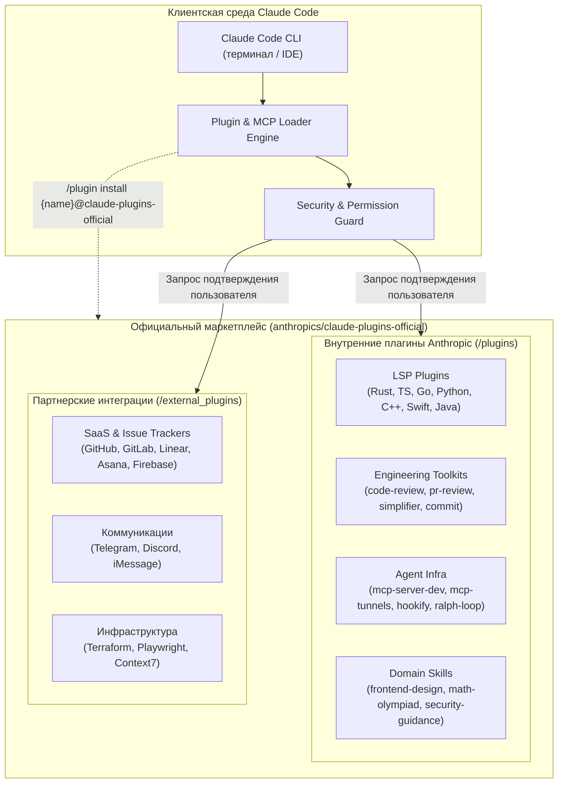

# 🧩 Claude Code Plugins Official: Официальный каталог плагинов, системных навыков и MCP-серверов от Anthropic

> **Ссылка на репозиторий:** [https://github.com/anthropics/claude-plugins-official](https://github.com/anthropics/claude-plugins-official)  
> **Организация:** Anthropic (`anthropics`)  
> **Слоган:** *«Official, Anthropic-managed directory of high quality Claude Code Plugins.»*  
> **Звёзды GitHub:** 40,000+ ★ (#2 в мировом Weekly топе Trendshift)  
> **Архитектурный стек:** JSON (Plugin Manifests) · Python / TypeScript · Model Context Protocol (MCP) · LSP (Language Server Protocol) · Claude Code CLI  
> **Лицензия:** MIT  

---

## 🎯 1. Архитектурная проблема: стандартизация расширяемости кодинг-агентов

До появления официального реестра плагинов экосистема Claude Code развивалась стихийно:
1. **Фрагментация конфигураций:**  
   Подключение сторонних инструментов требовало ручного прописывания MCP-серверов в `~/.claude.json`, копирования разрозненных файлов `CLAUDE.md` и самописных скриптов в каталоги проектов.
2. **Отсутствие стандартизированной интеграции с компиляторами и LSP:**  
   LLM-агенты часто галлюцинировали синтаксисом или не видели ошибок типов до запуска компиляции проекта. Им не хватало прямого доступа к Language Server Protocol (LSP) для мгновенной валидации символов и определений.
3. **Безопасность и проверка доверия (Supply Chain Security):**  
   Запуск непроверенных сторонних скриптов с доступом к файловой системе создавал критические риски выполнения вредоносного кода через внедрение промптов или перехват команд.

**`claude-plugins-official` стал официальным репозиторием-маркетплейсом Anthropic**, устанавливающим спецификацию плагинов для Claude Code, унифицирующим установку через команду `/plugin install` и предлагающим готовые наборы специализированных инструментов.

---

## 🏗️ 2. Архитектура и структура каталога плагинов

Каталог строго разделен на две категории плагинов:



### Стандартная анатомия плагина Claude Code:
Каждый плагин в каталоге строится по строгому манифесту:
```text
plugin-name/
├── .claude-plugin/
│   └── plugin.json      # Обязательный мета-манифест (имя, версия, описание, автор)
├── .mcp.json            # Декларативная конфигурация MCP-серверов (опционально)
├── commands/            # Пользовательские слэш-команды (/review, /commit, /audit)
├── hooks/               # Хуки жизненного цикла (Pre-commit, Post-build, Context-inject)
└── skills/              # Специализированные агентные навыки (Agent Skills)
```

Пример манифеста `.claude-plugin/plugin.json`:
```json
{
  "name": "code-review",
  "version": "1.2.0",
  "description": "Rigorous multi-pass code review with type consistency and security audit",
  "author": "Anthropic",
  "homepage": "https://github.com/anthropics/claude-plugins-official/tree/main/plugins/code-review",
  "min_claude_version": "0.8.0",
  "capabilities": ["mcp", "commands", "skills"]
}
```

---

## 🚀 3. Главные плагины из официальной коллекции

### 3.1. LSP-плагины глубокого анализа кода (Language Server Protocol)
Одно из ключевых нововведений — семейство плагинов для прямой интеграции Claude Code с серверами языкового анализа:
* **`rust-analyzer-lsp`:** мгновенная проверка borrow checker, раскрытие макросов и поиск определений функций в проектах на Rust.
* **`pyright-lsp`:** строгая статическая типизация и проверка сигнатур в Python.
* **`gopls-lsp`:** официальный языковой сервер для Go (навигация по интерфейсам и пакетам).
* **`typescript-lsp` / `clangd-lsp` / `swift-lsp` / `jdtls-lsp`:** нативная типизация для веб-разработки, C++, Swift и Java.

> **Эффект:** Агент больше не пытается компилировать код наугад через `cargo build` или `pytest` после каждой строчки — он мгновенно запрашивает у LSP ошибки в буфере памяти, экономя десятки тысяч токенов.

### 3.2. Инженерные воркфлоу и контроль качества
* **`code-simplifier`:** удаление мертвого кода, рефакторинг избыточной вложенности и анти-оверинжиниринг с сохранением семантики.
* **`pr-review-toolkit`:** комплексный многопроходный аудит pull request'ов (поиск регрессий, граничных условий и проверка документации).
* **`claude-security` & `security-guidance`:** верификация на уязвимости OWASP, проверка экранирования SQL/команд и аудит зависимостей.
* **`commit-commands`:** генерация семантических атомарных коммитов по спецификации Conventional Commits с привязкой к тикетам.

### 3.3. Разработка плагинов и агентных навыков
* **`skill-creator`:** интерактивный генератор кастомных Agent Skills с валидацией структуры каталогов.
* **`mcp-server-dev` & `mcp-tunnels`:** фреймворк быстрого создания и отладки локальных MCP-серверов с туннелированием.
* **`hookify`:** превращение рутинных команд проверки в автоматические хуки выполнения перед запуском агента.

---

## 💻 4. Установка и использование в терминале

### Установка плагина из маркетплейса:
```bash
# Установка плагина code-review
/plugin install code-review@claude-plugins-official

# Установка LSP-сервера для Rust
/plugin install rust-analyzer-lsp@claude-plugins-official

# Установка интеграции с GitHub
/plugin install github@claude-plugins-official
```

### Интерактивный браузер плагинов:
```bash
/plugin > Discover
```

### Просмотр установленных расширений и обновление:
```bash
/plugin list
/plugin update --all
```

---

## 🛡️ 5. Модель доверия и политики безопасности

Anthropic прямо акцентирует внимание на модели ответственности:
* **Песочница и запросы подтверждения:** Установка плагина не дает ему автоматических прав на выполнение произвольных скриптов без одобрения пользователя.
* **Разделение на Internal и External:** Плагины от команды Anthropic проходят аудит безопасности исходного кода. Сторонние плагины из `/external_plugins` помечаются отдельным флагом с предупреждением о необходимости проверки источника.
* **Стандартизация манифестов:** Жесткая схема `plugin.json` предотвращает скрытое внедрение фоновых демонов вне контроля менеджера Claude Code.

---

## 💡 6. Значение для базы знаний и персонального стека

1. **Экосистема вокруг Claude Code стала зрелой платформой:**  
   Появление официального каталога плагинов переводит Claude Code из категории «умный терминальный копилот» в статус **полноценной расширяемой агентной операционной системы** со своим маркетплейсом (аналог VS Code Marketplace или Homebrew).
2. **Связка с правилами кодинга:**  
   Плагины вроде `code-simplifier` и `rust-analyzer-lsp` идеально дополняют инженерные принципы лаконичности (**Ponytail**), правила фронтенда (**Taste Skill** / **Impeccable**) и локальные шлюзы (**Magpie**).
