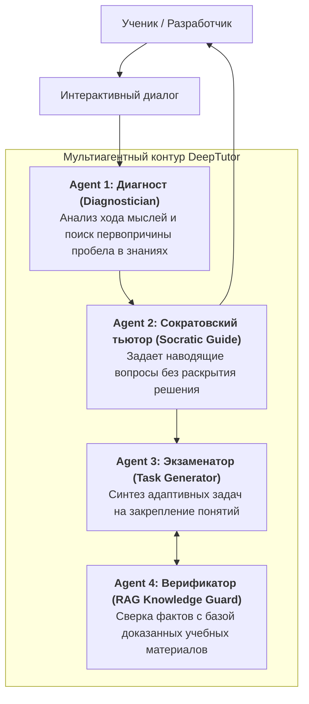

# 🎓 DeepTutor: Платформа адаптивного обучения на базе мультиагентных систем

> **Ссылка на репозиторий:** [https://github.com/HKUDS/DeepTutor](https://github.com/HKUDS/DeepTutor)  
> **Официальный портал:** [https://deeptutor.info](https://deeptutor.info)  
> **Авторы:** Лаборатория науки о данных Гонконгского университета (HKUDS Lab)  
> **Категория:** `02_agent_runtimes_and_harnesses`  
> **Звёзды GitHub:** 53,200+ ★ (#2 Weekly в мировых трендах GitHub, +10,567 ★ за неделю)  
> **Стек:** Python 3.11+, LangGraph, FastAPI, Qdrant / Milvus, React UI, CLI  
> **Лицензия:** MIT  

---

## 🎯 1. В чем проблема использования стандартных LLM как репетиторов?

Когда ученик задает вопрос обычной языковой модели (ChatGPT, Claude), модель:
1. **Сразу выдает готовый ответ:** Вместо того чтобы научить думать, LLM решает задачу за человека, убивая когнитивные усилия.
2. **Не имеет долговременной модели ученика (Student Mental Model):** Модель забывает, в каких концепциях человек путался вчера, и не видит пробелов в фундаменте знаний.
3. **Галлюцинирует в сложных научных темах:** При решении олимпиадных или инженерных задач модель ошибается в расчетах без сверки с верифицированными учебными пособиями.

**DeepTutor решает эту проблему через распределенную мультиагентную команду наставников:**

---

## ⚡ 2. Ключевые архитектурные модули

* **Динамический граф знаний учащегося:** Фиксация уровня освоения концепций с трассировкой предпосылок (pre-requisites).
* **Сократовский метод диалога:** Модель обучена запрету давать прямой ответ; вместо этого она ведет человека к инсайту через цепочку наводящих вопросов.
* **Верификация через RAG:** Все академические формулы и определения проверяются по базе проверенных научных учебников.

---

## 💡 3. Главные инженерные выводы

1. **AI-педагогика требует разделения ролей:** Один агент не может одновременно эмпатично вести диалог, строго проверять факты и обновлять долгосрочную матрицу пробелов.
2. **Адаптивный тьюторинг — это граф зависимостей:** Успех обучения зависит от точного выявления корневого пробела в фундаментальных темах.
