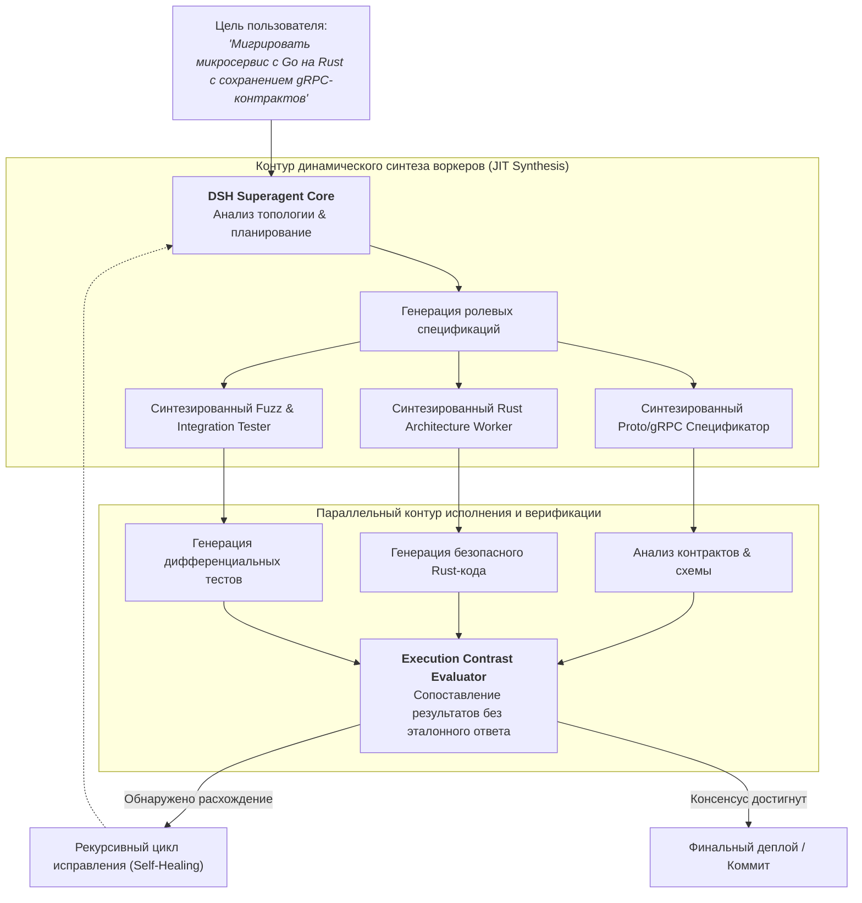

# 🧠 DSH Superagent: Исследовательский прототип суперагента DeepSeek для открытого мира

> **Ссылка на репозиторий:** [https://github.com/deepseek-ai/dsh-superagent-prototype](https://github.com/deepseek-ai/dsh-superagent-prototype)  
> **Исследовательская статья:** *Exploring Super-agent Design: Towards a More Autonomous Agent System*  
> **Разработчик:** DeepSeek AI Core Research  
> **Категория:** `02_agent_runtimes_and_harnesses`  
> **Звёзды GitHub:** 4,900+ ★ (#1 Daily и #1 Monthly в мировых трендах GitHub, +2,641 ★ за сутки)  
> **Стек:** TypeScript, Node.js, DSH Plugin Architecture, WebSocket, Docker  
> **Лицензия:** Apache 2.0  

---

## 🎯 1. В чем фундаментальный прорыв концепции «Суперагента»?

Большинство современных кодинг-агентов (Claude Code, Codex, OpenCode) функционируют как **линейные исполнители в жестких границах**:
* Человек обязан вручную декомпозировать сложную проблему на понятные подзадачи.
* Среда исполнения (harness), набор инструментов и системные промпты статичны и заданы создателями инструмента.
* Если агент сталкивается с задачей нового класса (неизвестная экосистема, сложная компиляция на гетерогенном кластере), он быстро заходит в тупик или бесконечный цикл ошибок.

**DeepSeek DSH Superagent меняет эту парадигму:**
Это не просто агент, решающий задачу в коде, а **мета-система, способная самостоятельно проектировать, отлаживать и масштабировать инфраструктуру своего собственного выполнения**:
1. **Код создан самими агентами:** Значительная часть кодовой базы прототипа спроектирована и написана автономными кодинг-агентами команды DeepSeek в их ежедневной инженерной практике.
2. **Динамический синтез субагентов (Just-in-Time Subagent Synthesis):** Суперагент анализирует топологию инженерной проблемы и «на лету» компилирует узкоспециализированные конфигурации воркеров с индивидуальными системными инструкциями и отфильтрованными наборами инструментов.
3. **Рекурсивная самопроверка без Ground Truth:** Прототип валидирует результаты сложных распределенных шагов через сопоставление параллельных гипотез (execution contrast), выявляя логические нестыковки до внесения необратимых изменений в репозиторий.

---

## 🏗️ 2. Ключевые архитектурные модули репозитория

| Модуль | Назначение | Техническая реализация |
|:---|:---|:---|
| `core/superagent` | Главный цикл планирования и оркестрации | Конечный автомат с поддержкой долгоживущих транзакций и графовой декомпозиции целей. |
| `harness/runtime` | Изолированная среда выполнения | Управление процессами, виртуальными терминалами (pty) и песочницами. |
| `jit-synthesis/` | Динамический компилятор субагентов | Автоматический синтез специализированных системных инструкций под конкретный этап задачи. |
| `eval/contrast` | Движок контрастного анализа гипотез | Запуск параллельных траекторий и поиск расхождений в поведении воркеров без знания эталонного ответа. |
| `transport/bridge` | Мост взаимодействия с экосистемой DSH | Подключение к DeepSeek Harness, передача стриминговых логов и поддержка human-in-the-loop подтверждений. |

---

## 🔄 3. Механизм самоэволюции среды выполнения

В отличие от традиционных харнесов, DSH Superagent не ограничен фиксированным набором тулов:
* Если для проверки задачи требуется специфический линтер, бенчмарк или сетевой анализатор, агент **самостоятельно пишет Bash/Python-скрипт**, помещает его в каталог динамических навыков (`dynamic-skills/`), верифицирует его безопасность в песочнице и подключает в качестве нового инструмента текущей сессии.
* При завершении задачи удачные вспомогательные скрипты индексируются в персистентную библиотеку навыков (Persistent Capability Registry) для использования в будущих проектах.

---

## 💡 4. Главные инженерные выводы

1. **Агенты, пишущие агентов:** Практика DeepSeek доказывает жизнеспособность подхода, при котором инженерная инфраструктура AI-ассистентов разрабатывается самими моделями под контролем человека.
2. **Контрастный анализ вместо слепого автопилота:** Параллельный запуск нескольких вариантов решения с сопоставлением результатов снижает вероятность скрытых галлюцинаций в критическом коде на порядок.
3. **От монолитных агентов к динамическим фабрикам субагентов:** Будущее за суперагентами, способными на лету конструировать узкопрофильные команды под каждую микрозадачу.
