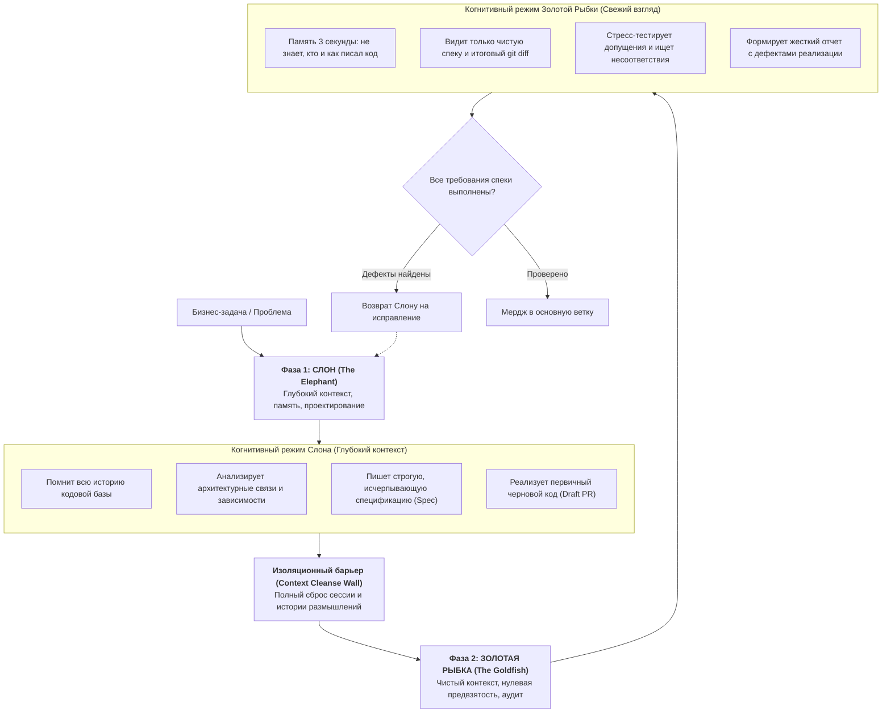

# 🐘🐟 Elephant-Goldfish Model (EGM): Стандарт агентной разработки от инженеров Google

> **Ссылка на репозиторий:** [https://github.com/google/elephant-goldfish-model](https://github.com/google/elephant-goldfish-model)  
> **Официальный сайт:** [https://egm.dev](https://egm.dev)  
> **Разработчик:** Google Engineering  
> **Категория:** `02_agent_runtimes_and_harnesses`  
> **Звёзды GitHub:** 8,300+ ★ (#19 Daily, #8 Weekly в мировых трендах GitHub, +582 ★ за сутки)  
> **Стек:** Python, CLI, Claude Code Plugin, Codex Plugin, Gemini 3.5 Flash, Antigravity Skill  
> **Лицензия:** Apache 2.0  

---

## 🎯 1. В чем фундаментальный парадокс контекста в AI-кодинге?

В современной разработке с агентами инженеры регулярно сталкиваются с когнитивной ловушкой LLM:
* **Эффект «усталости контекста» (Context Fatigue & Confirmation Bias):** Когда агент ведет длинный диалог, генерирует сотни строк плана и сам же пишет код, он влюбляется в собственные решения. При проверке диффов модель с «тяжелым» контекстом слепа к своим же багам, логическим противоречиям и краевым случаям.
* **Иллюзия компетентности:** Модель генерирует аккуратные тесты, которые подтверждают её же ошибочные предположения, упуская реальные требования спецификации.

**Инженеры Google разработали методологию EGM (Elephant-Goldfish Model), разделяющую процесс на два диаметрально противоположных когнитивных режима:**



---

## 🧠 2. Сравнение двух фаз методологии EGM

| Параметр | 🐘 Режим Слона (The Elephant) | 🐟 Режим Золотой Рыбки (The Goldfish) |
|:---|:---|:---|
| **Объем контекста** | **Максимальный (100k–1M токенов):** история репозитория, логи, документация. | **Минимальный (только спека + git diff):** изоляция от рассуждений автора. |
| **Главная цель** | **Синтез и создание:** спроектировать архитектуру и написать код. | **Критика и фальсификация:** доказать, что код не соответствует спецификации. |
| **Отношение к коду** | Созидательное, компромиссное, направленное на сборку. | Скептическое, въедливое, adversarial (наступательное). |
| **Тестовая стратегия** | Написание базовых юнит-тестов для проверки работоспособности. | Написание каверзных краевых тестов, ломающих реализацию Слона. |

---

## ⚡ 3. Практическое применение с кодинг-агентами

Плагин EGM встраивается в терминальные инструменты разработчика:
```bash
# Фаза 1: Слон проектирует спецификацию и пишет код
egm design "Implement distributed rate limiter with Redis and sliding window"

# Фаза 2: Автоматический сброс контекста и запуск Золотой Рыбки для ревью
egm review
```

---

## 💡 4. Главные инженерные выводы

1. **Никогда не доверяйте агенту ревьюить свой собственный код в той же сессии:** Тот же агент, очищенный от контекста создания, находит в 3–5 раз больше критических дефектов.
2. **Спецификация — единственный источник правды:** Разделение ролей заставляет инженера формализовать ожидания до написания первой строчки кода.
