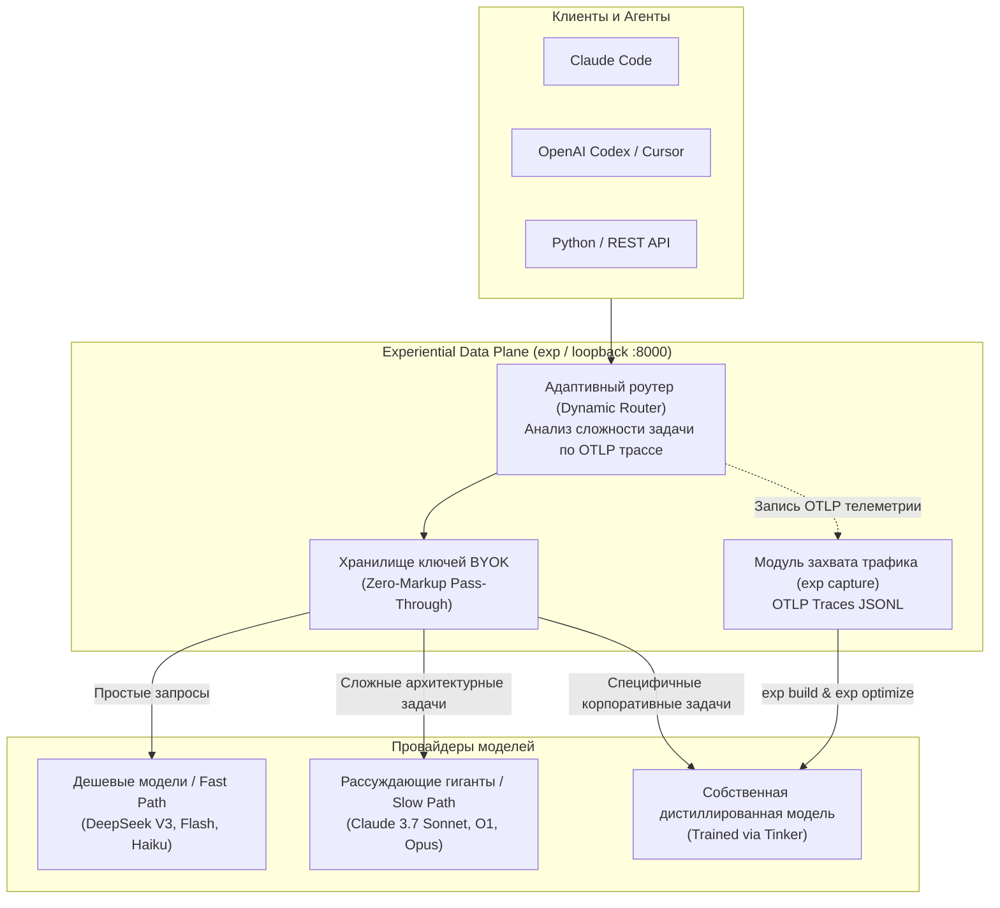

# 🌐 Experiential: Открытый самообучающийся AI-шлюз с нулевой наценкой

> **Ссылка на репозиторий:** [https://github.com/experientiallabs/experiential](https://github.com/experientiallabs/experiential)  
> **Официальная платформа:** [https://platform.experientiallabs.ai](https://platform.experientiallabs.ai)  
> **Разработчик:** Experiential Labs  
> **Категория:** `02_agent_runtimes_and_harnesses`  
> **Звёзды GitHub:** 16,000+ ★ (+691 ★ за сутки)  
> **Стек:** Python 3.13+, скомпилированный нативный Data Plane, OpenTelemetry (OTLP), OpenAI & Anthropic Messages API, Tinker  
> **Лицензия:** Apache-2.0  

---

## 🎯 1. В чём проблема коммерческих AI-шлюзов и роутеров?

В корпоративной и агентной разработке подключение множества моделей (OpenAI, Anthropic, Gemini, DeepSeek, локальные vLLM) сталкивается с тремя болезнями:
1. **Наценка посредников и вендорлок:** Облачные прокси (OpenRouter, Portkey и др.) берут процент со стоимости токенов или хранят ваши API-ключи на своих серверах.
2. **Слепая статическая маршрутизация:** Традиционные шлюзы используют захардкоженные regex-правила или эвристики для выбора модели. Они не понимают реальной сложности промпта и отправляют тривиальные задачи на Claude 3.7 / O1, сжигая бюджеты.
3. **Утеря ценнейшего актива — производственного трафика:** Тысячи промптов, цепочек мыслей и правок кода, проходящие через агентов команды (Claude Code, Cursor, Codex), растворяются в облаках провайдеров вместо того, чтобы обучать внутренние модели компании.

**Experiential решает эту триаду через концепцию Self-Learning Gateway:**
* **Zero-Markup & BYOK:** Полностью открытый локальный прокси на вашем хосте (`exp`). Вы подключаете свои ключи (OpenAI, Anthropic, Gemini, Azure, Bedrock, Fireworks, OpenRouter) без комиссии.
* **Passive Traffic Capture:** Перехват и сбор OpenTelemetry (OTLP) трассировок реальной работы инженеров и агентов без разрыва сессий.
* **Непрерывный цикл оптимизации:** Автоматическое построение обученного роутера под ваши задачи и дистилляция легковесной открытой модели (через Tinker), принадлежащей исключительно вам.



---

## ⚡ 2. Ключевые возможности и архитектурные компоненты

### 1. Единый API для OpenAI и Anthropic
Experiential эмулирует как протокол `/v1/chat/completions` от OpenAI, так и нативный `/v1/messages` от Anthropic. Это позволяет перенаправлять любые кодинг-агенты (включая Claude Code и Aider) на локальный порт без правки их исходного кода.

### 2. Экспериментальный захват трафика (`exp capture`)
На macOS утилита запускает сетевое расширение и сертификат, прозрачно логируя взаимодействие desktop-приложений Claude и ChatGPT с облаками в стандартный формат OpenTelemetry:
```bash
exp capture
```
Телеметрия сохраняется локально в формате OTLP JSONL, готовом для обучения классификаторов.

### 3. Оптимизация роутера и дистилляция моделей (`exp build` & `exp optimize`)
Имея датасет реальных трейсов (`traces.otel.jsonl`), разработчик запускает команду оптимизации:
```bash
# 1. Построение симуляции и оптимизация матриц маршрутизации под целевой бюджет
exp build support-agent

# 2. Тонкая настройка открытой модели под ваши задачи через интеграцию с Tinker
exp optimize model support-agent
```
Роутер учится распознавать типы задач и перенаправляет до 70% типовых запросов на сверхдешевые модели, удерживая качество ответов на уровне топовых коммерческих сеток.

---

## 💻 3. Быстрый старт и примеры использования

### Установка и запуск локального шлюза
```bash
pip install experiential

# Запуск интерактивного визарда настройки провайдеров и лимитов
exp
```

### Отправка первого запроса через curl
```bash
export EXP_GATEWAY_KEY="xpl_your_key_here"

curl http://127.0.0.1:8000/v1/chat/completions \
  -H "Authorization: Bearer $EXP_GATEWAY_KEY" \
  -H 'Content-Type: application/json' \
  -d '{
    "model": "opus-5",
    "messages": [{"role": "user", "content": "Оптимизируй алгоритм обхода графа на Rust"}]
  }'
```

### Использование через Python SDK
```python
import exp

# Загрузка скомпилированного роутера конкретного проекта как нативного OpenAI-клиента
with exp.load_router("backend-refactoring") as client:
    response = client.chat.completions.create(
        model="backend-refactoring",
        messages=[{"role": "user", "content": "Проведи ревью безопасности эндпоинта /auth"}],
    )
    print(response.choices[0].message.content)
```

---

## 💡 4. Главные инженерные выводы

1. **Экономика API строится на динамическом разделении сложности:** Отправка всех промптов в топовую модель экономически разорительна. Локальный шлюз с адаптивным роутером снижает ежемесячные затраты на токены в 3–5 раз.
2. **Данные взаимодействия — топливо для приватных моделей:** Собирая OTLP-трейсы реальных решений инженеров, компания создает обучающую выборку для собственной дистиллированной модели, ликвидируя зависимость от внешних AI-монополий.
3. **Zero-Markup как стандарт приватности:** Локальный Data Plane гарантирует, что конфиденциальный код и API-ключи никогда не проходят через сторонние облачные прокси.
