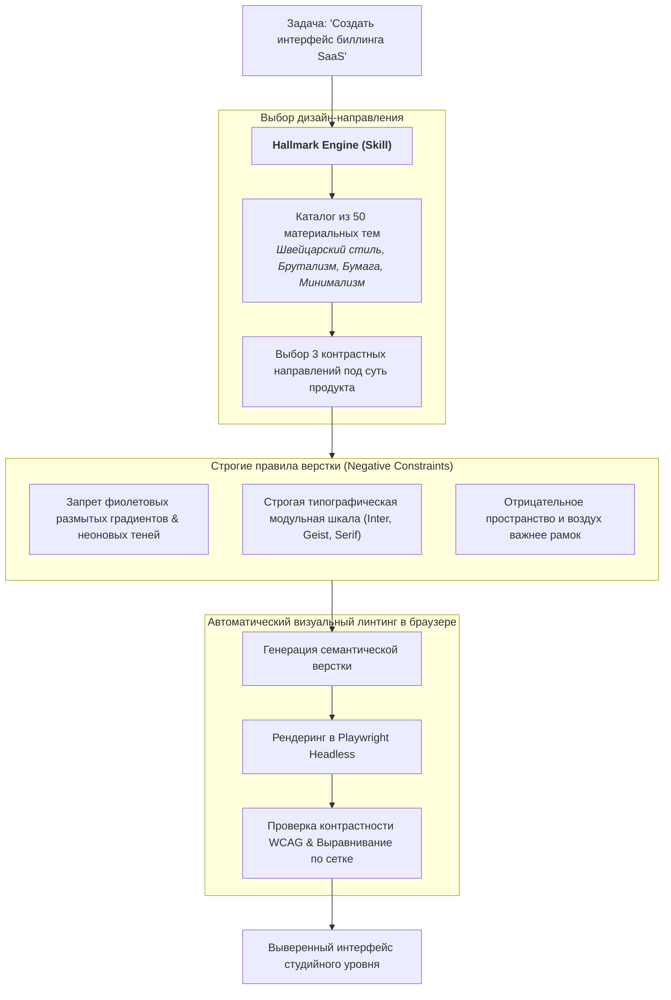

# 🎨 Hallmark: Дизайн-система от Together AI против шаблонного «AI Slop»

> **Ссылка на репозиторий:** [https://github.com/Nutlope/hallmark](https://github.com/Nutlope/hallmark)  
> **Официальный портал:** [https://usehallmark.com](https://usehallmark.com)  
> **Автор:** Hassan El Mghari (Nutlope / Together AI)  
> **Категория:** `02_agent_runtimes_and_harnesses`  
> **Звёзды GitHub:** 44,200+ ★ (#3 Weekly в мировых трендах GitHub, +10,582 ★ за неделю)  
> **Стек:** CSS, Tailwind CSS, TypeScript, Playwright (Headless Browser Linter), Claude Code Skill  
> **Лицензия:** MIT  

---

## 🎯 1. В чем проблема типичного дизайна от AI-ассистентов?

С появлением вайб-кодинга интернет заполнился тысячами однотипных интерфейсов, которые мгновенно считываются как сгенерированные машиной:
1. **Визуальные клише «AI Slop»:** Одинаковые фиолетово-синие градиенты, светящиеся рамки (glow), бессмысленные эмодзи в заголовках, случайные радиусы скруглений и перегруженные декоративные тени.
2. **Игнорирование сценария пользователя:** Агент начинает верстку с украшательств, забывая о цели визита человека на страницу.
3. **Отсутствие визуальной иерархии:** Все элементы кричат одинаковой яркостью, создавая когнитивный шум.

**Hallmark устанавливает жесткий стандарт («Hard Floor») взрослого продуктового дизайна:**

---

## ⚡ 2. Ключевые принципы Hallmark

1. **50 материальных тем (Fifty Material Themes):** Вместо выдуманных на ходу цветов агент выбирает темы, вдохновленные реальными физическими материалами: бумага, матовый металл, чернила, швейцарская типографика.
2. **Автоматический браузерный аудит:** Hallmark запускает безголовый браузер, делает скриншот и проверяет отступы, контрастность шрифтов и адаптивность для мобильных экранов.
3. **Фокус на конверсии и действии:** Интерфейс строится вокруг основного целевого действия пользователя (CTA), а не декораций.

---

## 💡 3. Главные инженерные выводы

1. **Дизайн-навыки должны задавать негативные ограничения:** Запрет плохих практик для LLM важнее бесконечных позитивных инструкций.
2. **Визуальный линтинг кодом закрывает разрыв между идеей и рендером:** Тестирование сгенерированного CSS в реальном браузере предотвращает визуальные дефекты верстки.
