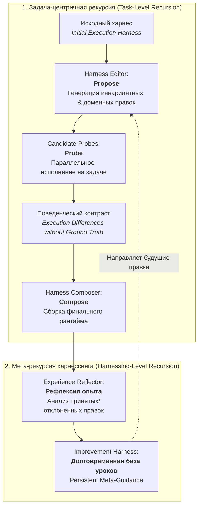
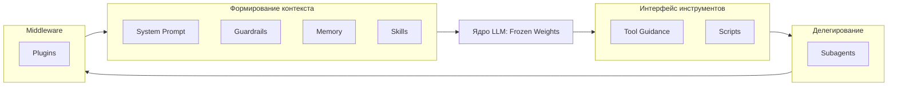
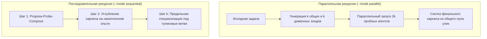

# 🤖 Harness²: Рекурсивный харнес автономных агентов для открытого мира от Google Research

> **Ссылка на репозиторий:** [https://github.com/google-research/harness2](https://github.com/google-research/harness2)  
> **Научная статья:** [arXiv:2610.14224](https://arxiv.org/abs/2610.14224) (*Recursive Agent Harnessing for an Open World*)  
> **Официальный портал проекта:** [https://harness2.github.io](https://harness2.github.io)  
> **Авторы:** Google Research  
> **Категория:** `02_agent_runtimes_and_harnesses`  
> **Звёзды GitHub:** 2,300+ ★ (#1 в мировом Daily топе Trendshift, +1,193 ★ за сутки)  
> **Поддерживаемые рантаймы-исполнители:** OpenCode · Codex CLI · Vertex AI / Gemini 3.5 Flash · GLM-5  
> **Лицензия:** Apache 2.0  

---

## 🎯 1. В чем фундаментальный прорыв Harness²?

В современной AI-инженерии существует терминологическое различие:
* **Модель (Model):** «сырая» нейросеть (веса LLM), преобразующая последовательность входных токенов в выходные токены.
* **Харнес (Harness):** целостная среда вокруг модели, превращающая её в функционального агента: системные промпты, контракты инструментов, барьеры безопасности (guardrails), память, набор навыков (skills), субагенты, скрипты и плагины.
* **Харнессинг (Harnessing):** процесс проектирования и оптимизации этой внешней среды.

### Главный парадокс открытого мира (Open World):
Традиционные агентные системы проектируются статически: инженер пишет фиксированный промпт и жестко задает инструменты под известные тестовые сценарии. Однако в реальном открытом мире агент сталкивается с задачами, распределение которых принципиально отличается от того, что видел создатель харнеса.

Дообучение весов (Fine-tuning / RL) для каждой новой задачи невозможно: это долго, астрономически дорого и приводит к катастрофическому забыванию (catastrophic forgetting).

**Harness² решает эту проблему через двухуровневую рекурсию без изменения весов модели:**
1. Веса базовой модели остаются **100% замороженными (Frozen Weights)**.
2. Система **рекурсивно переписывает и адаптирует саму себя (свой харнес)** под конкретную задачу через контрастный поиск и накопление мета-опыта.

---

## 🏗️ 2. Двухуровневая архитектура рекурсии

Harness² разделяет процесс рекурсивной оптимизации на два взаимосвязанных контура:



### 1. Задача-центричная рекурсия (Task-Level Recursion: Propose–Probe–Compose)
Оптимизирует харнес прямо в процессе решения текущей задачи:
* **Propose (Предложение):** редактор харнеса (`Harness Editor`) генерирует кандидатов правок двух типов:
  * *Инвариантные правки (Invariant edits):* общие улучшения самопроверки, декомпозиции и валидации вывода.
  * *Доменные правки (Domain edits):* специализированные инструкции и скрипты под конкретную предметную область задачи.
* **Probe (Зондирование):** кандидатные харнесы запускаются параллельно на той же задаче. Агент действует **без знания эталонного ответа (Ground-Truth)**, фиксируя траектории вызовов инструментов и промежуточные результаты.
* **Compose (Композиция):** композитор харнеса (`Harness Composer`) сопоставляет контрасты в поведении зондов, выявляет паттерны ошибок и синтезирует финальный очищенный харнес задачи.

### 2. Мета-рекурсия харнессинга (Harnessing-Level Recursion)
Переносит опыт между несвязанными задачами:
* Модуль `Experience Reflector` анализирует историю успешных композиций и причин отклонения неудачных кандидатов.
* Обновляется персистентный **харнес улучшений (Improvement Harness)** — мета-база знаний и правил, которая в дальнейшем обучает `Harness Editor` предлагать более точные правки на будущих задачах.

---

## 🧩 3. Восемь редактируемых компонентов харнеса

Harness² формализует окружение модели в виде восьми дискретных компонентов, сгруппированных по их системной роли в цикле работы агента:

| Роль в рантайме | Компонент | Что контролирует и оптимизирует |
|:---|:---|:---|
| **Формирование контекста**<br>*(Context Construction)* | **System Prompt** | Базовая персона, директивы reasoning-цикла, язык и тон ответа. |
| | **Guardrails** | Барьеры безопасности: запреты деструктивных команд, валидация гипотез. |
| | **Memory** | Долговременный контекст: извлечение релевантных фактов и предыдущих сессий. |
| | **Skills** | Каталог процедурных навыков (по стандарту Agent Skills): шаблоны, чеклисты. |
| **Интерфейс инструментов**<br>*(Tool Interface)* | **Tool Guidance** | Спецификации аргументов, подсказки по вызову API, обработка крайних случаев. |
| | **Scripts** | Детерминированные локальные Python/Bash утилиты, выполняющие рутину за агента. |
| **Делегирование**<br>*(Delegation)* | **Subagents** | Топология субагентов: разделение труда, запуск исследователей и ревьюеров. |
| **Middleware**<br>*(Interception)* | **Plugins** | Перехватчики ввода/вывода, хуки мониторинга контекста и квот. |



---

## 📈 4. Масштабирование рекурсии: Parallel vs Sequential

Harness² позволяет масштабировать вычислительный бюджет задачи ($k$) двумя способами:



1. **Параллельный режим (`--mode parallel`):**
   * Генерирует $k$ общих и $k$ доменно-специфичных зондов.
   * Запускает их параллельно в изолированных песочницах.
   * Композитор получает широкий поведенческий срез и сразу видит тупиковые стратегии.
2. **Последовательный режим (`--mode sequential`):**
   * Проводит $k$ последовательных итераций уточнения.
   * Каждая следующая итерация отталкивается от артефактов и ошибок предыдущей, что критично для многочасовых исследовательских и юридических задач.

---

## 📊 5. Результаты на бенчмарках

В исследовании Google Research (arXiv:2610.14224) фреймворк тестировался на трех сложнейших профессиональных бенчмарках с моделями **Gemini 3.5 Flash** и **GLM-5**:

| Бенчмарк | Предметная область | Базовый харнес | С одним шагом Harness² | Прирост |
|:---|:---|:---:|:---:|:---:|
| **WorkBuddy-Bench** | Офисные задачи, веб и сложный кодинг | 48.2 | **59.7** | **+11.5 пунктов** |
| **JobBench** | Реальные кейсы профессионального найма | 54.1 | **58.6** | **+4.5 пунктов** |
| **LAB (Legal Benchmark)** | Юридический анализ и правовые заключения | 61.3% (partial) | **73.1%** | **+11.8% pass rate** |

*Главный вывод авторов:* прирост от оптимизации внешней обвязки (харнеса) сопоставим с переходом на модель следующего поколения, при этом не требует затрат на обучение.

---

## ⚡ 6. Быстрый старт и запуск

### 1. Локальный демо-режим (без API-ключей):
Harness² содержит детерминированный локальный демо-стенд с реальным исполнением Python-кода:
```bash
# Клонирование и настройка через uv
git clone https://github.com/google-research/harness2.git
cd harness2
uv venv --python 3.12 .venv
source .venv/bin/activate
uv pip install -e '.[render]'

# Запуск локального демо с бюджетом k=2
harness2-demo --output runs/demo --k 2
```

### 2. Запуск на профессиональных бенчмарках с реальными моделями:
```bash
# Настройка бенчмарка LAB (Legal)
harness2-setup lab
harness2-check --bench lab

# Запуск параллельной рекурсии на юридическом домене
harness2 --bench lab --k 1 --mode parallel \
  --only-domains antitrust-competition --max-tasks 1

# Судейская оценка и генерация отчета
harness2-judge --bench lab --k 1 --mode parallel
harness2-report --bench lab --k 1 --mode parallel
```

---

## 💎 7. Значение для нашей базы знаний

Появление `harness2` завершает концептуальную триаду агентной инженерии в нашей базе заметок:
1. **Рантаймы исполнения:** [`docker-agent.md`](file:///home/blackzeshi/Documents/Notes/02_agent_runtimes_and_harnesses/docker-agent.md) и [`space.md`](file:///home/blackzeshi/Documents/Notes/05_security_osint_and_guardrails/space.md) дают изолированные микро-ВМ Firecracker и OCI-песочницы.
2. **Официальные навыки и плагины:** [`claude-plugins-official.md`](file:///home/blackzeshi/Documents/Notes/02_agent_runtimes_and_harnesses/claude-plugins-official.md) и [`android/skills`](https://github.com/android/skills) стандартизируют интерфейс инструментов.
3. **Рекурсивная самооптимизация:** [`harness2.md`](file:///home/blackzeshi/Documents/Notes/02_agent_runtimes_and_harnesses/harness2.md) объясняет, как заставить агента самостоятельно эволюционировать в среде открытого мира без переобучения весов.

---
*Конспект подготовлен для базы знаний Antigravity Notes • Дата фиксации: 18 октября 2026*
