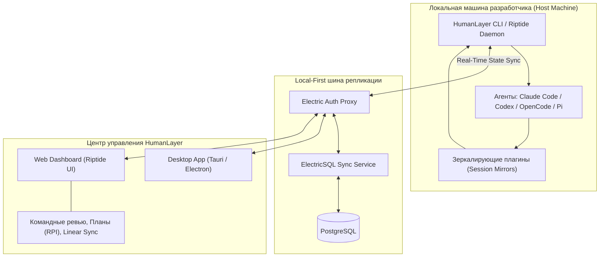
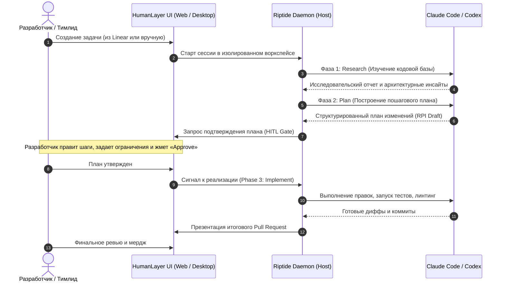

# 🕹️ HumanLayer: Единый центр управления и Human-in-the-Loop оркестрации автономных кодинг-агентов

> **Ссылка на репозиторий:** [https://github.com/humanlayer/humanlayer](https://github.com/humanlayer/humanlayer)  
> **Официальный сайт:** [https://humanlayer.dev](https://humanlayer.dev)  
> **Разработчик:** HumanLayer Inc.  
> **Категория:** `02_agent_runtimes_and_harnesses`  
> **Звёзды GitHub:** 12,200+ ★ (#5 Daily в мировых трендах GitHub, +395 ★ за сутки)  
> **Поддерживаемые агенты:** Claude Code · OpenAI Codex CLI · OpenCode · Pi  
> **Стек:** TypeScript, Bun, Turborepo, ElectricSQL (Local-First sync), oRPC, Hono, Tauri, Electron, React  
> **Лицензия:** Apache 2.0  

---

## 🎯 1. В чем проблема параллельной работы кодинг-агентов в команде?

С появлением мощных автономных терминальных кодинг-агентов (Claude Code, Codex, OpenCode) инженерные команды столкнулись с кризисом масштабирования:

1. **Хаос разрозненных терминальных сессий:** Если у разработчика или команды параллельно запущено 5–10 агентов, отслеживать их прогресс, открытые ветки и текущие задачи через отдельные вкладки терминала становится невозможно.
2. **Отсутствие прозрачного Human-in-the-Loop (HITL):** Агенты либо требуют постоянного присутствия человека у терминала для подтверждения каждого `bash`-вызова, либо работают в режиме полного автопилота с риском затереть рабочие файлы или задеплоить непроверенные изменения.
3. **Разрыв между планированием и исполнением:** Архитектурный план, исследовательские заметки и тикеты в трекере (Linear/Jira) живут отдельно от терминальной сессии агента.
4. **Сложность совместной работы (Team Steering):** Невозможно делегировать агента коллеге, расшарить текущее состояние выполнения задачи или централизованно просмотреть диффы всех активных агентов команды.

**HumanLayer решает эту задачу, превращая локальные терминальные агенты в управляемый командный флот:** он запускает агентов на машинах разработчиков, синхронизирует сессии в реальном времени через Local-First шину данных и предоставляет единый центр управления (Web, Desktop, TUI) с удобным интерфейсом ревью планов и диффов.



---

## 🏗️ 2. Архитектура и структура монорепозитория

HumanLayer реализован как высокопроизводительный монорепозиторий на **Bun** и **Turborepo**, объединяющий фронтенд, фоновые демоны, десктопные оболочки и типизированные контракты RPC:

| Модуль / Путь | Назначение и стек | Ключевые функции |
|:---|:---|:---|
| `apps/riptide-daemon` | Фоновый демон на локальной машине (Bun/Node) | Запускает и оркестрирует локальные агентные сессии, перехватывает stdin/stdout, мониторит состояние хоста. |
| `apps/cli` | Основной терминальный CLI `humanlayer` | Точка входа для запуска сессий, управления воркспейсами и инициализации демона. |
| `apps/riptide-ui` | Универсальный веб-интерфейс на React / Tailwind | Интерфейс управления задачами, просмотра live-транскриптов, графов сессий и валидации диффов. |
| `apps/riptide-native` / `riptide-electron` | Десктопные клиенты для macOS / Windows / Linux | Нативные обертки над UI на **Tauri (Rust)** и **Electron** с системными уведомлениями и хоткеями. |
| `apps/riptide-electric-proxy` | Аутентификационный прокси к ElectricSQL | Безопасная Local-First репликация между клиентами и PostgreSQL с поддержкой оффлайн-режима. |
| `apps/riptide-api` | Бэкенд API на базе **oRPC + Hono** | Управление организациями, инвайтами, правами доступа и персистентными настройками. |
| `apps/riptide-*-plugin` | Плагины интеграции для Claude Code, OpenCode, Pi | Зеркалируют активность сторонних CLI-агентов в дашборд HumanLayer в реальном времени. |
| `apps/riptide-rpi-claude-plugin` | Навык Research-Plan-Implement (RPI) | Формализует строгую методологию: исследование -> план -> утверждение человеком -> реализация. |
| `apps/linear-cli` | Двусторонняя интеграция с Linear | Автоматическая привязка тикетов, обновление статусов задач и фиксация ссылок на PR. |
| `contracts/` | oRPC и Effect RPC контракты | Строго типизированные схемы взаимодействия микросервисов и клиентов. |

---

## 🔄 3. Цикл работы: Пайплайн Research-Plan-Implement (RPI)

HumanLayer внедряет дисциплинированный рабочий процесс **RPI**, предотвращающий слепой вайб-кодинг:



---

## ⚡ 4. Local-First репликация через ElectricSQL

Ключевое архитектурное преимущество HumanLayer перед традиционными веб-дашбордами — **Local-First архитектура**:
* Разработчик работает на локальной машине с минимальной сетевой задержкой.
* Благодаря связке **PostgreSQL + ElectricSQL** все события, логи терминалов, диффы и статусы сессий реплицируются мгновенно между всеми участниками команды.
* Если пропал интернет, агент продолжает работать локально под управлением `riptide-daemon`, а при восстановлении связи состояние прозрачно синхронизируется с облаком без конфликтов.

---

## 🛡️ 5. Сравнение платформ управления кодинг-агентами

| Критерий | HumanLayer | Paperclip | Docker Agent | Сырой терминал (Raw CLI) |
|:---|:---|:---|:---|:---|
| **Подход к управлению** | **Централизованный флот + HITL** | Виртуальная компания / агенты-сотрудники | OCI-контейнеры и песочницы | Индивидуальный ручной ввод |
| **Поддержка агентов** | Claude Code, Codex, OpenCode, Pi | Claude 3.5, локальные модели | Docker AI CLI | Один конкретный инструмент |
| **Синхронизация состояния** | **Local-First (ElectricSQL)** | Web API / БД | OCI Runtime телеметрия | Отсутствует (локальный TTY) |
| **Интерфейс** | Desktop (Tauri/Electron) + Web + CLI | Web App дашборд | CLI / Docker Desktop | Только терминал |
| **Human-in-the-Loop** | Встроенный гейт утверждения планов RPI | Ролевые согласования | Контейнерные политики | Блокирующий ввод в stdin |
| **Трекинг задач** | Нативная синхронизация с Linear | Внутренние таски | Нет | Нет |

---

## 🚀 6. Быстрый старт и запуск локального стека

Для запуска полного стека требуются **Bun**, **Docker** и (для сборки нативного десктопа) **Rust**:

```bash
# Клонирование репозитория
git clone https://github.com/humanlayer/humanlayer.git
cd humanlayer

# Установка зависимостей на Bun
bun install
cp .env.example .env

# Проверка типов и запуск тестов
bun --bun run typecheck
bun run test

# Запуск полного локального девстека (БД, Electric, API, UI)
bun --bun run devstack help
bun --bun run devstack up
```

### Привязка к Claude Code:
Плагин `apps/riptide-claude-code-plugin` подключается к локальному Claude Code и начинает автоматически транслировать сессии в интерфейс HumanLayer:

```bash
# Установка CLI
bun install -g @humanlayer/cli

# Инициализация хост-демона
humanlayer daemon start

# Запуск сессии с привязкой к задаче
humanlayer run --agent claude-code --task "Refactor auth middleware to oRPC"
```

---

## 💡 7. Главные инженерные выводы

1. **Конец эпохи «один агент в одном окне терминала»:** С ростом сложности задач неизбежен переход к многоагентным флотам, где человек выступает дирижером и валидатором, а не оператором ввода.
2. **Local-First — идеальный паттерн для кодинг-инструментов:** Использование ElectricSQL гарантирует нулевую задержку пользовательского интерфейса, оффлайн-устойчивость и надежную командную синхронизацию.
3. **Методология RPI снижает галлюцинации и лишние затраты:** Принудительное разделение на фазы Research, Plan (с утверждением человеком) и Implement предотвращает неконтролируемое переписывание кодовой базы и экономит токены.
