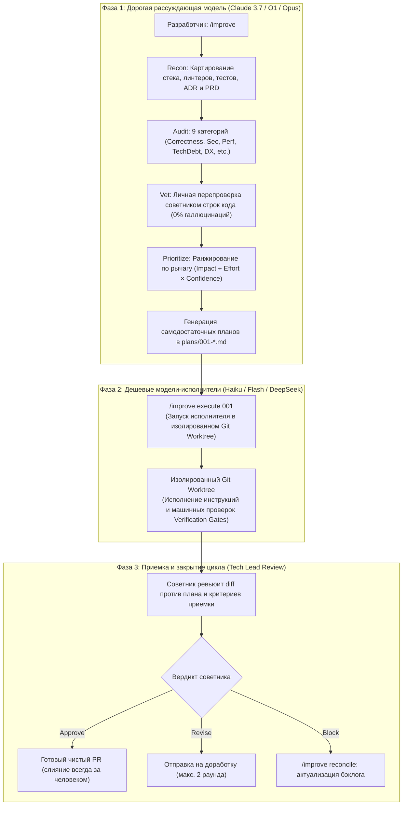

# 🧠 shadcn /improve: Архитектурный агентный навык аудита и спецификации кодовой базы

> **Ссылка на репозиторий:** [https://github.com/shadcn/improve](https://github.com/shadcn/improve)  
> **Автор:** shadcn (создатель культовой дизайн-экосистемы `shadcn/ui`)  
> **Категория:** `02_agent_runtimes_and_harnesses`  
> **Звёзды GitHub:** 10,100+ ★ (+426 ★ за сутки)  
> **Стек:** Агентный навык (`SKILL.md`), Markdown-планы (`plans/`), Git Worktrees, CLI (`npx skills add shadcn/improve`)  
> **Лицензия:** MIT  

---

## 🎯 1. В чём идея: Архитектура Split-Brain («Умный советник — дешевый рабочий»)

В традиционной агентной разработке разработчики допускают одну из двух крайностей:
1. **Поручают всё дешевым моделям:** Модель (Haiku, Flash, DeepSeek V3) не способна удержать архитектурный контекст крупного репозитория, плодит костыли, ломает смежные модули и не видит долгосрочный техдолг.
2. **Поручают всё флагманским рассуждающим моделям:** Использование Claude 3.7 Sonnet / Opus или OpenAI O1 для рутинного написания кода, компиляции и прогона линтеров сжигает сотни долларов за день.

### Манифест shadcn:
> *"Use your most capable model for the part where intelligence compounds — understanding the codebase, judging what's worth doing, writing the spec — and hand execution to cheaper models. The skill never implements anything itself. The plan is the product."*  
> *(«Используйте самую умную модель там, где интеллект масштабируется — понимание кодовой базы, оценка приоритетов, написание спецификаций — а само исполнение передайте дешевым моделям. Навык никогда не пишет код сам. План — это и есть готовый продукт»)*.



---

## ⚡ 2. Шестифазный конвейер работы навыка

Навык делит процесс рефакторинга на строгие детерминированные этапы:

1. **Recon (Разведка окружения):** Анализирует стек, точные команды сборки/тестов (`npm test`, `cargo clippy`, `pytest`), а также архитектурные решения компании (`docs/adr/`, `PRD`, `CONTEXT.md`, `DESIGN.md`). Благодаря этому советник говорит на языке вашего проекта и не предлагает отвергнутые архитектурные паттерны.
2. **Audit (Параллельный аудит по 9 категориям):** Запускает параллельных агентов по 9 направлениям:
   * `Correctness` (корректность)
   * `Security` (безопасность)
   * `Performance` (производительность)
   * `Test coverage` (покрытие тестами)
   * `Tech debt` (технический долг)
   * `Dependencies & migrations` (зависимости)
   * `DX` (удобство разработки)
   * `Docs` (документация)
   * `Direction` (продуктовые предложения на основе кодовой базы).
3. **Vet (Строгая верификация):** Советник сам перечитывает каждое указанное агентами место (`file:line`), отсекая ложные срабатывания и галлюцинации.
4. **Prioritize (Ранжирование по рычагу):** Вычисляет коэффициент полезного действия задачи:
   $$\text{Leverage} = \frac{\text{Impact}}{\text{Effort}} \times \text{Confidence}$$
5. **Plan (Генерация самодостаточных планов):** Создает файлы в каталоге `plans/`. Каждый план содержит:
   * Выдержки из актуального кода (inlined snippets) и хэш коммита для проверки дрифта.
   * **Verification Gates:** Машинно-верифицируемые команды проверки результата (исполнитель не должен «гадать», решил ли он задачу).
   * **Hard Boundaries & STOP Conditions:** Четкие рамки не-вмешательства («если условие X неверно, остановись и доложи»).
6. **Execute & Reconcile (Исполнение и актуализация):**
   * `/improve execute <plan>` — запускает дешевого субагента в изолированном `git worktree`.
   * `/improve reconcile` — проверяет статус внедренных планов, разблокирует застрявшие и удаляет потерявшие актуальность.

---

## 🛡️ 3. Железные правила безопасности (Hard Rules)

* **Никаких прямых правок исходного кода советником:** Единственная папка, куда навык имеет право писать в вашей основной ветке — это `plans/`.
* **Изолированные Git Worktrees:** Исполнители вносят правки только в одноразовых изолированных рабочих деревьях Git. Финальное слияние (merge) всегда остается за человеком.
* **Нулевая утечка секретов:** Навык распознает типы учетных данных, но никогда не копирует их значения в планы, предлагая ротацию.

---

## 💻 4. Быстрый старт и команды

### Установка в агентную среду
```bash
npx skills add shadcn/improve
```

### Основные сценарии вызова
* `/improve` — полный архитектурный аудит кодовой базы, формирование таблицы находок и генерация выбранных планов.
* `/improve quick` — экспресс-проход по горячим точкам и узким местам без лишних затрат.
* `/improve security` — сфокусированный аудит на уязвимости, SSRF, утечки памяти и права доступа.
* `/improve branch` — экспресс-ревью диффа текущей ветки перед открытием Pull Request.
* `/improve execute 001` — делегирование исполнения плана `plans/001-*.md` дешевой модели в изолированном ворктри.
* `/improve reconcile` — автоматическая синхронизация бэклога планов с состоянием репозитория.

---

## 💡 5. Главные инженерные выводы

1. **Разделение планирования и исполнения экономит до 90% бюджета:** Дорогие модели должны думать, дешевые — реализовывать детерминированные шаги.
2. **Спецификация как главный интерфейс человека и AI:** Самодостаточный план в Markdown с машинными гейтами верификации исключает хаос «слепого вайб-кодинга».
3. **Безопасность через Git Worktrees:** Изоляция правок агента в отдельных рабочих деревьях защищает основную кодовую базу от случайных повреждений.
