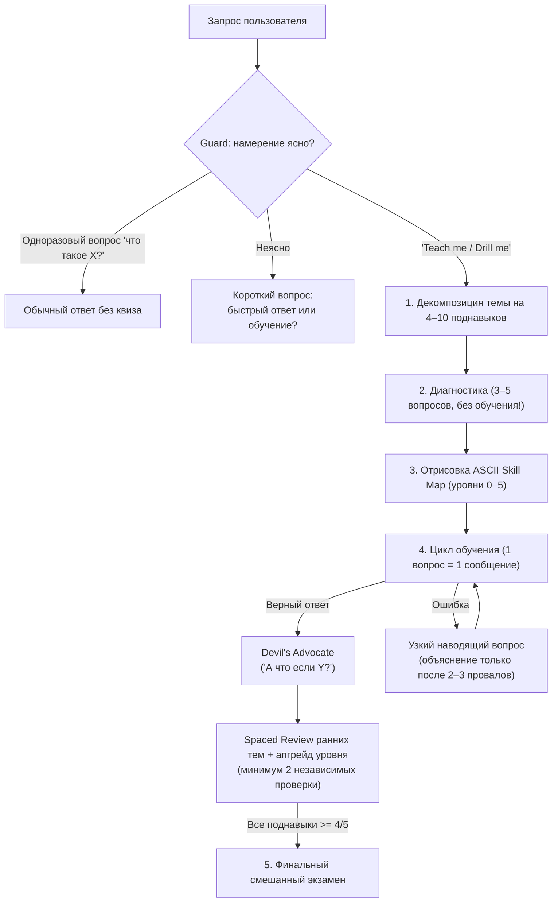

# 🎓 Jane Street Agent Skills: Сократический репетитор без лести и спойлеров

> **Ссылка на репозиторий:** [https://github.com/janestreet/agent_skills](https://github.com/janestreet/agent_skills)  
> **Организация:** Jane Street  
> **Категория:** `02_agent_runtimes_and_harnesses`  
> **Звёзды GitHub:** 7,500+ ★ (+1,745 ★ за сутки)  
> **Стек:** Переносимый формат `SKILL.md` (подходит для кодинг-агентов и обычных чат-ботов через system prompt)  
> **Лицензия:** MIT (вклад принимается по DCO `Signed-off-by`)

---

## 🎯 1. Зачем ещё один обучающий промпт и почему он выстрелил

Обычные LLM-тьюторы страдают от двух пороков: **сикофантии (лести)** (*«Отличная попытка! Вы почти угадали!»*) и **преждевременных лекций**, когда модель сама выдаёт готовый ответ вместо того, чтобы заставить ученика думать.

Инженеры **Jane Street** выложили лаконичный, предельно жёсткий скилл **`socratic-tutor`**, который превращает любую сильную LLM в строгого майевтического преподавателя, доводящего пользователя до реального владения темой, а не до иллюзии понимания.

---

## ⚙️ 2. Пятифазная механика `socratic-tutor`



### Ключевые правила дизайна промпта
1. **Защита от ложного старта (Guard):** если пользователь просто спросил *«объясни X»*, скилл не навязывает многоходовую викторину, а либо отвечает нормально, либо уточняет намерение одной фразой.
2. **Один вопрос — точка:** модель обязана завершить сообщение сразу после вопроса — никаких подсказок, намёков, примеров ответа или мини-лекций в хвосте.
3. **Запрет на лесть и додумывание:** фраза *«Not quite — why would X happen if Y were true?»* вместо *«Great try!»*. Частичный или расплывчатый ответ не засчитывается; модель не приписывает ученику инсайты, которые тот не сформулировал явно.
4. **Строгая система уровней (0–5) и карта прогресса:**
   * `0` — незнакомо, `1` — слышал, `2` — может следить за мыслью, `3` — решает с помощью, `4` — решает самостоятельно, `5` — может научить другого и обрабатывает edge-кейсы / состязательные вопросы.
   * Повышение уровня требует **2+ независимых проверок**, причём минимум одна — отложенное припоминание без подсказки (*spaced review*).

```text
Topic: <topic>                          overall: ######.... 58%
-----------------------------------------------------------------
subskill A            [########..]  4/5  * independent
subskill B            [######....]  3/5  <- current focus
subskill C            [##........]  1/5
-----------------------------------------------------------------
```

5. **Практические задания в агентной среде:** если у агента есть доступ к терминалу или инструментам, тьютор ставит реальные упражнения (*«напиши запрос...»*, *«предскажи вывод кода»*) и проверяет фактический результат исполнения, а не пересказ пользователя.

---

## 💻 3. Команды управления сессией и использование

Во время обучения пользователь в любой момент может управлять режимом:
* `show progress` — вывести актуальную ASCII-карту навыков;
* `harder` / `easier` — изменить сложность вопросов;
* `just tell me` — разово отключить сократический режим для текущего вопроса;
* `save state` / `resume from:` — сериализовать карту навыков, пробелы и пройденное в компактный текстовый блок для переноса в новую сессию.

### Установка
* В кодинг-агенте: скопировать каталог `socratic-tutor/` в папку скиллов (`.agents/skills/`, `.claude/skills/` и т.д.).
* В обычном чат-боте: вставить тело `socratic-tutor/SKILL.md` в system/custom prompt.

---

## 💡 5. Главные инженерные выводы

1. **Плотность правил бьёт объём промпта:** весь `socratic-tutor/SKILL.md` занимает ~120 строк, но закрывает все классические провалы LLM-обучения (спойлеры, сикофантию, преждевременное повышение оценки, потерю состояния между сессиями).
2. **Сериализация состояния (`save state`) прямо в тексте** — элегантный способ сделать переносимую долговременную память для скилла, не привязанного к конкретной БД или IDE.
3. **Обязательный Guard на входе** должен быть стандартом для любых агрессивных поведенческих скиллов, чтобы не ломать UX на коротких справочных запросах.
