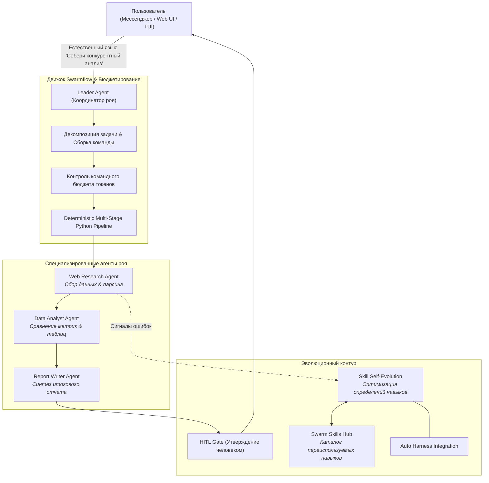

# 🐝 JiuwenSwarm: Интеллектуальный рой автономных агентов для решения составных задач через мессенджеры

> **Ссылка на репозиторий:** [https://github.com/openJiuwen-ai/jiuwenswarm](https://github.com/openJiuwen-ai/jiuwenswarm)  
> **Официальный сайт:** [https://openjiuwen.com/en/](https://openjiuwen.com/en/)  
> **Swarm Skills Hub:** [https://swarmskills.openjiuwen.com/](https://swarmskills.openjiuwen.com/)  
> **Разработчик:** OpenJiuwen AI Community  
> **Категория:** `02_agent_runtimes_and_harnesses`  
> **Звёзды GitHub:** 8,700+ ★ (#2 Daily в мировых трендах GitHub, +743 ★ за сутки)  
> **Платформы:** Windows, macOS, Linux, HarmonyOS PC · Web UI (Vite/React) · TUI · Чат-боты  
> **Стек:** Python 3.11+, uv, FastAPI, WebSockets, Textual (TUI), React  
> **Лицензия:** Apache 2.0  

---

## 🎯 1. В чем проблема классических мультиагентных систем?

Большинство существующих агентных фреймворков (CrewAI, AutoGen, ChatDev) страдают от трех системных болезней:
1. **Бесконечные круговые диалоги (Agent Chatter):** Агенты тратят десятки тысяч токенов на вежливые переписки друг с другом («Спасибо!», «Отличный план!», «Приступаю к работе»), не приближаясь к решению инженерной задачи.
2. **Сложность управления нетехническими пользователями:** Чтобы поставить задачу рою, пользователю приходится запускать сложные Python-скрипты в консоли. Нет нативного доступа через каналы, где люди реально общаются (Slack, Telegram, Discord, WeChat).
3. **Хрупкость навыков и отсутствие эволюции:** Если инструмент изменил схему API или вернул неожиданный ответ, агент застревает в цикле ошибок. Навыки статичны и не умеют самообучаться на прошлых неудачах.

**JiuwenSwarm предлагает прагматичную альтернативу:**
* **Топология Leader–Teammates:** Лидер декомпозирует намерение пользователя, формирует проектную команду специализированных агентов и строго контролирует бюджет токенов.
* **Детерминированные процессы Swarmflow:** Жесткие пайплайны на Python со встроенными точками согласования с человеком (**HITL**).
* **Самоэволюция навыков (Skill Self-Evolution):** Автоматическая детекция ошибок и доработка определений навыков без дообучения весов модели.
* **Доставка прямо в руки:** Доступ через один установщик на ПК, веб-интерфейс, терминальный TUI или рабочие мессенджеры.



---

## 🏗️ 2. Ключевые архитектурные модули

| Модуль | Системная роль | Особенности реализации |
|:---|:---|:---|
| **Multi-Agent Swarm** | Распределенная координация агентов | Лидер динамически нанимает и распускает узкопрофильных воркеров; агенты могут выполняться на разных машинах кластера. |
| **Swarmflow** | Детерминированные конвейеры задач | Многоэтапные Python-скрипты; прогрессивное раскрытие инструментов (`swarmflow_progressive_tool`); командный лимит токенов. |
| **HITL Integration** | Человек в контуре управления | Встроенные примитивы `human` и `human_session` для паузы выполнения и запроса подтверждения действий. |
| **Skill Self-Evolution** | Автоматическая адаптация навыков | Анализирует трассировки ошибок и недовольство пользователя, переписывая промпты и контракты навыков. |
| **Swarm Skills Hub** | Каталог навыков | Облачный репозиторий готовых навыков: поиск, установка, ремикширование и публикация. |
| **Auto Harness** | Оптимизация рантайма | Интеграция с методологией рекурсивной оптимизации харнеса без обучения весов. |
| **Безопасность и политики** | Разграничение прав доступа | Обязательный интерактивный аппрув деструктивных команд, строгий whitelist путей файловой системы. |

---

## 🔄 3. Swarmflow: Совмещение гибкости агентов и детерминизма кода

Вместо хаотичного общения агентов в общем чате JiuwenSwarm использует концепцию **Swarmflow**:
1. Лидер транслирует пользовательскую задачу в детерминированный граф этапов.
2. На каждом этапе работает конкретный воркер, которому выдается **только необходимый минимум инструментов** (принцип прогрессивного раскрытия тулов), что снижает галлюцинации.
3. Команда ограничена общим лимитом токенов (`team token budget`) — если воркер зациклился, процесс принудительно останавливается и эскалируется человеку.
4. Разработчик может мониторить дерево исполнения в реальном времени через интерактивный TUI-экран `/swarmflows`.

```python
# Пример декларативного этапа Swarmflow с HITL
from workswarm import Swarmflow, Stage, AgentGroup

swarm = Swarmflow(
    name="SecurityAuditFlow",
    token_budget=150_000,
    stages=[
        Stage("recon", agent="ReconWorker", tools=["nmap_scan", "dns_lookup"]),
        Stage("vulnerability_analysis", agent="AppSecWorker", tools=["cve_search"]),
        Stage("human_approval", hitl=True, prompt="Подтвердите начало активного тестирования найденных CVE"),
        Stage("exploit_verification", agent="ExploitWorker", progressive_tools=True),
        Stage("reporting", agent="ReportWorker", template="markdown_report")
    ]
)
```

---

## 📊 4. Сравнение JiuwenSwarm с альтернативными мультиагентными фреймворками

| Параметр | JiuwenSwarm | CrewAI | Microsoft AutoGen | OpenAI Swarm |
|:---|:---|:---|:---|:---|
| **Управление процессом** | **Детерминированный Swarmflow + Python** | Последовательные / иерархические цепочки | Свободный групповой чат агентов | Простая передача управления (Handoffs) |
| **Интерфейсы** | **Desktop App, Web, TUI, Чат-боты** | Python скрипты, CLI | CLI, Web Studio (Studio UI) | Только код Python |
| **Эволюция навыков** | **Skill Self-Evolution + Auto Harness** | Нет (статические промпты) | Нет | Нет |
| **Контроль бюджета** | **Team Token Budget на уровне графа** | Ограничение итераций | Ограничение раундов | Ручной контроль |
| **HITL поддержка** | **Нативные примитивы `human` / `human_session`** | Ручной ввод в терминале | UserProxyAgent | Кастомная реализация |
| **Каталог навыков** | **Публичный Swarm Skills Hub** | Интеграция с LangChain Tools | Навыки в коде | Отсутствует |

---

## 🚀 5. Быстрый старт и установка

### 1. Десктопная версия:
Доступны готовые инсталляторы в один клик для Windows 10/11, macOS (Intel / Apple Silicon) и HarmonyOS PC на официальном портале [openjiuwen.com](https://openjiuwen.com/en/jiuwenswarm).

### 2. Установка через CLI (Python 3.11+):

```bash
# Установка пакета workswarm из PyPI
pip install workswarm

# Инициализация конфигурации
jiuwenswarm-init

# Запуск бэкенда и веб-интерфейса
jiuwenswarm-start
# Фронтенд открывается по адресу http://localhost:5173
```

### 3. Сборка из исходников:

```bash
git clone https://github.com/openJiuwen-ai/jiuwenswarm.git
cd jiuwenswarm
uv venv
uv pip install -e .
```

---

## 💡 6. Главные инженерные выводы

1. **Роевые агенты должны быть связаны строгим workflow:** Свободный чат агентов красив в демо, но непригоден в продакшене из-за сливов токенов и потери контекста. Swarmflow возвращает предсказуемость инженерных пайплайнов.
2. **Доступность через привычные мессенджеры:** Агентная система приносит максимальную пользу тогда, когда доступ к ней находится в одном клике в Slack, Telegram или Teams, а не скрыт за развертыванием локального терминала.
3. **Самоэволюция навыков — обязательный шаг к автономности:** Способность роя переписать неудачный навык после ошибки пользователя устраняет необходимость постоянного ручного промпт-инжиниринга.
