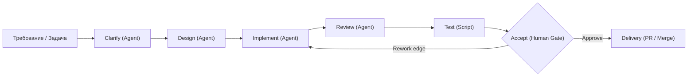

# ⚒️ Tencent LoopForge: Self-Hosted платформа доставки кода с coding-агентами и SOP-гейтами

> **Ссылка на репозиторий:** [https://github.com/Tencent/LoopForge](https://github.com/Tencent/LoopForge)  
> **Официальный сайт:** [https://loopforge.cn](https://loopforge.cn)  
> **Организация:** Tencent (Open Source)  
> **Категория:** `02_agent_runtimes_and_harnesses`  
> **Звёзды GitHub:** 765+ ★ (+174 ★ за сутки, GitHub Trending 2026-11-14)  
> **Стек:** Go (`agentflow`), React (`chatbot/`), MySQL, Docker, MCP, Python 3.8+ (`loopforge-cli`)  
> **Лицензия:** MIT

---

## 🎯 1. В чём проблема «одноразовых» запусков coding-агентов

Если просто попросить CLI-агента «почини этот баг», результат зависит от удачи конкретного прогона: агент может пропустить планирование, забыть тесты, проверить собственный код поверхностно или оборваться на середине. **LoopForge** решает это для командной разработки, оборачивая существующие CLI coding-агентов в воспроизводимый процесс от требования до PR/MR.

Платформа поддерживает **10 исполнителей (executors)** поверх вашей собственной инфраструктуры и ключей: **CodeBuddy, Codex, Claude Code, OpenCode, Cursor CLI, Antigravity, Kimi Code, Pi, DeepSeek Harness и ZCode**.

---

## 🏗️ 2. Два режима работы и архитектура SOP-графа



### 1. Chat with Main Bot (быстрые задачи и исследование)
* Диалоговый workbench, где через `@` подключаются роли, скиллы, требования, SOP и репозитории; для каждой беседы выбирается свой executor, модель и уровень прав.
* Поддерживает **очередь сообщений** и кнопку **Steer** для перенаправления агента на лету; поднимает **Conversation Workspace** (Docker-песочницу с нужными репо) и вызывает проектные роли как субагентов.

### 2. SOP-движок (повторяемая инженерная доставка)
* **Визуальный DAG-дизайнер** с узлами пяти типов: **Agent**, **Script**, **Human gate**, **Sub-SOP** и **Preview build** (сборка и архивирование статики для ревью).
* Узлы объявляют артефакты и зависимости; параллельные готовые ветки исполняются вместе, а при ошибке или отказе на Human gate предусмотрены **рёбра возврата на доработку (rework-on-failure)**.
* Изоляция через **Роли (Roles)**: планирование, реализация, ревью и тестирование получают отдельные промпты, модели, правила, Skills и MCP-инструменты.
* Единый инбокс **Needs review** собирает все гейты, ожидающие человека, с логами, трассами инструментов, снапшотами артефактов и расчётом токенов/стоимости.

### Внутренняя структура Go-бэкенда (модуль `agentflow`)

| Директория | Ответственность |
| :--- | :--- |
| `cmd/agentflow` | API-сервер, воркер или объединённый процесс |
| `cmd/agentflow-runner` | Персональные и пуловые машины исполнения (runners) |
| `cmd/agentflow-mcp`, `cmd/agentflow-gate-mcp` | Публичный MCP и структурированный вывод гейтов |
| `internal/engine` | Граф SOP, аренды (leases), планирование, жизненный цикл песочниц и доставка |
| `internal/repo` / `internal/httpapi` | Хранилище MySQL и HTTP/MCP-обработчики по доменам |
| `internal/runtime`, `internal/runner`, `internal/tracker` | Протоколы исполнителей, учёт секретов, артефакты и адаптеры GitHub/PR |

---

## 💻 3. LoopForge Local: встроенные SOP прямо в вашем CLI-агенте

Если не нужен сервер на Docker + MySQL, пакет **LoopForge Local** разворачивает встроенный DevFlow-цикл прямо внутрь вашего проекта:

```bash
# Установка локального рабочего цикла (например, для Claude Code)
npx -y loopforge-cli@latest install claude

# Запуск внутри ассистента
/start-devflow "описание задачи"
```

* **Classic Edition** (`loopforge install <host>`): полные нативные бандлы для CodeBuddy, Codex, Cursor и Claude Code.
* **Portable Edition** (`loopforge skills install <host>`): единая машина состояний в `skills/` на чистом Python 3.8+ stdlib с адаптерами также для **Pi, DeepSeek Harness и Hermes Agent**. Артефакты каждого шага складываются в `artifacts/{task_slug}/`.

---

## 🔗 4. Синергия с базой знаний

* **Связка с [HumanLayer](file:///home/blackzeshi/Documents/Notes/02_agent_runtimes_and_harnesses/humanlayer.md) и [Paperclip](file:///home/blackzeshi/Documents/Notes/02_agent_runtimes_and_harnesses/paperclip.md):** близкий класс HITL-оркестраторов, где LoopForge делает акцент на жёсткой графовой повторяемости SDLC (Agent + Script + Human gate + rework edges) и локальном CLI-пакете `loopforge-cli`.
* **Связка с [OpenSpec](file:///home/blackzeshi/Documents/Notes/02_agent_runtimes_and_harnesses/openspec.md) и [Spec Kit](file:///home/blackzeshi/Documents/Notes/02_agent_runtimes_and_harnesses/spec-kit.md):** LoopForge добавляет к spec-driven подходу полноценный серверный/локальный рантайм исполнения с изоляцией ролей и трассировкой доставки до PR.
