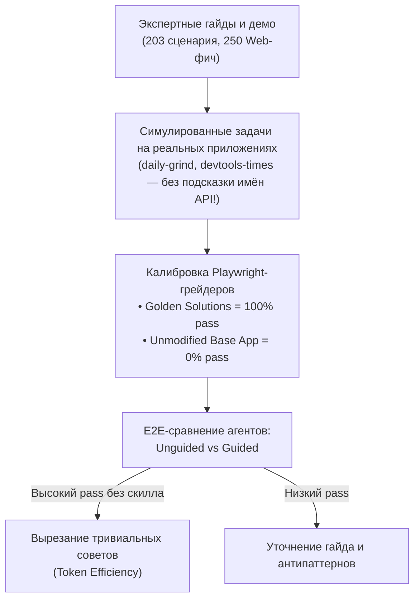

# 🌐 Modern Web Guidance: Веб-стандарты Chrome, Edge, Firefox и MDN внутри контекста кодинг-агентов

> **Ссылки на репозитории:** [GoogleChrome/modern-web-guidance](https://github.com/GoogleChrome/modern-web-guidance) (пакет скиллов) · [GoogleChrome/modern-web-guidance-src](https://github.com/GoogleChrome/modern-web-guidance-src) (исходники и eval-харнес)  
> **Авторы:** Команды **Google Chrome, Microsoft Edge, Mozilla Firefox и MDN**  
> **Категория:** `02_agent_runtimes_and_harnesses`  
> **Звёзды GitHub:** 6,900+ ★ (`+1,876 ★`) и 2,650+ ★ (`+910 ★` для `-src`)  
> **Стек:** CLI на TypeScript (`npx modern-web-guidance`), Markdown-гайды, Playwright Eval Harness  
> **Лицензия:** Apache-2.0 (код) · CC-BY 4.0 (документация и гайды)

---

## 🎯 1. Зачем это нужно: Лечение «легаси-инерции» LLM во фронтенде

Обучающие выборки LLM переполнены устаревшим веб-кодом 2015–2022 годов. Из-за этого кодинг-агенты по умолчанию генерируют тяжёлые JS-полифилы, хрупкие хаки позиционирования и недоступные кастомные виджеты там, где современная веб-платформа давно даёт нативные, быстрые и доступные API.

**Modern Web Guidance** — это не «справочник на сотни тысяч токенов», а компактный CLI-пакет скиллов, который подгружает в контекст агента ровно те паттерны, которые модели чаще всего забывают или применяют с ошибками.

---

## 📦 2. Содержимое и токен-бюджет

Пакет включает два модульных скилла (можно выбирать при установке флагом `--choose`):
* **`modern-web-guidance`** (~205 токенов в базовом описании): **250 фич веб-платформы** (140 CSS & Layout, 36 HTML & DOM, 74 JS & Web APIs) и **203 практических гайда** по 6 направлениям:
  * 🎨 **User Experience:** View Transitions (включая cross-document и scoped), `@starting-style`, entry/exit анимации, scroll-driven animations.
  * 📐 **CSS Layout:** Container Queries (size/style/scroll-state), `subgrid`, `oklch`, `light-dark()`, `text-wrap: balance/pretty`, `@scope`, `:has()`.
  * ⚡ **Performance:** диагностика INP, `scheduler.yield()`, `content-visibility`, Speculation Rules.
  * 📝 **Forms & UI:** Anchor Positioning, Popover API, `<dialog>`, `:user-invalid`, `field-sizing`, кастомизируемый `<select>`, HTML `switch`.
  * ♿ **Accessibility:** синхронизация `aria-invalid` с `:user-invalid`, доступный generated content, учёт системного масштаба текста.
  * 🤖 **Built-in AI:** локальные клиентские браузерные API (`Translator`, `LanguageDetector`, `Summarizer`, `LanguageModel` / Prompt API).
* **`chrome-extensions`** (~175 токенов): Manifest V3, service workers, API расширений и публикация в Chrome Web Store.

---

## 🧪 3. Замкнутый конвейер Evals и измеренный прирост качества

Ключевая особенность проекта в репозитории `modern-web-guidance-src` — **автоматическая калибровка полезности каждого гайда**. Если LLM уже стабильно решает задачу без подсказки, лишний совет удаляют из гайда ради экономии токенов; если агент ошибается — гайд дорабатывают.



### Результаты E2E-оценки (ноябрь 2026, ~215 задач / ~1795 проверок Playwright)

| Агент и модель | Unguided → Guided | Прирост (Uplift) |
| :--- | :---: | :---: |
| **Antigravity CLI** (`gemini-4-argon`) | `58% → 94%` | **+36 п.п.** |
| **Claude Code** (`opus-5-5`) | `57% → 88%` | **+31 п.п.** |
| **Codex CLI** (`gpt-6.1-sol`) | `54% → 82%` | **+28 п.п.** |

---

## 💻 4. Быстрый старт и интеграция

CLI можно запускать даже без установки скилла — как инструмент поиска и аудита легаси-кода:

```bash
# Интерактивный мастер установки (поддержка Antigravity, Claude Code, Codex, Cursor и др.)
npx modern-web-guidance@latest install

# Поиск гайдов по задаче и выдача конкретного документа
npx modern-web-guidance@latest search "animate a dialog modal backdrop"
npx modern-web-guidance@latest retrieve "animate-to-from-top-layer"

# Сканирование текущей кодовой базы на устаревшие веб-паттерны
npx modern-web-guidance@latest legacy-scan .

# Установка как плагин в Antigravity CLI / Claude Code / Skills CLI
agy plugin install https://github.com/GoogleChrome/modern-web-guidance
npx skills add GoogleChrome/modern-web-guidance
```

> **Телеметрия:** CLI отправляет анонимную статистику запросов (имя агента, ID гайдов, поисковые запросы, без пользовательских промптов). Отключается переменной `DISABLE_TELEMETRY=1`.

---

## 💡 5. Главные инженерные выводы

1. **Скилл + CLI с `search`/`retrieve` — эталон Progressive Disclosure:** вместо загрузки 200 гайдов в системный промпт агент держит в памяти ~205 токенов и запрашивает нужный гайд точечно по задаче.
2. **Evals с калибровкой (Golden 100% / Baseline 0%) отсекают «воду»:** измерение *uplift* не даёт скиллу превратиться в простыню очевидных рекомендаций, которые модель и так знает.
3. **Командная стандартизация от всех вендоров браузеров:** объединение Chrome, Edge, Firefox и MDN гарантирует кроссбраузерные, а не «Chrome-only» решения с адекватными фолбэками.
