# 🌐 Monid: «OpenRouter для инструментов агентов» — единый шлюз, тарификация и динамический роутинг 2000+ API

> **Ссылка на репозиторий:** [https://github.com/monid-ai/monid](https://github.com/monid-ai/monid)  
> **Официальный портал:** [https://monid.ai](https://monid.ai)  
> **Документация:** [https://docs.monid.ai](https://docs.monid.ai)  
> **Каталог инструментов:** [https://monid.ai/tools](https://monid.ai/tools)  
> **Разработчик:** Monid AI Inc.  
> **Категория:** `02_agent_runtimes_and_harnesses`  
> **Звёзды GitHub:** 6,400+ ★ (#24 Daily в мировых трендах GitHub, +316 ★ за сутки)  
> **Охват:** 2,000+ готовых инструментов от 72+ провайдеров API  
> **Стек:** Deno 2.x, TypeScript, Zod, Model Context Protocol (MCP)  
> **Лицензия:** MIT  

---

## 🎯 1. В чем проблема интеграции инструментов в современные AI-агенты?

Когда разработчик создает автономного агента, ему требуются десятки внешних возможностей: поиск в веб, парсинг страниц, обогащение профилей компаний (enrichment), мониторинг соцсетей, финансовые котировки, синтез голоса и генерация медиа.

Сегодня это приводит к архитектурному тупику:
1. **Зоопарк API-ключей и биллингов:** Разработчик вынужден регистрироваться у десятков вендоров, привязывать кредитные карты к каждому сервису, следить за балансами и хранить пачку чувствительных секретов в окружении.
2. **Раздувание контекстного окна (Context Bloat):** Если загрузить в системный промпт спецификации 100+ MCP-инструментов, модель потратит десятки тысяч токенов только на описание схем аргументов еще до начала диалога.
3. **Статическая привязка (Vendor Lock-in в коде):** Инструменты жестко зашиваются в код агента. Если вендор поискового API упал или повысил тарифы, агент ломается.
4. **Несправедливый биллинг:** Многие API списывают средства за вызов даже тогда, когда поиск вернул пустой результат или сервис ответил внутренней ошибкой 500.

**Monid решает эту проблему по аналогии с тем, как OpenRouter решил проблему зоопарка LLM:**
* **Один базовый URL и один API-ключ** открывают доступ к **2,000+ инструментам от 72+ провайдеров**.
* **Динамический выбор эндпоинта во время исполнения (Call-time Routing)** по реальной цене, здоровью сервиса и задержкам p50/p95.
* **Справедливый расчет стоимости по сырому ответу:** если вендор вернул ошибку или пустой результат, списание строго равно 0$.

```mermaid
flowchart LR
    Agent["AI-агент (Claude Code, Cursor, MCP Client)"] -->|"Один ключ, один URL: api.monid.ai"| Gateway["Шлюз Monid (OpenRouter for Tools)"]
    
    subgraph ThreeVerbs["Три глагола Monid"]
        direction TB
        V1["1. discover (Бесплатно)<br>Ранжирование каталога под задачу агента"]
        V2["2. inspect (Бесплатно)<br>Получение точной Zod-схемы выбранного тула"]
        V3["3. run (Оплата по факту)<br>Исполнение вызова с замером задержки"]
    end
    
    Gateway --> ThreeVerbs
    
    ThreeVerbs --> Providers
    
    subgraph Providers["72+ провайдеров (2000+ инструментов)"]
        P1["Web Search (Exa, Brave, TinyFish, Tavily)"]
        P2["Enrichment (People, Company, LinkedIn, GitHub)"]
        P3["Social & Media (X, Reddit, TikTok, YouTube)"]
        P4["Generative AI (Voice, Video, Images, OCR)"]
    end
```



---

## ⚡ 2. Три глагола Monid: Discover, Inspect, Run

Взаимодействие агента с Monid предельно минималистично и стандартизировано:

| Глагол | Тарификация | Назначение | Что возвращает |
|:---|:---|:---|:---|
| **`discover`** | **Бесплатно (Zero-cost)** | Семантический поиск по всему каталогу инструментов под конкретную задачу агента. | Ранжированный список кандидатов с указанием цены, текущего health-статуса, реальных задержек (p50/p95) и подсказок более дешевых альтернатив. |
| **`inspect`** | **Бесплатно (Zero-cost)** | Извлечение полной сигнатуры контракта конкретного эндпоинта (`provider#endpoint`). | Строгая схема входных параметров (JSON Schema / Zod), описания параметров и документация ограничений. |
| **`run`** | **По факту использования** | Физическое исполнение запроса через выбранного вендора. | Ответ провайдера + метка списания стоимости (settlement receipt). |

> **Для кодинг-агентов:** Достаточно подключить один файл `https://monid.ai/SKILL.md` в каталог навыков агента, и модель автоматически осваивает протокол поиска и вызова тулов.

---

## 🧩 3. Декларативная архитектура коннекторов на Deno 2.x

Репозиторий `monid-ai/monid` представляет собой открытый фреймворк коннекторов. Каждый коннектор описывается чисто декларативно на **TypeScript / Zod**, что позволяет AI-агентам генерировать новые интеграции в один PR.

### 1. Определение провайдера (`provider.ts`)
Задает идентичность, метод аутентификации и модель учета использования:

```typescript
// connectors/tinyfish/provider.ts
import { defineProvider, presets, UsageModelKind } from "@/engine";

export default defineProvider({
    name: "tinyfish",
    meta: {
        displayName: "TinyFish",
        summary: "Zero-cost live-web search and clean multi-URL fetch.",
        homepageUrl: "https://tinyfish.ai",
        categories: ["web-search"],
    },
    auth: { inject: presets.auth.header("X-API-Key") },
    usage: { model: { kind: UsageModelKind.FREE } },
});
```

### 2. Определение эндпоинта (`endpoint.ts`)
Задает маршрут, схему параметров и семантическое описание для агента:

```typescript
// connectors/tinyfish/endpoints/search/endpoint.ts
import { defineEndpoint } from "@/engine";
import { zTinyfishSearchQueryParams } from "./schema/inputs.ts";

export default defineEndpoint({
    meta: {
        displayName: "TinyFish Web Search",
        summary: "Search the live web, news, or research papers.",
        description: "Browser-rendered search over the live web. Results are never cached. " +
                     "Snippets only: pipe result URLs into TinyFish /fetch when you need full text.",
        docsUrl: "https://docs.tinyfish.ai/search-api/reference",
        categories: ["web-search", "news-search"],
    },
    endpoint: "/search",
    request: {
        method: "GET",
        path: "/",
        baseUrl: "https://api.search.tinyfish.ai",
    },
    input: { schema: { queryParams: zTinyfishSearchQueryParams } },
    timeouts: { requestMs: 15_000, runMs: 20_000 },
});
```

---

## 💰 4. Модель биллинга и расчет по сырому ответу (Raw Envelope Settlement)

Критическое отличие Monid от обычных API-прокси — **справедливый расчет затрат**:
* Модель тарификации декларируется в коннекторе:
  * `FLAT`: фиксированная плата за успешный вызов.
  * `PER_RESULT`: плата за количество возвращенных сущностей (например, 0.002$ за найденную компанию).
  * `PER_UNIT`: плата за объем (например, за 1000 символов текста или секунду сгенерированного аудио).
* **Списание рассчитывается по сырому ответу до маппинга данных:** если внешний сервис вернул ошибку 4xx/5xx, не нашел совпадений или оборвал соединение по таймауту, операция фиксируется как нулевая и с пользователя списывается **0.00$**.

---

## 📊 5. Сравнение подходов к инструментам для AI-агентов

| Характеристика | Monid | Прямой MCP (Сырые сервера) | Tool Broker / Собственный шлюз | LangChain / LlamaIndex Tools |
|:---|:---|:---|:---|:---|
| **Управление ключами** | **Единый ключ на 2000+ API** | Отдельный конфиг и ключ на каждый сервер | Своя БД ключей и шифрование | Хардкод переменных окружения |
| **Расход контекста LLM** | **0 токенов в стартовом промпте** (динамический `discover`) | Огромный (все схемы грузятся на старте) | Зависит от реализации | Схемы всех инструментов в промпте |
| **Выбор провайдера** | **Динамический по цене и latency в runtime** | Жестко зашит в конфигурацию | Статические правила | Жестко зашит в код |
| **Тарификация** | Единый прозрачный баланс + settlement по результату | Оплата каждому вендору отдельно | Собственная биллинговая логика | Оплата вендорам |
| **Тестирование коннекторов** | 188 оффлайн-тестов на Deno без сети | Сложно тестировать изолированно | Ручные интеграционные тесты | Моки в Python/JS |

---

## 🚀 6. Практическое использование и CLI

Для работы с локальным фреймворком требуется **Deno 2.x**:

```bash
# Клонирование репозитория
git clone https://github.com/monid-ai/monid.git
cd monid

# Проверка типов и запуск 188 оффлайн-тестов
deno task check && deno task test

# Навигация по каталогу инструментов
deno task catalog providers                        # Список всех провайдеров
deno task catalog endpoints --category web-search  # Поиск инструментов по категории
deno task catalog inspect 'exa#search'             # Инспекция точного контракта эндпоинта

# Запуск инструмента локально с тестовым ключом вендора
export TINYFISH_CREDENTIALS_API_KEY="your-api-key"
deno task engine:run 'tinyfish#search'   --query-params '{"query":"solid-state battery suppliers","domain_type":"news"}'
```

---

## 💡 7. Главные инженерные выводы

1. **Динамический роутинг побеждает статические интеграции:** Агент не должен быть намертво привязан к одному поставщику поиска или парсинга. Возможность выбрать самый быстрый и дешевый эндпоинт в момент запроса снижает себестоимость работы агентов в разы.
2. **Семантическое описание как контракт:** В архитектуре Monid описание эндпоинта в `meta.description` пишется специально для рассуждающей модели. Четкое указание границ возможностей тула («что делает, а чего не делает, и куда идти вместо него») драматически снижает ошибки вызова.
3. **Декларативность ускоряет масштабирование экосистемы:** Отсутствие императивного кода адаптеров позволяет сообществу и AI-агентам добавлять поддержку новых API за считанные минуты через лаконичные PR.
