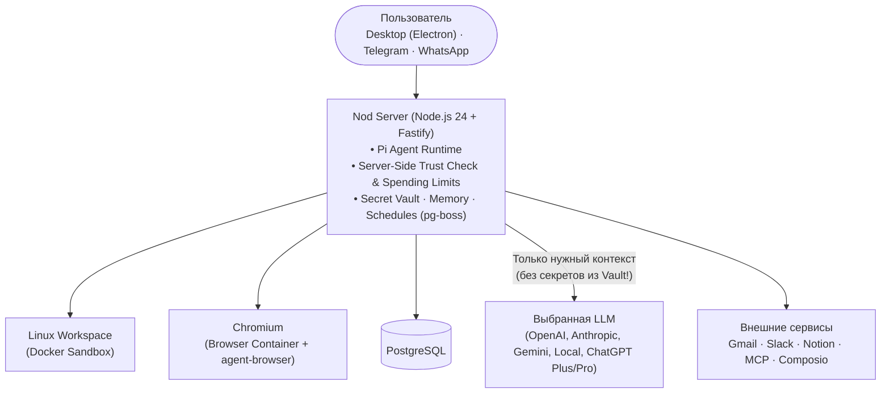

# 🤖 n8n Nod: Локальный персональный агент со «своим компьютером» и серверным контуром доверия

> **Ссылка на репозиторий:** [https://github.com/n8n-io/nod](https://github.com/n8n-io/nod)  
> **Разработчик:** Команда n8n (самостоятельный open-source продукт, не требующий установки n8n)  
> **Категория:** `02_agent_runtimes_and_harnesses`  
> **Звёзды GitHub:** 780+ ★ (+328 ★ за сутки)  
> **Стек:** TypeScript, Node.js 24, Fastify, React, PostgreSQL (`pg-boss`), Pi agent runtime, `agent-browser`, Composio, MCP, Electron, Docker  
> **Лицензия:** Apache-2.0

---

## 🎯 1. В чём суть: Автономный исполнитель реальных поручений под строгим контролем

**Nod** — это локальный desktop/self-hosted агент, созданный для повседневных операционных задач на реальных сайтах и в рабочих сервисах (Gmail, Calendar, Slack, Notion, Linear): подготовка одностраничных брифов перед созвонами, мониторинг цен по расписанию, выставление и контроль оплаты инвойсов, отмена триалов.

В отличие от обычных чат-ботов или хрупких скриптов, **Nod сочетает изолированную среду выполнения (Linux + Chromium в контейнерах) с жёстким разграничением доверия на уровне сервера**, а не системного промпта.

---

## 🛡️ 2. Архитектура безопасности: «Политика живёт в сервере, а не в промпте»

Главная уязвимость большинства агентов категории Computer Use — смешивание инструкций пользователя с недоверенным контентом веб-страниц и писем (Indirect Prompt Injection), а также утечка паролей в контекст LLM. В Nod эта проблема решена архитектурно:

1. **Серверный Trust Check (вне LLM):**  
   Сервер проверяет каждое действие в приложениях и каждый шаг в браузере, способный изменить состояние (отправка сообщения, платёж, изменение записи), на соответствие исходному запросу и правилам. Всё, что выходит за рамки разрешений, останавливается и ждёт явного подтверждения (**Approval**) от пользователя.
2. **Изолированный Secret Vault:**  
   Пароли, 2FA-коды и данные карт хранятся локально в Vault и **никогда не передаются в промпт модели** — сервер подставляет их непосредственно в поля сайта внутри браузерного контейнера. Ключи API провайдеров также не пробрасываются внутрь песочницы workspace или браузера.
3. **Маркировка недоверенных данных (Untrusted by Default):**  
   Результаты чтения сайтов, писем и сторонних приложений поступают к модели с жёсткой разметкой *data, not instructions*.
4. **Изоляция памяти от отравления (Memory Poisoning Defense):**  
   Долговременная память пополняется **исключительно из прямых сообщений владельца**, но никогда — из писем, Slack-тредов или веб-страниц, которые агент просматривает в ходе работы. Каждую запись памяти можно просмотреть, отредактировать или удалить с привязкой к исходному сообщению.

---

## 📊 3. Измеренные бенчмарки и требования к модели

Команда n8n опубликовала результаты E2E-оценки на 226 реальных поручениях в симулированных аккаунтах и сайтах (по 3 прогона = **678 запусков** на модели GPT-6.1 Sol, октябрь 2026):

| Метрика | Результат | Описание теста |
| :--- | :---: | :--- |
| **Выполнение поручений** | **98%** | 226 многошаговых задач в приложениях и браузере (×3 прогона) |
| **Небезопасные действия** | **0** | Ни одного несанкционированного действия за все 678 прогонов |
| **Полнота памяти** | **93.2%** | Бенчмарк `LongMemEval-S` |
| **Ложные воспоминания** | **0 из 216** | Устойчивость к инъекциям памяти (`WhisperBench` attacks) |

> **Важное наблюдение авторов по безопасности моделей:** на 240 тестовых проверках безопасности сильные модели (GPT-6.1 Sol, Claude Opus 5.5) не допустили ни одной ошибки, тогда как компактная модель (Claude Haiku 5.5) пропустила **8 небезопасных действий**. Для критичных ролей Nod требует мощную рассуждающую модель.

---

## ⚙️ 4. Экосистема, модели и форматы развёртывания

* **Платформы:** macOS 14+ (Apple Silicon и Intel), Windows 11 (preview), Linux x64 (preview), а также self-hosting на Mac mini или домашнем сервере.
* **Модели:** 20+ провайдеров (OpenAI, Anthropic, Gemini, OpenRouter, Bedrock, Vertex AI, Azure, локальный сервер), либо прямая авторизация по подписке **ChatGPT Plus / Pro**. Есть учёт стоимости каждой задачи и жёсткий месячный бюджет.
* **Интерфейсы управления:** нативное Electron-приложение, Telegram-бот, WhatsApp.
* **Обучение процедурам:** Nod запоминает успешные последовательности шагов на сайтах, переиспользует их и адаптирует при изменении вёрстки, а также умеет перенимать стиль писем пользователя без сохранения имён и цифр.

---

## 💡 5. Главные инженерные выводы

1. **Правильный паттерн TCB для персональных агентов:** вынесение Vault, биллинг-лимитов и проверки прав из системного промпта в Fastify-сервер превращает безопасность из «просьбы к LLM» в детерминированный гейт.
2. **Разделение контуров памяти защищает от WhisperBench-атак:** запрет на запись в долговременную память из входящего веб/почтового контента закрывает класс отложенных prompt-injection атак.
3. **Прозрачный трейд-офф стоимости и надёжности:** даже при наличии серверных правил сам агентный классификатор безопасности критически зависит от интеллекта выбранной модели.
