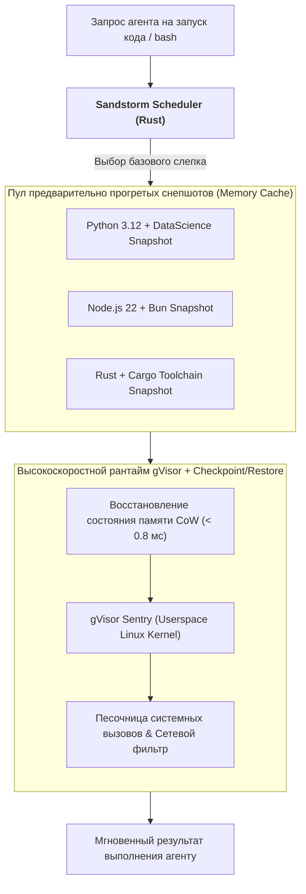

# 🌪️ Sandstorm: Сверхплотная инфраструктура песочниц для AI-агентов на Rust

> **Ссылка на репозиторий:** [https://github.com/deeplethe/sandstorm](https://github.com/deeplethe/sandstorm)  
> **Разработчик:** Deeplethe Research  
> **Категория:** `02_agent_runtimes_and_harnesses`  
> **Звёзды GitHub:** 3,600+ ★ (#13 Daily в мировых трендах GitHub, +285 ★ за сутки)  
> **Стек:** Rust, gVisor (Go kernel rewrite), CRIU / Memory Checkpoint-Restore, Linux namespaces  
> **Лицензия:** Apache 2.0  

---

## 🎯 1. В чем проблема хостинга сред исполнения для агентных систем?

Современные автономные платформы (Claude Code, Paperclip, OpenDots, HumanLayer) вынуждены запускать код, сгенерированный LLM, в изолированных средах.
Существующие решения оказываются экономически нежизнеспособными при масштабировании:
1. **Docker-контейнеры:** Запуск занимает 1–3 секунды, слабая изоляция ядра Linux (один общий `sys_ptrace` или уязвимость в ядре ведет к побегу из контейнера).
2. **Микро-ВМ (Firecracker):** Отличная изоляция KVM, но высокий расход оперативной памяти (минимум 128 МБ на инстанс). Запустить 10,000 параллельных сессий на одном сервере невозможно.
3. **Холодный старт:** Подготовка среды (установка npm/pip зависимостей) занимает минуты на каждую сессию.

**Sandstorm решает этот кризис через связку ядра gVisor и технологии Checkpoint/Restore на Rust:**
* Запуск песочницы из предварительно прогретого замороженного снепшота памяти (Adaptive Snapshot Restoration) занимает **менее 1 миллисекунды (< 0.8 мс)**.
* **Экстремальная плотность:** Использование механизма дедупликации памяти (Copy-on-Write) позволяет держать **до 5,000 активных песочниц на обычном сервере с 64 ГБ RAM**.
* **Аппаратная безопасность:** Пользовательский код изолируется виртуализированным ядром gVisor, перехватывающим все системные вызовы в пространстве пользователя (userspace kernel).

---

## ⚡ 2. Ключевые архитектурные достоинства

* **Субмиллисекундный старт:** Мгновенный fork-and-restore процесс без прохождения длительного цикла boot операционной системы.
* **Userspace-ядро:** gVisor перехватывает все вызовы `read`, `write`, `execve`, исключая риск компрометации хостовой операционной системы.
* **Автоматическое усыпление (Idle Suspend):** Если агент бездействует 5 секунд, память песочницы сжимается и сбрасывается на NVMe-диск, освобождая RAM для других агентов.

---

## 💡 3. Главные инженерные выводы

1. **Экономика решает судьбу агентных платформ:** Переход от монолитных ВМ к снепшот-песочницам снижает себестоимость обслуживания кодинг-агентов на порядок.
2. **Безопасность без оверхеда:** Userspace-ядра в связке с Rust обеспечивают бескомпромиссную защиту при скорости нативного процесса.
