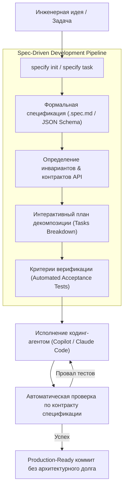

# 💫 GitHub Spec Kit: Разработка через спецификации (SDD) для кодинг-агентов

> **Ссылка на репозиторий:** [https://github.com/github/spec-kit](https://github.com/github/spec-kit)  
> **Официальный сайт:** [https://speckit.org](https://speckit.org)  
> **Разработчик:** GitHub Open Source  
> **Категория:** `02_agent_runtimes_and_harnesses`  
> **Звёзды GitHub:** 146,400+ ★ (+949 ★ за сутки)  
> **Стек:** Python, CLI (`specify-cli`), Markdown / JSON Schema, GitHub Copilot, Claude Code, Cursor  
> **Лицензия:** MIT  

---

## 🎯 1. В чем проблема «Вайбкодинга» и почему нужен Spec-Driven Development?

С появлением автономных кодинг-агентов разработчики столкнулись с феноменом **Context Drift (Дрейф контекста)** и **Architectural Degradation (Архитектурная эрозия)**:
1. **Хаотичные промпты:** Разработчик пишет неструктурированный запрос («сделай авторизацию через OAuth»), агент начинает писать код без формализованных инвариантов, угадывая граничные случаи.
2. **Иллюзия быстрого старта:** Первые 50 строк кода генерируются за секунды, но через 5 итераций агент запутывается в собственных предположениях, ломает интерфейсы и генерирует регрессии.
3. **Отсутствие доказательств (Evidence):** Агент сообщает, что всё работает, но не существует формального контракта, по которому можно автоматически проверить соответствие ожиданиям.

**Spec Kit внедряет фундаментальный принцип:** *«Intent & Evidence ahead of implementation»* (Намерение и верификация строго предшествуют реализации). Код — это лишь производная функция от спецификации.



---

## ⚡ 2. Архитектура Spec Kit и инструментарий `specify-cli`

Spec Kit построен вокруг CLI-утилиты `specify-cli`, расширяемой через пресеты (presets), бандлы (bundles) и кастомные воркфлоу:

1. **Единый формат спецификации (`.specify/`):**
   * `intent.md` — высокоуровневые бизнес-цели и пользовательские сценарии.
   * `contract.json` — машиночитаемые интерфейсы, типы входных/выходных данных, границы ошибок.
   * `plan.md` — пошаговый DAG задач для агента с зависимостями.
   * `evidence.md` — артефакты подтверждения (лог тестов, покрытие, снапшоты вывода).
2. **Агностичность к LLM-агентам:**
   * Поддерживает GitHub Copilot Workspace, Claude Code, Cursor, Gemini CLI, Antigravity.
   * Пресеты автоматически инжектят правила чтения и обновления спецификаций в контекст используемого агента.
3. **Self-Healing Loop:** Агент не считается выполнившим задачу, пока `specify check` не подтвердит соответствие всех критериев из `contract.json`.

---

## 🚀 3. Быстрый старт и практический воркфлоу

```bash
# Установка CLI
pip install specify-cli

# Инициализация спецификации в проекте
specify init --agent claude-code

# Генерация формального контракта новой функциональности
specify task create auth-oauth2 \
  --title "GitHub OAuth2 Device Flow" \
  --require-tests \
  --spec-type api-feature

# Запуск агента по спецификации
specify run auth-oauth2

# Валидация доказательств соответствия
specify verify auth-oauth2
```

---

## 💡 4. Главные инженерные выводы

1. **Спецификации как новый язык программирования:** В эпоху автономных агентов инженеры пишут не циклы и функции, а спецификации, инварианты и тесты. Spec Kit стандартизирует эту парадигму для open-source и enterprise.
2. **Защита от амнезии контекста:** Когда контекстное окно агента переполняется, агент перечитывает компактный `contract.json`, а не гигабайты исходного кода, сохраняя 100% фокус на архитектурной цели.
