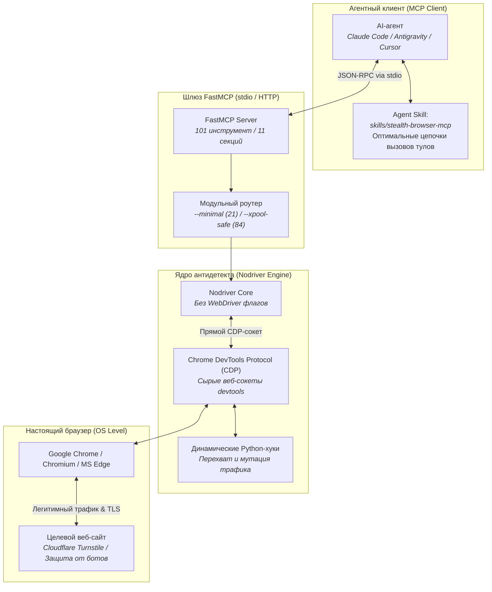

# 🌐 Stealth Browser MCP: Антидетект-автоматизация браузера по протоколу MCP с обходом Cloudflare

> **Ссылка на репозиторий:** [https://github.com/vibheksoni/stealth-browser-mcp](https://github.com/vibheksoni/stealth-browser-mcp)  
> **Автор проекта:** Вибхек Сони (Vibhek Soni / vibheksoni)  
> **Категория:** `02_agent_runtimes_and_harnesses`  
> **Звёзды GitHub:** 2,700+ ★ (#12 в мировом Daily топе Trendshift, быстрорастущий инструмент)  
> **Технологический стек:** Python 3.10+ · FastMCP · Nodriver · Chrome DevTools Protocol (CDP) · Chrome / Chromium / Edge  
> **Лицензия:** MIT  

---

## 🎯 1. В чем проблема классических браузерных агентов?

Когда автономные кодинг-агенты (Claude Code, Antigravity, Cursor, Codex) пытаются выполнить веб-серфинг, спарсить документацию, проверить развернутый фронтенд или скачать нужные файлы, они практически сразу сталкиваются с глухой стеной:
* **Playwright и Selenium выдают себя на сетевом и JS-уровне:** флаг `navigator.webdriver = true`, неконсистентные TLS/JA3-отпечатки, специфичные тайминги вызовов и хуков.
* **Современные системы защиты (WAF / Anti-Bot):** Cloudflare Turnstile, Queue-It, DataDome, PerimeterX, Akamai мгновенно идентифицируют сессии агентов как подозрительные боты и выдают капчи или вечные экраны ожидания.
* **Разрыв в протоколах:** стандартный Playwright MCP сервер тяжеловесен, запускается медленно и не дает агенту низкоуровневого контроля над сырыми событиями Chrome DevTools Protocol (CDP).

**Stealth Browser MCP устраняет эту проблему:**
Он оборачивает передовой антидетект-движок **[`nodriver`](https://github.com/ultrafunkamsterdam/nodriver)** в официальный протокол **Model Context Protocol (FastMCP)**, предоставляя агентам 101 специализированный инструмент для невидимого взаимодействия с реальными браузерами семейства Chromium без веб-драйверов.

---

## 🏗️ 2. Архитектура и уровни взаимодействия

Архитектура системы исключает промежуточные эмуляторы и работает напрямую с сокетами CDP браузера:



### Ключевые архитектурные отличия от Playwright:
1. **Отсутствие флага `navigator.webdriver`:** В отличие от Puppeteer и Playwright, `nodriver` не подключается как отладочный драйвер через стандартный интерфейс Selenium. Браузер запускается как обычный пользовательский процесс с валидным профилем.
2. **Настоящие аппаратные отпечатки:** Canvas, WebGL, аудио-контекст, раскладка шрифтов и TLS-стек (JA3/JA4) совпадают с нативным десктопным браузером операционной системы (Windows, macOS, Linux).
3. **Прямое исполнение скриптов до парсинга документа (`Page.addScriptToEvaluateOnNewDocument`):** агент может внедрять изолированные сценарии до того, как загрузится антибот-скрипт целевого сайта.

---

## 🧰 3. Модульная структура инструментов (101 тул в 11 секциях)

Сервер поддерживает гибкое переключение режимов. Агент может работать с полным набором инструментов (101 шт.), компактным ядром (21 шт. в режиме `--minimal`) или безопасным пулом (`--xpool-safe` без `Runtime.enable`, предотвращающим обнаружение CDP):

| Секция | Кол-во тулов | Назначение и функциональные возможности |
|:---|:---:|:---|
| **`browser-management`** | 8 | Запуск, закрытие, рестарт инстансов Chrome/Edge, переключение user-agent, очистка профилей. |
| **`element-interaction`** | 13 | Клики, скроллинг, ввод текста с имитацией нажатий клавиш человека, drag-and-drop, фокус. |
| **`element-extraction`** | 9 | Извлечение текста, ссылок, таблиц, селекторов и структуры DOM. |
| **`file-extraction`** | 9 | Скачивание файлов, чтение локальных кэшей, выгрузка PDF, работа с блобами. |
| **`network-debugging`** | 10 | Перехват HTTP-запросов, мониторинг заголовков, инспекция тел ответов, захват полезной нагрузки. |
| **`cdp-functions`** | 17 | Прямое выполнение команд Chrome DevTools Protocol, управление сокетами и доменами CDP. |
| **`progressive-cloning`** | 10 | **Пиксель-точное клонирование компонентов**: выгрузка элемента со всеми вычисленными стилями CSS, разметкой и ассетами. |
| **`cookies-storage`** | 3 | Чтение, экспорт и инъекция Cookie, манипуляция `localStorage` и `sessionStorage`. |
| **`tabs`** | 5 | Открытие, закрытие, активация и параллельный мониторинг браузерных вкладок. |
| **`debugging`** | 7 | Диагностика процесса браузера, снятие полных скриншотов страницы, замер памяти и логов консоли. |
| **`dynamic-hooks`** | 10 | **Динамические Python-хуки**: агент может на лету задать правило перехвата и модификации сетевого трафика. |

---

## 🎨 4. Киллер-фичи для кодинг-агентов

### 1. Пиксель-точное клонирование UI (Progressive Element Cloning)
Классические краулеры извлекают лишь сырой HTML-код элемента без контекста стилей, что приводит к «сломанной» верстке при попытке агента скопировать чужой интерфейс.  
`stealth-browser-mcp` через CDP извлекает:
* Полное поддерево DOM элемента;
* Все вычисленные стили (`window.getComputedStyle`) и CSS-переменные;
* Привязанные обработчики событий и активные анимации;
* Встроенные SVG и фоновые изображения в base64.
Агент получает готовый, компилируемый компонент для Tailwind или React в один вызов инструмента.

### 2. Динамические сетевые перехватчики (AI Dynamic Hooks)
Агент может внедрить кастомный легковесный скрипт на Python прямо в процесс перехвата сетевого уровня:
```python
# Агент на лету создает правило подмены заголовков или блокировки трекеров:
async def request_hook(request):
    if "telemetry" in request.url:
        return {"action": "block"}
    if "api.example.com" in request.url:
        return {
            "action": "modify_headers",
            "headers": {"X-Custom-Auth": "sandbox-token"}
        }
```

### 3. Нативный агентный навык (Agent Skill)
В репозитории поставляется готовый навык `skills/stealth-browser-mcp`. Он обучает LLM:
* Правильному порядку действий: `navigate` $\rightarrow$ `wait_for_selector` $\rightarrow$ `verify_state` $\rightarrow$ `action`;
* Использованию пре-скриптов до загрузки DOM;
* Своевременному вызову `close_browser` для предотвращения утечек оперативной памяти в фоне.

---

## ⚙️ 5. Подключение к Claude Code, Antigravity и Cursor

### Установка в окружение:
```bash
git clone https://github.com/vibheksoni/stealth-browser-mcp.git
cd stealth-browser-mcp
python -m venv venv
source venv/bin/activate
pip install -r requirements.txt
```

### Регистрация в Claude Code CLI (через stdio):
```bash
claude mcp add-json stealth-browser-mcp '{
  "type": "stdio",
  "command": "/absolute/path/to/stealth-browser-mcp/venv/bin/python",
  "args": ["/absolute/path/to/stealth-browser-mcp/src/server.py"]
}'
```

### Регистрация в Antigravity / Cursor / Claude Desktop (`claude_desktop_config.json`):
```json
{
  "mcpServers": {
    "stealth-browser-mcp": {
      "command": "/absolute/path/to/stealth-browser-mcp/venv/bin/python",
      "args": ["/absolute/path/to/stealth-browser-mcp/src/server.py", "--minimal"],
      "env": {
        "BROWSER_IDLE_TIMEOUT": "300"
      }
    }
  }
}
```

---

## 🛡️ 6. Модель доверия (Trust Model) и безопасность

Поскольку сервер предоставляет агенту полный доступ к браузеру на уровне хост-машины (выполнение JavaScript, доступ к хранилищу кук, выполнение команд CDP, скачивание файлов):
* **Рекомендуемый транспорт:** исключительно локальный `stdio` канал внутри доверенной машины разработчика.
* **Сетевой HTTP-транспорт:** если сервер поднимается удаленно (`--transport http`), обязательно задание токена авторизации:
  `export STEALTH_BROWSER_MCP_AUTH_TOKEN="strong-random-token"`.
* **Фоновый сборщик (Reaper):** параметр `BROWSER_IDLE_TIMEOUT=600` автоматически закрывает зависшие экземпляры браузера при отсутствии активности агента в течение 10 минут, защищая хост от утечки ОЗУ.

---
*Конспект подготовлен для базы знаний Antigravity Notes • Дата фиксации: 18 октября 2026*
