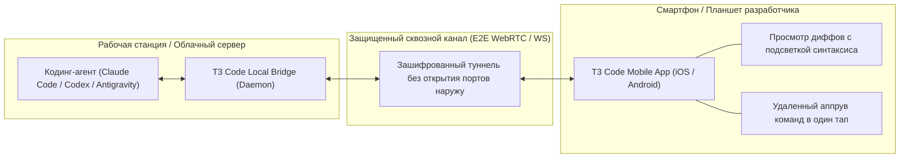

# 📱 T3 Code: Мобильный и десктопный пульт управления кодинг-агентами от Тео

> **Ссылка на репозиторий:** [https://github.com/pingdotgg/t3code](https://github.com/pingdotgg/t3code)  
> **Автор:** Theo Browne (t3.gg / ping.gg)  
> **Категория:** `02_agent_runtimes_and_harnesses`  
> **Звёзды GitHub:** 36,200+ ★ (#6 Daily в мировых трендах GitHub, +875 ★ за сутки)  
> **Клиенты:** iOS, Android, macOS, Linux, Windows, Web Dashboard  
> **Стек:** TypeScript, React, Tailwind CSS, Tauri (Rust core), WebSockets, WebRTC  
> **Лицензия:** MIT  

---

## 🎯 1. В чем идея «Control Surface» для кодинг-агентов?

Когда разработчик запускает длительные агентные сессии (например, масштабный рефакторинг репозитория, прогон интеграционных тестов или миграцию зависимостей через Claude Code или Codex), он оказывается привязан к экрану терминала:
* Нужно постоянно подтверждать разрешения на выполнение команд (HITL).
* Просматривать диффы кода перед коммитом.
* Корректировать траекторию рассуждений модели, если агент пошел по неверному пути.

**T3 Code решает эту проблему, разделяя вычислительный узел и поверхность управления:**
* На мощном рабочем компьютере или сервере работает локальный агент в своем окружении с доступом к кодовой базе, компиляторам и Docker.
* Разработчик держит в руках **смартфон (iPhone/Android)** или открывает легковесный десктопный клиент: на экране транслируются live-логи, структурные диффы и кнопки подтверждения (`Approve`, `Reject`, `Direct Input`).

---

## ⚡ 2. Ключевые возможности T3 Code

1. **Удаленный аппрув в один клик:** Всплывающие push-уведомления на смартфоне при попытке агента выполнить потенциально опасное действие (удаление файлов, сетевой запрос, git push).
2. **Пиксель-точный просмотр Git Diff:** Адаптированный для мобильного экрана просмотрщик изменений кода с возможностью оставлять голосовые или текстовые комментарии-инструкции для агента.
3. **Безопасное сквозное шифрование:** Соединение между телефоном и рабочим компьютером устанавливается через прямой P2P WebRTC канал с локальными ключами — исходный код не оседает на сторонних серверах.
4. **Кросс-агентная поддержка:** Нативные коннекторы для Claude Code, OpenAI Codex CLI, Cursor Composer, Hermes и Antigravity.

---

## 💡 3. Главные инженерные выводы

1. **Смена паттерна работы инженера:** Разработчик перестает быть «набирателем кода» и становится супервизором, который может направлять работу агентов на прогулке или в дороге.
2. **Надежный Human-in-the-Loop без трения:** Снижение порога валидации действий агента за счет мобильного интерфейса предотвращает разрушительные ошибки автопилота.
