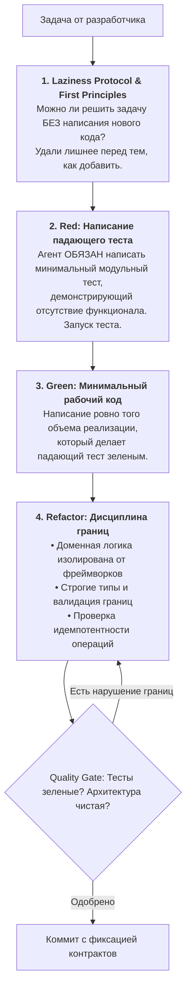

# 📐 ub-mode: Дисциплина чистой архитектуры и TDD для кодинг-агентов

> **Ссылка на репозиторий:** [https://github.com/unclebob/ub-mode](https://github.com/unclebob/ub-mode)  
> **Вдохновители:** Robert C. Martin (Uncle Bob), Poteto Mode  
> **Категория:** `02_agent_runtimes_and_harnesses`  
> **Звёзды GitHub:** 6,000+ ★ (#10 Weekly в мировых трендах GitHub, +5,418 ★ за неделю)  
> **Формат:** Спецификация правил и детерминированные гейты качества (Quality Gates)  
> **Лицензия:** MIT  

---

## 🎯 1. В чем проблема «быстрого и грязного» вайб-кодинга?

Кодинг-агенты превосходно генерируют код, который внешне работает, но катастрофически увеличивает энтропию кодовой базы:
* Модель смешивает работу с базой данных, HTTP-запросы и бизнес-правила в одной гигантской функции.
* Добавляет десятки неиспользуемых библиотек ради решения тривиальной задачи.
* Не пишет тестов или создает фиктивные тесты, проверяющие тривиальные геттеры вместо бизнес-логики.
* Через неделю проект становится невозможно поддерживать.

**`ub-mode` надевает на агента «наручники дисциплины» классического Software Engineering:**

---

## 📏 2. Ключевые аксиомы `ub-mode`

1. **Test-Driven Development (TDD):** Ни одной строчки производственного кода без предварительного падающего юнит-теста.
2. **Принцип вычитания (Subtract Before You Add):** Перед добавлением новой функции агент обязан проверить, нельзя ли удалить дублирующийся старый код или переиспользовать существующие примитивы.
3. **Дисциплина границ (Boundary Discipline):** Бизнес-сущности ничего не знают о базе данных, веб-сервере или формате сериализации (Clean Architecture / Hexagonal).
4. **Идемпотентность по умолчанию:** Любая операция агента над данными или инфраструктурой должна быть безопасна для повторного выполнения при сбое.

---

## 💡 3. Главные инженерные выводы

1. **Дисциплина важнее скорости:** Агент, пишущий 1000 строк кода в минуту без архитектурных ограничений, ведет проект к переписыванию с нуля.
2. **TDD — идеальный контракт для AI:** Падающий тест дает модели четкий, бинарный критерий завершения задачи (Pass/Fail) без двусмысленности промптов.
