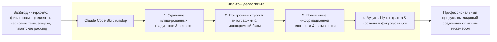

# 🧹 Unslop: Очистка фронтенда от ИИ-штампов и вайбкодинг-слопа

> **Ссылка на репозиторий:** [https://github.com/heydamir/unslop](https://github.com/heydamir/unslop)  
> **Автор:** Дамир (@heydamir)  
> **Категория:** `02_agent_runtimes_and_harnesses`  
> **Звёзды GitHub:** 7,100+ ★ (+976 ★ за сутки)  
> **Стек:** JavaScript / Shell, Claude Code Skill, Codex, Antigravity, Tailwind CSS, React, HTML/CSS  
> **Лицензия:** MIT  

---

## 🎯 1. В чем проблема «AI Slop» в сгенерированном фронтенде?

Когда разработчик просит современную языковую модель (Claude 3.7 / GPT-4o / DeepSeek) создать интерфейс без жестких стилистических ограничений, результат мгновенно выдает свое машинное происхождение:
1. **Фиолетово-индиговый синдром:** Бесконечные градиенты `bg-gradient-to-r from-purple-600 to-indigo-600` на кнопках, заголовках и границах карточек.
2. **Фальшивая декоративность:** Неоновые свечения (`blur-3xl opacity-20`), гигантские радиусы скруглений (`rounded-3xl`), бессмысленные эмодзи перед каждым словом (🚀, ✨, 🔥) и шаблонный маркетинг-копирайтинг.
3. **Разреженность и низкая плотность:** Гигантские отступы (`p-12`), пустые карточки-обертки без семантики и отсутствие продуманных состояний (hover, focus, disabled, loading, empty state).

**Unslop** — это специализированный агентный навык (Agent Skill), который инспектирует кодовую базу интерфейса, безжалостно вычищает все маркеры машинного слопа и перестраивает стили в соответствии с принципами сдержанного, функционального и контекстно-зависимого дизайна.



---

## ⚡ 2. Манифест деслоппинга: Ключевые правила Unslop

1. **Цвет должен быть обоснован продуктом:** Никаких случайных акцентов. Если продукт — системная утилита, базовая палитра строится на оттенках серого (`slate`/`zinc`) с одним строгим семантическим акцентом.
2. **Типографика важнее рамок:** Вместо оборачивания каждого блока в отдельную плашку с бордером, иерархия разделов выстраивается весом шрифта, размером кегля и контрастом текста.
3. **Плотность информации:** Экран рабочего инструмента должен показывать данные, а не пустые поля. Компактные таблицы, четкие списки, отсутствие декоративного «воздуха» там, где он мешает чтению.
4. **Контекстный копирайтинг:** Замена клише вроде *"Supercharge your workflow with AI-powered brilliance"* на прямое инженерное описание действия: *"View build logs, inspect traces, or deploy to staging"*.

---

## 🚀 3. Быстрый старт и интеграция

```bash
# Установка навыка в каталог навыков Claude Code или Antigravity
git clone https://github.com/heydamir/unslop.git ~/.agents/skills/unslop
# или добавление в проект
npx @heydamir/unslop init

# Запуск в контексте агента:
# "claude: /unslop src/components/Dashboard.tsx"
# "claude: run unslop audit across all tailwind components"
```

---

## 💡 4. Главные инженерные выводы

1. **Разница между «работает» и «хочется пользоваться»:** Вайбкодинг решает проблему логики, но порождает визуальный шум. Unslop возвращает чувство вкуса и инженерную культуру в сгенерированный код.
2. **Идеальное дополнение к Impeccable и Design.md:** В связке с правилами Impeccable навык Unslop дает гарантию, что агент не оставит после себя следов шаблонного ИИ-дизайна.
