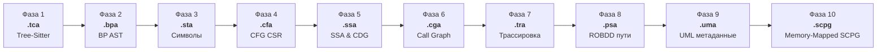

# 🏛️ OpenHeart: Движок сжатых графов программ SCPG и студия 19 проекций UML 2.5 на чистом Rust

> **Ссылка на репозиторий:** [https://github.com/AhmadHassan-BTed/OpenHeart](https://github.com/AhmadHassan-BTed/OpenHeart)  
> **Интерактивная веб-студия:** [https://ahmadhassan-bted.github.io/OpenHeart/](https://ahmadhassan-bted.github.io/OpenHeart/)  
> **Автор проекта:** Ахмад Хассан (Ahmad Hassan / B-Ted)  
> **Категория:** `03_knowledge_graphs_and_ontologies`  
> **Звёзды GitHub:** 490+ ★ (#17 в мировом Daily топе Trendshift)  
> **Технологический стек:** Rust 1.75+ · Tree-Sitter · Succinct Balanced Parentheses · ROBDD · Cytoscape.js · WebAssembly  
> **Поддерживаемые языки кода:** Rust · TypeScript · Python · Java · Kotlin · C++  
> **Лицензия:** MIT  

---

## 🎯 1. В чем проблема классических графов кода (CPG)?

В современной программной инженерии понимание кодовой базы многотысячных репозиториев упирается в фундаментальное архитектурное противоречие:
* **Традиционные Code Property Graphs (CPG) и компиляторные IR** построены на указателях (heap-allocated pointers). На каждый узел AST, ребро зависимости и базовый блок аллоцируются отдельные структуры в оперативной памяти.
* На проектах масштаба Linux, Chromium или enterprise-монолитах это приводит к **колоссальному расходу памяти (десятки гигабайт RAM)**, постоянному кэш-промаху (cache thrashing) процессора из-за pointer-chasing и задержкам анализа в десятки минут.
* При этом в процессе компиляции теряется высокоуровневый замысел разработчика (архитектура, доменные границы, паттерны проектирования GoF), а обратная привязка элементов диаграмм к конкретному токену в исходном коде требует дорогого поиска.

**OpenHeart предлагает математически строгое и сверхсжатое решение:**
Вместо классических указателей проект вводит формальную модель **Succinct Compositional Program Graph (SCPG)**, объединяющую битовые скобочные структуры, разреженные матрицы CSR и бинарные диаграммы решений ROBDD. Это обеспечивает **сжатие графа программы до 128 раз** с мгновенной **двунаправленной трассируемостью $O(1)$** между кодом и визуальными проекциями.

---

## 📐 2. Математический базис: 7-кортеж SCPG

Граф программы в OpenHeart формализуется как математический 7-кортеж:

$$\mathcal{G} = (V, E, \nu, \varepsilon, \tau, \rho, \Sigma_\Phi)$$

Где:
* $V$ — дискретное множество вершин графа (токены, операторы, блоки, функции, классы);
* $E \subseteq V \times V$ — ориентированные ребра (поток управления, поток данных, вызовы, владение);
* $\nu: V \to \mathcal{T}_V$ — типизация вершин в метамодели UML 2.5 и AST;
* $\varepsilon: E \to \mathcal{T}_E$ — семантическая типизация ребер (16 типов отношений: наследование, композиция, агрегация, вызов и др.);
* $\tau: V \to \mathbb{N}$ — **монотонный 32-битный якорь `token_id`**, обеспечивающий связь с точной позицией в файле за $O(1)$;
* $\rho: V \to \text{ROBDD}$ — каноническая функция предикатного пути исполнения;
* $\Sigma_\Phi$ — глобальный манифест схем классификаторов и топологических инвариантов.

---

## 🔬 3. Как достигается 128-кратное сжатие памяти?

```mermaid
flowchart TD
    subgraph Traditional["Традиционный AST (Pointer-Heavy CPG)"]
        N1["Root Node (64B)"] -->|ptr| N2["Class Node (64B)"]
        N2 -->|ptr| N3["Method Node (64B)"]
        N2 -->|ptr| N4["Field Node (64B)"]
        style Traditional fill:#3d1117,stroke:#f85149
    end

    subgraph Succinct["OpenHeart SCPG (Succinct Balanced Parentheses)"]
        BP["Битовая строка скобок: <b>((()())())</b><br>Хранится в упакованном <b>u64[]</b> (2 бита на узел)"]
        Rank["Таблица <b>Jacobson Rank/Select</b>: $O(1)$ навигация к родителю/детям"]
        CSR["Разреженные строки <b>Compressed Sparse Row (CSR)</b> для CFG и DFG"]
        style Succinct fill:#112217,stroke:#3fb950
    end
```

Вместо сохранения дерева AST в виде объектов в куче (`struct Node { children: Vec<Box<Node>> }`), OpenHeart использует **лаконичные структуры данных (Succinct Data Structures)**:



### 1. Скобочные последовательности (Balanced Parentheses, BP):
Любое дерево парсинга кодируется битовой строкой: открывающая скобка `(` кодируется как `1`, закрывающая `)` как `0`.
* Дерево из $N$ узлов занимает всего **$2N$ бит** (четверть байта на узел!).
* Для навигации по дереву (переход к родителю, поиск $k$-го потомка, наименьший общий предок LCA) строится индекс **Jacobson Rank/Select**, выполняющий операции за строгое время **$O(1)$** без разыменования указателей.

### 2. Матрицы CSR (Compressed Sparse Row):
Графы потока управления (CFG) и потока данных (DFG) сериализуются в три плоских непрерывных массива (`values`, `column_indices`, `row_offsets`), что исключает фрагментацию памяти и идеально ложится в L1/L2 кэш CPU.

### 3. Сжатие путей через ROBDD (Reduced Ordered Binary Decision Diagrams):
Условия ветвлений и предикаты сводятся к каноническим графам решений с точным подсчетом выполнимых путей (`#SAT path counting`) всего в 12 байт на узел.

---

## ⚙️ 4. Десятифазный компиляторный конвейер SCPG

Компиляция исходного кода в бинарный граф проходит через 10 строгих фаз. Каждая фаза генерирует верифицированный контрольной суммой CRC-64 бинарный артефакт с собственной сигнатурой:



| Фаза | Расширение | Магический заголовок | Архитектурная сущность |
|:---:|:---:|:---:|:---|
| **1** | `.tca` | `TCA\0` | Лексический разбор через Tree-Sitter, 16-байтный пул `TokenRecord`, интернирование строк FNV-1a. |
| **2** | `.bpa` | `BPA\0` | Сжатое BP-дерево в `u64[]`, таблицы прыжков `JumpTable`, индексы Rank/Select. |
| **3** | `.sta` | `STA\0` | Таблица символов, скоупы видимости, иерархия типов. |
| **4** | `.cfa` | `CFA\0` | Граф потока управления в формате CSR, дерево доминаторов Купера (Cooper Dominators). |
| **5** | `.ssa` | `SSA\0` | Статическое одиночное присваивание (SSA), $\phi$-функции, граф зависимостей управления (CDG). |
| **6** | `.cga` | `CGA\0` | Межпроцедурный граф вызовов (Call Graph), анализ указателей Андерсена (Points-To). |
| **7** | `.tra` | `TRA\0` | Биективный индекс универсальной трассируемости `UMLLinkRecord[]`. |
| **8** | `.psa` | `PSA\0` | Сводки путей выполнения на базе ROBDD и точный подсчет моделей #SAT. |
| **9** | `.uma` | `UMA\0` | Семантические метаданные UML 2.5, детекторы паттернов банды четырех (GoF Patterns). |
| **10** | `.scpg` | `SCPG` | **Финальный контейнер**: напрямую проецируется в виртуальную память ядра ОС (`mmap`). |

---

## 📊 5. Набор из 19 детерминированных визуальных проекций

Из единого бинарного контейнера `.scpg` OpenHeart автоматически проецирует 19 видов диаграмм, закрывая полный спектр анализа:

### 1. Структурные проекции UML 2.5 (7 диаграмм):
1. **01 · Class Diagram:** таксономия классов, наследование, поля, методы, модификаторы видимости.
2. **02 · Package Diagram:** модульные пространства имен и межпакетные зависимости.
3. **03 · Component Diagram:** подсистемы, предоставляемые и требуемые интерфейсы.
4. **04 · Composite Structure Diagram:** внутренние порты и соединители составных классификаторов.
5. **05 · Object Diagram:** снимки кучи во время выполнения и связи объектов.
6. **06 · Deployment Diagram:** распределение артефактов по вычислительным узлам и серверам.
7. **07 · Profile Diagram:** метамодели, стереотипы и тегированные значения.

### 2. Поведенческие проекции UML 2.5 (7 диаграмм):
8. **08 · Sequence Diagram:** дорожки жизни (lifelines), синхронные/асинхронные вызовы, полосы активации.
9. **09 · State Machine Diagram:** состояния, переходы, триггеры событий и guard-условия.
10. **10 · Activity Diagram:** рабочие процессы бизнес-логики, узлы решений, слияния и дорожки (swimlanes).
11. **11 · Use Case Diagram:** границы акторов, сценарии использования, отношения `<<include>>` и `<<extend>>`.
12. **12 · Communication Diagram:** топология взаимодействия объектов с нумерацией порядка сообщений.
13. **13 · Interaction Overview Diagram:** макро-управление между вложенными кадрами последовательностей.
14. **14 · Timing Diagram:** временные диаграммы состояний и тактовые импульсы.

### 3. Компиляторные промежуточные представления (5 IR-диаграмм):
15. **15 · Control Flow Graph (CFG):** базовые блоки, условия ветвления и обратные дуги циклов.
16. **16 · Data Flow Graph (DFG):** цепочки определения-использования значений (Def-Use SSA chains).
17. **17 · Control Dependence Graph (CDG):** зависимости условий, управляющих выполнением блоков.
18. **18 · Call Graph (CG):** межпроцедурный граф вызовов и сильно связные компоненты рекурсии (SCC).
19. **19 · ROBDD Saturation:** граф насыщения бинарных решающих диаграмм с подсчетом путей #SAT.

---

## 🛠️ 6. Практическое использование и Web Studio

### Запуск веб-студии (100% Client-Side на GitHub Pages):
OpenHeart содержит полноценный браузерный интерфейс на Cytoscape.js и Monaco Editor:
* Клонирование и парсинг репозитория происходят **прямо в браузере** без бэкенда;
* Клик по любому блоку диаграммы мгновенно подсвечивает точные строки кода в Monaco Editor благодаря $O(1)$ `token_id` якорям;
* Экспорт в JSON, PlantUML, Mermaid и стандартный формат обмена XMI.

### Сборка и запуск CLI на Rust:
```bash
# Сборка нативного движка
git clone https://github.com/AhmadHassan-BTed/OpenHeart.git
cd OpenHeart
cargo build --release

# Анализ кодовой базы и генерация SCPG-контейнера
./target/release/openheart-cli analyze --source ./my_project --output ./artifacts/project.scpg

# Экспорт диаграммы классов в PlantUML и SVG
./target/release/openheart-cli export --scpg ./artifacts/project.scpg --diagram class --format puml
```

---

## 💎 7. Синергия с категорией графов знаний

В нашей базе знаний `OpenHeart` встает рядом со следующими столпами:
* [`xerj.md`](file:///home/blackzeshi/Documents/Notes/03_knowledge_graphs_and_ontologies/xerj.md) — обеспечивает сверхбыстрый гибридный векторно-графовый поиск по коду.
* [`semantica.md`](file:///home/blackzeshi/Documents/Notes/03_knowledge_graphs_and_ontologies/semantica.md) — организует онтологические графы знаний общего назначения.
* [`openheart.md`](file:///home/blackzeshi/Documents/Notes/03_knowledge_graphs_and_ontologies/openheart.md) — дает фундаментальный математический аппарат сжатия AST и графов программ (SCPG), позволяющий AI-агентам мгновенно ориентироваться в миллионах строк кода без перегрузки контекстного окна.

---
*Конспект подготовлен для базы знаний Antigravity Notes • Дата фиксации: 18 октября 2026*
