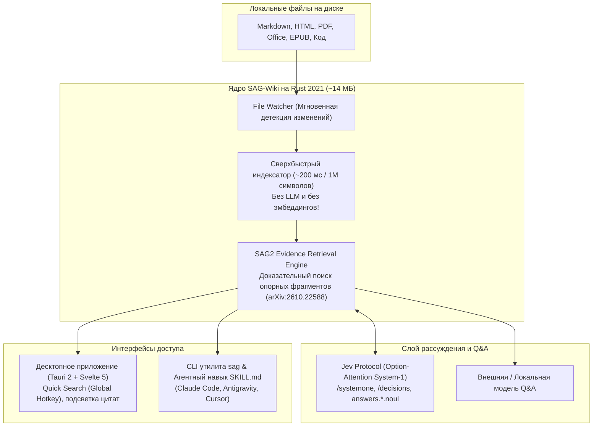

# 📚 SAG-Wiki: Легковесная локальная база знаний для людей и AI-агентов на Rust

> **Ссылка на репозиторий:** [https://github.com/Zleap-AI/SAG-Wiki](https://github.com/Zleap-AI/SAG-Wiki)  
> **Научная статья (SAG2):** [arXiv:2610.22588](https://arxiv.org/abs/2610.22588)  
> **Репозиторий бенчмарков:** [Zleap-AI/SAG-Benchmark](https://github.com/Zleap-AI/SAG-Benchmark)  
> **Разработчик:** Zleap AI  
> **Категория:** `03_knowledge_graphs_and_ontologies`  
> **Звёзды GitHub:** 800+ ★ (+492 ★ за сутки)  
> **Стек:** Rust 2021, Tauri 2, Svelte 5, проприетарный ретривал SAG2, Jev Option-Attention (протокол `/systemone`, `/decisions`), CLI `sag`, агентный навык `SKILL.md`  
> **Лицензия:** MIT  

---

## 🎯 1. В чём проблема классического RAG и векторных баз?

Стандартный векторный RAG (Retrieval-Augmented Generation) и тяжелые GraphRAG-пайплайны страдают от фундаментальных проблем:
1. **Медленная и дорогая индексация:** Нарезка документов на чанки и прогон через эмбеддинг-модели сжигает гигабайты памяти и требует постоянных сетевых вызовов к API.
2. **Потеря точной цитируемости и контекста:** Векторная близость (Cosine Similarity) часто находит семантически похожие, но фактологически нерелевантные фрагменты («галлюцинации ретривала»). Читатель не может мгновенно прыгнуть к точной строке в оригинале.
3. **Разрыв между человеком и агентом:** Инструменты вроде Obsidian или Notion удобны человеку, но сложны для чтения CLI-агентами; а векторные базы (Chroma, Pinecone, Qdrant) удобны скриптам, но непрозрачны для инженера.

### Архитектурный манифест SAG-Wiki:
* **Компактность и локальность:** Дистрибутив приложения весит всего **14 МБ**, не требует развертывания отдельных СУБД (Postgres, Milvus) и держит файлы в исходных папках пользователя на диске.
* **Экстремальная скорость:** Индексация **1 миллиона символов занимает всего ~200 мс** на чистом Rust — с нулевыми вызовами LLM или эмбеддинг-сервисов!
* **Двойная природа (Dual Interface):** Одинаково первоклассный UX для человека (нативный десктоп на Tauri 2 + Svelte 5) и для кодинг-агента (быстрый CLI `sag` + официальный агентный навык `SKILL.md`).



---

## ⚡ 2. Научный фундамент: Технология ретривала SAG2 (arXiv:2610.22588)

Вместо плоских векторных эмбеддингов система использует алгоритм **SAG2 (Second-Generation Structured Association Graph)**:
* **Evidence Scoring:** Алгоритм ищет не абстрактное сходство векторов, а строит цепочки доказательств (evidence passages), связывающие вопрос с ключевыми утверждениями в разных документах.
* **Query-Time Expansion:** Динамическое расширение запроса в момент поиска, исключающее раздувание индекса на диске.
* **Результаты на бенчмарках доказательного поиска:**
  * На сложных многошаговых датасетах (**MuSiQue**, **2WikiMultiHopQA**, **HotpotQA**) метрика точности **Recall@10** у SAG2 превосходит как классический BM25, так и первую версию алгоритма SAG с заметным отрывом при нулевых затратах на генерацию эмбеддингов.

---

## 🔌 3. Интеграция с протоколом Jev (System-1 Decision Making)

SAG-Wiki нативно поддерживает интеграцию с архитектурой **Jev / Option-Attention**:
* В настройках поиска можно указать локальный или удаленный эндпоинт сервиса Jev (`/systemone` или `/decisions`).
* Сервис реализует контракт типизированных решений через протокол `answers.*.noul`, позволяя мгновенно принимать решения о релевантности фрагментов без ожидания генерации токенов большой авторегрессионной моделью.

---

## 🛠️ 4. Использование и подключение к кодинг-агентам

### Установка навыка для Claude Code / Antigravity
Вы можете подключить базу знаний SAG-Wiki прямо к вашему кодинг-агенту, добавив манифест навыка:
```text
Install https://github.com/Zleap-AI/SAG-Wiki/blob/main/cli/skills/sag/SKILL.md and follow its setup flow for my current project.
```

### Команды терминального CLI (`sag`)
```bash
# Конфигурация локального сервиса Jev без авторизации
sag config --url http://127.0.0.1:8000/v1 --model local-jev --auth none

# Добавление каталога в индекс
sag add ~/Documents/Notes

# Быстрый поиск фрагментов доказательств по базе
sag search "архитектура TCB для агентов"

# Ответ на вопрос с точной ссылкой на строки первоисточника
sag ask "Как устроен конвейер Poison-Exhaust-Hallucinate в BLA?"
```

---

## 💡 5. Главные инженерные выводы

1. **Эмбеддинги не обязательны для качественного локального RAG:** Алгоритмы структурно-доказательного поиска (SAG2) индексируют терабайты текста за секунды без разорения на вызовах API эмбеддингов.
2. **Точная цитируемость важнее красивых саммари:** Пользователю и агенту нужен не пересказ своими словами, а мгновенный переход к точной строке и файлу с фактом.
3. **Tauri 2 + Rust — идеальный стек легковесного утилитного ПО:** Вес дистрибутива в 14 МБ и старт за доли секунды выгодно отличают SAG-Wiki от тяжелых Electron-приложений.
