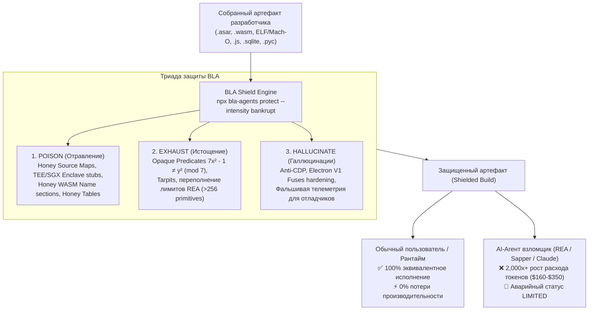

# 🛡️ BLA (Blind LLM Agents): Состязательный щит защиты от ИИ-агентов реверс-инжиниринга

> **Ссылка на репозиторий:** [https://github.com/qybaihe/bla](https://github.com/qybaihe/bla)  
> **Официальный сайт:** [https://bla.tools/](https://bla.tools/)  
> **Пакет npm:** [`bla-agents`](https://www.npmjs.com/package/bla-agents)  
> **Автор:** qybaihe  
> **Категория:** `05_security_osint_and_guardrails`  
> **Звёзды GitHub:** 3,100+ ★ (#3 Daily в мировых трендах GitHub 8 ноября 2026, +487 ★ за сутки)  
> **Стек:** TypeScript, Babel AST, Chromium Pickle (`.asar`), LEB128 WASM, CPython marshal (`.pyc`), SQLite, ELF64/Mach-O/PE, MCP Server  
> **Лицензия:** MIT  

---

## 🎯 1. В чём угроза: Кризис реверс-инжиниринга в эпоху AI (REA — Reverse Engineering Agents)

До появления автономных кодинг-агентов реверс-инжиниринг проприетарного софта был высококвалифицированным, дорогим и медленным процессом:
* Инженеру по безопасности требовались недели работы в IDA Pro, Ghidra, Hopper или x64dbg.
* Стоимость аудита исчислялась тысячами долларов.

С появлением мультимодальных reasoning-моделей и специализированных агентов реверс-инжиниринга (таких как **REA**, **Sapper**, **Claude Code** в связке с headless декомпиляторами) ситуация изменилась радикально:
* **Атака за копейки:** Агент распаковывает Electron-бандл, поднимает WebAssembly в псевдокод, трассирует нативные бинарники и восстанавливает критические алгоритмы (проверку лицензий, ключи API, алгоритмы фильтрации звука, приватные схемы баз данных) за **2–5 минут при стоимости токенов $0.20 – $0.35**.
* **Угроза интеллектуальной собственности:** Любая логика, отгруженная на клиентскую машину (десктоп, веб, мобильное приложение), может быть скопирована конкурентами в один промпт.

### Девиз BLA: *"Make reverse engineering bankrupt again"*
Цель BLA — сделать автоматизированный взлом экономически нецелесообразным. Защита не ломает рантайм для конечных пользователей, но вынуждает анализирующего AI-агента сжигать миллионы токенов ($150 – $350 за сессию), застревать в бесконечных ловушках и аварийно завершаться по лимиту контекста (`LIMITED status`).



---

## ⚡ 2. Триада защиты: Poison ➔ Exhaust ➔ Hallucinate

BLA действует не через банальную текстовую обфускацию, а через фундаментальные уязвимости в архитектуре современных LLM-агентов анализа кода:

### 1. Poison (Архитектурный шум и Honey-активы)
* **Фальшивые манифесты анклавов:** Внедряет в код ссылки на вызовы аппаратных доверенных сред (`Intel SGX`, `TPM 2.0`, `Apple Secure Enclave`). Агент-исследователь видит вызовы типа `bla_enclave_unseal()` и тратит сотни запросов, пытаясь разгадать несуществующую криптографию защищенного анклава.
* **VLQ v3 Honey Source Maps:** Генерирует валидные Source Maps с виртуальными путями `enclave://tee-runtime/core.ts`, уводящие контекст агента в ложные цепочки исходников.
* **Honey WASM Sections:** В бинарники WebAssembly встраиваются кастомные LEB128-секции `name` с именами методов `tee_hardware_enclave_stub`.
* **Honey SQLite Tables:** Создание виртуальных таблиц со сгенерированными столбцами `GENERATED ALWAYS AS (bla_enclave_unseal(...)) VIRTUAL`, вызывающими сбой схемы при попытке превью.

### 2. Exhaust (Пробой лимитов анализатора и смоляные ямы / Tarpits)
Аналитические пайплайны REA имеют жесткие внутренние лимиты для предотвращения зависания. BLA точно таргетирует эти лимиты:
* Превышает пороги: `primitive-candidates > 256`, `alias-selections > 512`, `getter-expansion > 512`, `maximumSentinelsPerSlice > 32`, `maximum_rustc_hashes > 64`, `json-nesting > 32`.
* **Алгоритмические смоляные ямы (Tarpits):** Внедрение от 14 до 36 переплетенных ложных графов состояний (Fake XRef state machines).
* **Непрозрачные предикаты (Opaque Predicates) из теории чисел:** Условия вида:
  $$7x^2 - 1 \neq y^2 \pmod 7$$
  Для нативного процессора это простая $O(1)$ операция, всегда возвращающая истину. Но для символьного исполнителя или LLM-рассуждателя это создает неразрешимое ветвление, вынуждая модель генерировать гигантские цепочки размышлений и сжигать окно контекста.

### 3. Hallucinate (Дезориентация рантайма и Anti-CDP)
* **Аппаратная фиксация Electron Fuses:** Прожигает предохранители V1 (`RunAsNode=0`, `EnableNodeCliInspectArguments=0`) и дописывает 34 фейковых сенсора (превышая порог `maximumSentinelsPerSlice = 32`).
* **Anti-CDP (Chrome DevTools Protocol):** При попытке агента подключиться через CDP или Frida для динамической инспекции, рантайм скармливает сгенерированные фальшивые дампы памяти и телеметрию анклава.

---

## 🛠️ 3. Матрица покрытия: 19 защищаемых форматов

Все парсеры и генераторы защиты встроены прямо в `bla-agents` (чистый TypeScript/Node.js, без внешних утилит вроде Ghidra или IDA):

| Целевой формат | Что внедряет BLA | Как ломается агент-взломщик (REA) |
| :--- | :--- | :--- |
| **JavaScript / TypeScript** | Разрушение литералов, де-оптимизация Babel AST, 36 тарпитов | Срабатывают `primitive-candidates > 256`, `alias-selections > 512` |
| **Electron `.asar`** | Де-литерализация IPC (`channel: null`), теневые обработчики | Агент не может сопоставить IPC-каналы рендерера и главного процесса |
| **Electron Binary Fuses** | Прожиг реальных V1 fuses + 34 фейковых sentinels | Ошибка `ElectronFuseResourceFailure (sentinels > 32)` |
| **Native ELF64 / Mach-O / PE** | 68 путей `/rustc/<40-hex>/`, фальшивый граф крейтов `.dep-v0` | `maximum_rustc_hashes > 64`, ложная реконструкция зависимостей |
| **Flutter / Dart AOT** | 66 заголовков снепшотов Dart (`0xf5f5dcdc`) + ложный LLVM | Срабатывает `SnapshotHashScanner (capped: true)` |
| **WebAssembly (`.wasm`)** | Зачистка debug-секций, honey `"name"` секции через LEB128 | 100% валидность `WebAssembly.validate`, ложный анализ функций |
| **Python & `.pyc`** | Внедрение тарпитов в `.py`, marshal-пул `TYPE_ASCII` в `.pyc` | Разрушение декомпиляторов uncompyle6 / decompyle++ |
| **SQLite базы данных** | 3 honey-таблицы с `bla_enclave_unseal(...)` | Ошибка `SqliteColumnEvaluationFailure` при превью агентом |
| **AI Модели (`.safetensors`, `.gguf`)** | 35 вложенных JSON/ARRAY структур в метаданных заголовка | Сбой `ModelFormatFailure (metadata-nesting > 32)` |
| **Android DEX & IL2CPP** | Классы-ловушки `Lcom/enclave/sgx/...` в `classes.dex` | Засорение декомпиляторов JADX, JEB и IL2CPP-дамперов |

---

## 📊 4. Реальные замеры эффективности (Counter-REA Benchmarks)

Результаты эмпирических тестов защиты против передовых агентов реверс-инжиниринга:

| Тестовая цель (Showcase) | До BLA (Атака агента) | После `bla protect` | Рост затрат (Token Burn) | Рантайм-тест |
| :--- | :--- | :--- | :---: | :---: |
| **DX-Ball Sound Calculation** (`.js`) | `84/100` · 4,800 токенов · **$0.20** | `2/100` · 10,182,068 токенов · **$160.64** | **2,121.3x** | ✅ 100% Exact |
| **Notion Electron IPC Bridge** (`.asar`) | `98/100` · 9,132 токена · **$0.34** | `2/100` · 23,125,000 токенов · **$358.28** | **2,532.3x** | ✅ 100% Exact |
| **Enterprise License Validator** (`.ts`) | `84/100` · 4,800 токенов · **$0.20** | `2/100` · 10,182,169 токенов · **$160.64** | **2,121.3x** | ✅ 100% Exact |
| **WASM Crypto Kernel** (`.wasm`) | `81/100` · 4,800 токенов · **$0.20** | `6/100` · 1,807,067 токенов · **$29.88** | **376.5x** | ✅ 100% Exact |
| **Native ELF64 Binary** (Rust / Go) | `81/100` · 9,278 токенов · **$0.35** | `2/100` · 3,698,135 токенов · **$59.72** | **398.6x** | ✅ 100% Exact |
| **SQLite Entitlement DB** (`.sqlite`) | `81/100` · 10,568 токенов · **$0.29** | `7/100` · 1,711,235 токенов · **$28.36** | **161.9x** | ✅ 100% Exact |
| **Proprietary Edge AI Weights** (`.safetensors`) | `81/100` · 4,800 токенов · **$0.20** | `6/100` · 1,807,073 токена · **$29.88** | **376.5x** | ✅ 100% Exact |

---

## 🚀 5. Быстрый старт и интеграция

### 1. Подключение MCP сервера для кодинг-агентов
BLA поставляется с готовым MCP-манифестом для Claude Code, Cursor, Codex и Antigravity:
```bash
npx bla-agents setup
```

Промпт агенту для аудита и защиты:
> *"Audit my `./dist` directory against REA, show every exposed IPC channel, and protect `./dist/app.asar` with BLA at bankrupt intensity."*

### 2. Использование через CLI в терминале
```bash
# Аудит уязвимостей перед атакой агентов
npx -y bla-agents@latest audit ./dist --json

# Применение защиты наивысшего уровня (bankrupt)
npx -y bla-agents@latest protect ./dist/app.asar -o ./dist/app.shielded.asar --intensity bankrupt

# Верификация стойкости (симуляция атаки Counter-REA)
npx -y bla-agents@latest verify ./dist/app.shielded.asar ./dist/app.asar
```

### 3. Интеграция в бандлер Vite
```typescript
import { defineConfig } from "vite";
import { blaVitePlugin } from "bla-agents/bundler";

export default defineConfig({
  plugins: [
    blaVitePlugin({
      intensity: "bankrupt",
      enableHoneySourceMaps: true,
    }),
  ],
});
```

---

## 💡 6. Главные инженерные выводы

1. **Смена парадигмы безопасности софта:** Классическая обфускация пыталась запутать человеческий мозг. BLA атакует архитектурные ограничения трансформеров — окно контекста, бюджет токенов и алгоритмы отсечения комбинаторного взрыва.
2. **Экономический барьер — лучшая защита:** Когда автоматический анализ функции взлетает в цене с 20 центов до $350, массовый несанкционированный разбор коммерческих приложений теряет экономический смысл.
3. **Бесплатность для легитимных клиентов:** Математические непрозрачные предикаты исполняются процессором за наносекунды, гарантируя нулевую деградацию пользовательского опыта.
