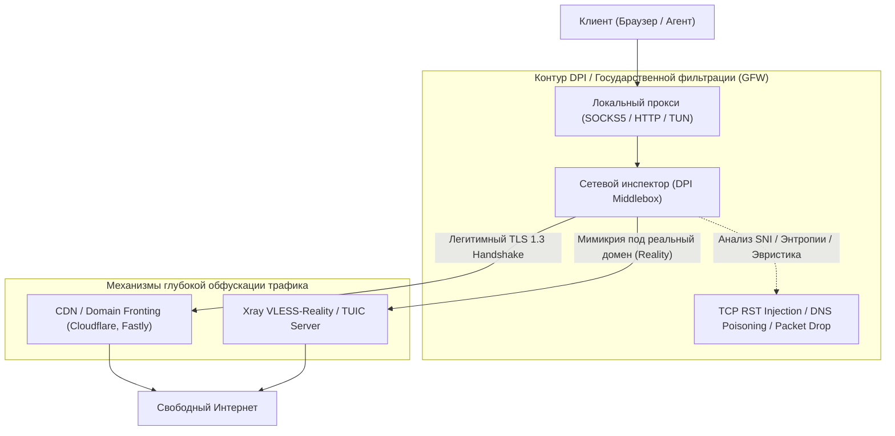

# 🌐 FQ-Book: Архитектура сетевых прокси, туннелей и механизмов обхода DPI-систем

> **Ссылка на репозиторий:** [https://github.com/hoochanlon/fq-book](https://github.com/hoochanlon/fq-book)  
> **Автор:** hoochanlon  
> **Название:** *«这本书能让你连接互联网» (The Book That Connects You to the Internet)*  
> **Категория:** `05_security_osint_and_guardrails`  
> **Звёзды GitHub:** 7,400+ ★ (#12 Daily в мировых трендах GitHub, +281 ★ за сутки)  
> **Стек:** Linux Networking, TCP/IP, Shadowsocks, V2Ray/Xray, WireGuard, IPFS, DNSCrypt, eBPF  
> **Лицензия:** CC BY-NC 4.0  

---

## 🎯 1. В чем фундаментальная ценность книги?

Большинство материалов по сетевой безопасности либо слишком абстрактные (модели OSI без практических реализаций), либо сводятся к примитивным инструкциям по кликам в готовых GUI-клиентах.

**FQ-Book — это глубокая инженерная анатомия противостояния систем глубокой фильтрации пакетов (DPI / GFW) и протоколов маскировки трафика:**
* **Детальный разбор техник цензуры:** От базовой блокировки портов и IP-адресов до отравления DNS-кэша, внедрения пакетов TCP RST, атак на цифровые сертификаты (Active Probing) и статистического анализа энтропии зашифрованного потока.
* **Архитектурный анализ протоколов обхода:** Почему классический OpenVPN легко детектируется по статическим заголовкам рукопожатия, и как современные протоколы (Shadowsocks-AEAD, VLESS-Reality, TUIC, Hysteria 2) мимикрируют под легитимный TLS 1.3 трафик популярных зарубежных сайтов.

---

## 🔍 2. Ключевые разделы сетевой инженерии в книге

1. **Анатомия DNS-атак и защита:** Анализ DNS Hijacking и DNS Cache Poisoning. Настройка защищенных резолверов через DNS over HTTPS (DoH), DNS over TLS (DoT), Oblivious DoH (ODoH) и DNSCrypt.
2. **Эволюция туннелей и прокси:**
   * **SOCKS5 / Shadowsocks:** Симметричное шифрование потока, защита от replay-атак через AEAD-шифры (ChaCha20-Poly1305, AES-256-GCM).
   * **V2Ray / Xray (VMess, VLESS, Trojan, Reality):** Полная имитация стандартного веб-сервера (Nginx/Caddy) с заимствованием чужого валидного сертификата без владения приватным ключом (VLESS-Reality).
   * **QUIC / UDP-туннели (Hysteria 2, TUIC):** Агрессивная перегрузочная оптимизация на базе UDP для каналов с высокой потерей пакетов.
3. **Децентрализованные сети и устойчивость:** Практическое использование протокола IPFS (InterPlanetary File System) и ZeroNet для создания неуязвимых к централизованным блокировкам узлов хранения данных.
4. **Сетевая операционная безопасность (OpSec):** Оценка чистоты IP-адресов (Datacenter vs Residential), борьба со снятием отпечатков TCP/IP стека (p0f) и изоляция сетевых интерфейсов через Linux Network Namespaces.

---

## 💡 3. Главные инженерные выводы

1. **Будущее за протоколами без собственных сигнатур:** Любой протокол с уникальным заголовком обречен на блокировку эвристическими нейросетевыми DPI-фильтрами. Выживают только протоколы, неотличимые от стандартного TLS-трафика.
2. **Понимание работы сетей необходимо AI-инженерам:** Автономные агенты, работающие в распределенных средах, обязаны уметь обходить сетевые ограничения и диагностировать сбои маршрутизации.
