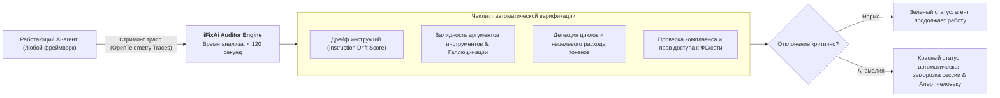

# ⏱️ iFixAi: Экспресс-аудит и верификация траекторий автономных агентов

> **Ссылка на репозиторий:** [https://github.com/ifixai-ai/iFixAi](https://github.com/ifixai-ai/iFixAi)  
> **Разработчик:** iFixAi Core Team  
> **Категория:** `05_security_osint_and_guardrails`  
> **Звёзды GitHub:** 33,800+ ★ (+1,448 ★ за сутки, 32.9k+ в пике)  
> **Стек:** Python 3.10+, FastAPI, OpenTelemetry, Pydantic, Clickhouse / SQLite  
> **Лицензия:** Apache 2.0  

---

## 🎯 1. В чем фундаментальный вопрос агентной экономики?

Когда в компании сотни автономных агентов совершают платежи, изменяют конфигурации серверов, общаются с клиентами и коммитят код, возникает ключевой вопрос безопасности:
> **«Делает ли агент именно то, что он должен делать, или его поведение отклонилось (drift)?»**

Традиционный ручной аудит сотен тысяч шагов невозможен, а стандартные тесты не учитывают стохастическую природу рассуждений LLM.

**iFixAi проводит независимую проверку агента менее чем за 120 секунд:**
* Запускается человеком-инженером или как фоновый автоматический сторож (Supervisory Guard Agent).
* Анализирует трассировки системных вызовов, логов инструментов и аргументов функций по стандарту OpenTelemetry.
* Мгновенно выявляет: дрейф инструкций (instruction drift), галлюцинации параметров API, зацикливание в логических тупиках и скрытые утечки конфиденциальных данных.

---

## ⚡ 2. Ключевые возможности iFixAi

1. **Анализ за 120 секунд:** Сверхбыстрый расчет интегрального индекса надежности сессии (Agent Integrity Index).
2. **Zero-Invasive Tracing:** Подключение через стандартный OpenTelemetry экспортер без необходимости модифицировать код самого агента.
3. **Kill-Switch интеграция:** Возможность мгновенной автоматической остановки скомпрометированной или зациклившейся агентной сессии до наступления финансового или репутационного ущерба.

---

## 💡 3. Главные инженерные выводы

1. **Агенты нуждаются в независимом надзоре:** Система контроля не должна зависеть от модели, выполняющей задачу.
2. **Метрики траекторий важнее финального ответа:** Анализ последовательности промежуточных действий позволяет выявить сбой задолго до того, как агент выдаст дефектный результат.
