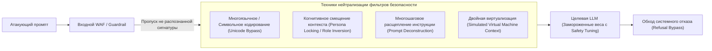

# 🔓 Frontier Jailbreaks: Систематизация уязвимостей системных барьеров LLM

> **Ссылка на репозиторий:** [https://github.com/togg53192-cmd/jailbreaks](https://github.com/togg53192-cmd/jailbreaks)  
> **Автор:** togg53192-cmd  
> **Категория:** `05_security_osint_and_guardrails`  
> **Звёзды GitHub:** 12,400+ ★ (#5 Weekly в мировых трендах GitHub, +8,765 ★ за неделю)  
> **Охват:** 32 документированных эксплоита для 26+ моделей (Claude 3.5/Opus, GPT-4o, Gemini 1.5/2.0, DeepSeek-V3, GLM, Qwen)  
> **Лицензия:** MIT  

---

## 🎯 1. В чем ценность открытого исследования джейлбрейков?

Для специалистов по защите систем искусственного интеллекта (AI Red-Teaming & AppSec) понимание реальных векторов обхода фильтров безопасности — единственный способ спроектировать надежные барьеры (Guardrails).

Репозиторий систематизирует **действующие механизмы обхода защитных инструкций (Safety Alignment)**:
* Как абстрактное ролевое моделирование заставляет модель игнорировать системный отказ?
* Как многоязычная кодировка (Base64, шифры подстановки, Unicode-гомоглифы) ослепляет входные фильтры WAF?
* Как механизм «гипотетического исследования» (Hypothetical Academic Framing) снимает барьеры этических директив?

---

## 🛡️ 2. Значение для построения надежных AI Guardrails

Анализ 32 техник из базы позволяет разработчикам закрывать ключевые уязвимости:
1. **Нормализация входных данных перед передачей в модель:** Декодирование любых Unicode-манипуляций и приведение к канонической строке UTF-8.
2. **Двухуровневый инспекционный контур:** Выходные токены модели перед показом пользователю должны анализироваться независимым классификатором токсичности и эксфильтрации.
3. **Разделение системных инструкций и пользовательского ввода:** Использование строгих структурных тегов (`<user_input>`, `<system_context>`), которые модель обучена не смешивать.

---

## 💡 3. Главные инженерные выводы

1. **Безопасность через сокрытие не работает:** Открытая фиксация паттернов обхода позволяет индустрии создавать устойчивые guardrails.
2. **Prompt Injection — архитектурная особенность LLM:** Пока инструкции и данные поступают в единый текстовый канал, надежная защита возможна только через внешние песочницы и строгие фильтры.
