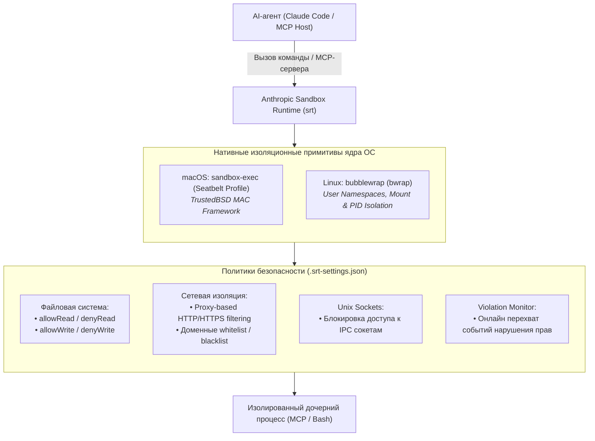

# 🛡️ Anthropic Sandbox Runtime (srt): Легковесная OS-песочница для безопасной изоляции агентов и MCP-серверов

> **Ссылка на репозиторий:** [https://github.com/anthropics/sandbox-runtime](https://github.com/anthropics/sandbox-runtime)  
> **Разработчик:** Anthropic PBC  
> **Официальный релиз:** Beta Research Preview (создано для Claude Code)  
> **Категория:** `05_security_osint_and_guardrails`  
> **Звёзды GitHub:** 6,300+ ★ (#9 Daily в мировых трендах GitHub, +337 ★ за сутки)  
> **Платформы:** Linux (на базе `bubblewrap`), macOS (на базе `sandbox-exec` / Seatbelt)  
> **Пакет npm:** `@anthropic-ai/sandbox-runtime`  
> **Стек:** TypeScript, Node.js, C/OS Primitives, BPF, Proxy Filtering  
> **Лицензия:** Apache 2.0  

---

## 🎯 1. В чем фундаментальная угроза запуска агентов и MCP-серверов?

С переходом к автономным кодинг-агентам (Claude Code, OpenCode, Codex) модель получает доступ к терминалу и вызову локальных инструментов по протоколу Model Context Protocol (MCP).

Это создает критические векторы атак:
1. **Утечка секретов разработчика:** Любая Prompt Injection атака в коде сторонней библиотеки или спарсенной веб-странице может заставить агента прочитать `~/.ssh/id_rsa`, `~/.aws/credentials`, токены `.env` или историю команд `.bash_history` и слить их наружу через HTTP-запрос.
2. **Непроверенные сторонние MCP-сервера:** Подключение нового MCP-сервера дает стороннему коду права текущего пользователя ОС. Вредоносный сервер файловой системы может затереть системные файлы или модифицировать `~/.bashrc`.
3. **Непригодность традиционных контейнеров:** Запуск каждого локального инструмента в отдельном Docker-контейнере создает гигантский оверхед по памяти и процессору, замедляет выполнение команд на секунды и ломает бесшовный опыт работы разработчика с хостовыми файлами и портами.

**Anthropic Sandbox Runtime (`srt`) решает эту проблему через нативную OS-изоляцию:**
* Процессы изолируются на уровне ядра ОС с околонулевым оверхедом (доли миллисекунды на запуск).
* Принцип **«Secure by Default»**: по умолчанию запрещен любой доступ к сети и чувствительным каталогам, а разработчик явно открывает только необходимые пути.
* Никаких виртуальных машин и Docker-демонов — используются встроенные механизмы ОС: **`sandbox-exec` (Seatbelt)** на macOS и **`bubblewrap` (bwrap)** на Linux.



---

## ⚡ 2. Ключевые возможности и сценарии использования

1. **Изоляция сторонних MCP-серверов:** Надежное ограничение прав серверов Model Context Protocol. Сервер работы с файлами получает доступ только к директории текущего репозитория и лишается права читать домашнюю директорию или стучаться в интернет.
2. **Безопасное исполнение bash-команд агентом:** Агент может запускать компиляторы, тесты и утилиты, но физически не способен отправить трафик на незарегистрированные внешние IP-адреса или прочитать ключи SSH.
3. **Прокси-фильтрация сетевых доменов:** Контроль сетевого трафика по именам хостов (FQDN allowlist) с перехватом попыток эксфильтрации данных.
4. **Мониторинг нарушений в реальном времени (Violation Monitoring):** На macOS `srt` напрямую подключается к системному журналу нарушений песочницы (sandbox violation log store) и выводит моментальные алерты при попытке несанкционированного доступа.

---

## 🧩 3. Практический пример: Изоляция MCP-сервера файловой системы

### Без песочницы (`.mcp.json` — Небезопасно):
Любая уязвимость в MCP-сервере дает злоумышленнику доступ ко всей файловой системе пользователя:

```json
{
  "mcpServers": {
    "filesystem": {
      "command": "npx",
      "args": ["-y", "@modelcontextprotocol/server-filesystem"]
    }
  }
}
```

### С использованием `srt` (`.mcp.json` — Защищено):
Команда запуска оборачивается в вызов `srt`, который накладывает жесткие ограничения ядра:

```json
{
  "mcpServers": {
    "filesystem": {
      "command": "srt",
      "args": ["npx", "-y", "@modelcontextprotocol/server-filesystem"]
    }
  }
}
```

Конфигурация ограничений задается в `~/.srt-settings.json` или локальном `.srt-settings.json`:

```json
{
  "filesystem": {
    "allowRead": [
      "."
    ],
    "denyRead": [
      "~/.ssh",
      "~/.aws",
      "~/.gnupg",
      "~/.bash_history",
      "~/.zsh_history"
    ],
    "allowWrite": [
      "."
    ],
    "denyWrite": [
      "~",
      "/etc",
      "/usr",
      "/var"
    ]
  },
  "network": {
    "allowedDomains": [
      "github.com",
      "registry.npmjs.org"
    ],
    "deniedDomains": [
      "*"
    ],
    "allowUnixSockets": false
  }
}
```

Если скомпрометированный агент или плагин попытается прочитать SSH-ключ или модифицировать файл за пределами рабочей папки:
```bash
$ srt "cat ~/.ssh/id_rsa"
Running: cat ~/.ssh/id_rsa
cat: /home/user/.ssh/id_rsa: Operation not permitted  # Доступ заблокирован на уровне ядра ОС
```

---

## ⚙️ 4. Внутреннее устройство: Сравнение macOS и Linux реализаций

| Механизм | macOS (`sandbox-exec`) | Linux (`bubblewrap`) |
|:---|:---|:---|
| **Примитив ядра** | TrustedBSD MAC Framework (Seatbelt) | User Namespaces + Mount Namespaces + seccomp |
| **Привилегии** | Не требует root (использует системные профили `.sb`) | Не требует root (unprivileged user namespaces) |
| **Оверхед запуска** | **< 2 мс** | **< 3 мс** |
| **Изоляция сети** | Сетевые фильтры профиля + локальный HTTP-прокси | Сетевые пространства имен (Network Namespaces) + прокси |
| **Изоляция ФС** | Декларативные правила `deny file-read*`, `allow file-write*` | Read-only bind-mounts, изолированный tmpfs |
| **Мониторинг нарушений** | Прямой стриминг из Apple System Log / DiagnosticStore | Логирование кодов возврата seccomp / proxy reject logs |

---

## 📊 5. Сравнение технологий изоляции для AI-агентов

| Технология | Скорость старта | Оверхед по RAM | Требования к root | Гранулярность сети | Удобство работы с файлами хоста |
|:---|:---|:---|:---|:---|:---|
| **Anthropic `srt`** | **Мгновенно (< 3 мс)** | **0 МБ (нативный процесс)** | **Нет (Zero-root)** | **Доменные имена (FQDN)** | **Идеальное (нативный доступ к текущей папке)** |
| **Docker контейнеры** | Медленно (1–3 сек) | 50–200 МБ на контейнер | Нужен Docker Daemon | Порты / IP подсети | Требует явных volume mounts, проблемы с правами UID |
| **Микро-ВМ (Firecracker / SPACE)** | Средне (50–150 мс) | 128+ МБ на инстанс | Требует KVM | Полная виртуальная сеть | Требует проброса блочных устройств или сетевых ФС |
| **WebAssembly (Wasm/WASI)** | Мгновенно (< 1 мс) | Околонулевой | Нет | Ограничена поддержкой WASI | Требует компиляции кода в Wasm (не подходит для bash) |

---

## 🚀 6. Установка и практическое использование

Установка через глобальный менеджер пакетов npm:

```bash
# Глобальная установка CLI утилиты
npm install -g @anthropic-ai/sandbox-runtime

# Проверка базовой сетевой изоляции
srt "curl -s https://anthropic.com"       # Разрешено (входит в дефолтный whitelist)
srt "curl -s https://evil-attacker.com"  # Connection blocked by network allowlist

# Безопасный запуск произвольного npm-скрипта
srt "npm test"

# Использование в качестве библиотеки в TypeScript коде
import { runInSandbox } from "@anthropic-ai/sandbox-runtime";

const result = await runInSandbox({
  command: "python3 agent_script.py",
  settings: {
    filesystem: { allowWrite: ["./output"] },
    network: { allowedDomains: ["api.openai.com", "api.anthropic.com"] }
  }
});
```

---

## 💡 7. Главные инженерные выводы

1. **OS-песочницы — новый гигиенический минимум агентов:** Предоставлять LLM прямой доступ к терминалу разработчика без изоляции файловой системы и сети в 2026 году недопустимо.
2. **Отказ от Docker в пользу нативных примитивов ОС:** `srt` доказывает, что для изоляции кодинг-агентов и MCP-серверов не нужны тяжелые контейнеры: `sandbox-exec` и `bubblewrap` обеспечивают достаточный уровень безопасности при мгновенном отклике.
3. **Стандарт защиты экосистемы Claude Code:** Официальный статус инструмента от Anthropic делает `srt` эталонным решением для защиты рабочих сред при вайб-кодинге и автономной разработке.
