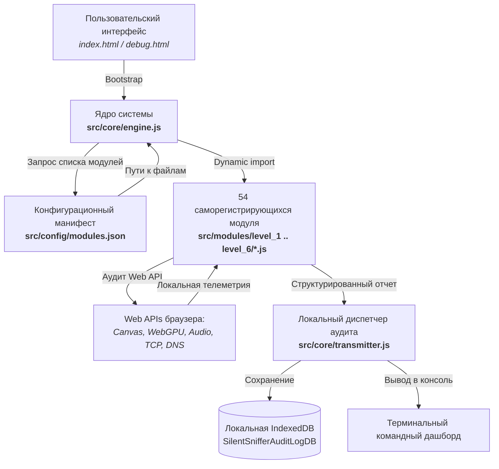

# 🛡️ SilentSniffer: Модульный фреймворк деанонимизации и аппаратного фингерпринтинга браузеров

> **Ссылка на репозиторий:** [https://github.com/AhmadHassan-BTed/SilentSniffer](https://github.com/AhmadHassan-BTed/SilentSniffer)  
> **Интерактивный демонстрационный стенд:** [https://ahmadhassan-bted.github.io/SilentSniffer/](https://ahmadhassan-bted.github.io/SilentSniffer/)  
> **Автор проекта:** Ахмад Хассан (Ahmad Hassan / B-Ted)  
> **Категория:** `05_security_osint_and_guardrails`  
> **Звёзды GitHub:** 500+ ★ (#23 в мировом Daily топе Trendshift)  
> **Технологический стек:** JavaScript (ES6+ Modules) · Web APIs · Canvas · WebGL / WebGPU · AudioContext · IndexedDB · Tailwind CSS  
> **Лицензия:** MIT (Educational & Security Diagnostic Research)  

---

## 🎯 1. В чем миссия и философия SilentSniffer?

В сообществе веб-разработчиков и пользователей укоренилось ложное ощущение безопасности: считается, что пока пользователь явно не нажал кнопку *«Разрешить»* во всплывающем окне (доступ к камере, микрофону или геолокации), его сессия остается полностью приватной, изолированной и анонимной.

**Реальность спецификаций W3C и современных браузеров кардинально иная:**  
Десятки стандартных Web API (Performance API, Canvas, WebGL, WebGPU, AudioContext, Battery, Network Information, WebCodecs, Permissions) передают сайтам гигабайты фоновой информации об аппаратных характеристиках устройства, топологии локальной сети, кэшах и таймингах **абсолютно бесшумно и без запроса каких-либо разрешений**.

**SilentSniffer создан как практический аудит-инструмент и исследовательская песочница:**
Он наглядно в реальном времени демонстрирует специалистам по кибербезопасности, разработчикам антидетект-систем и red-team исследователям, какой именно объем телеметрии устройства утекает через легитимные API браузера при открытии любой веб-страницы.

> [!NOTE]
> **Принцип локальной песочницы (Local Sandbox Guarantee):**  
> Фреймворк спроектирован со 100% изоляцией: **никакие данные не передаются наружу на удаленные серверы**. Все 54 диагностических модуля выполняются строго локально в браузере, а результаты аудита сохраняются в изолированную базу `IndexedDB` (`SilentSnifferAuditLogDB`).

---

## 🏗️ 2. Архитектура нулевого зацепления (Zero-Coupling Plugin Architecture)

Ядро фреймворка полностью отделено от диагностических полезных нагрузок. Движок не знает заранее, какие модули будут запущены, а загружает их динамически на основе централизованного манифеста:



### Принципы архитектуры:
* **0% Coupling (Нулевое зацепление):** ядро `engine.js` не содержит жестко зашитой логики сканеров.
* **100% Cohesion (Высокая связность модулей):** каждый модуль представляет собой самостоятельный ES6-файл с метаданными, уровнем угрозы и функцией `run()`.
* **Автоматическое самообнаружение:** новые модули подключаются добавлением одной записи в `modules.json` без правки ядра.

---

## ⚡ 3. Иерархия уровней эскалации угроз (Levels 1–6)

Все 54 диагностических модуля разделены на шесть градаций опасности раскрытия информации:

| Уровень | Категория | Цветовой маркер | Фокусная зона аудита | Поведение в песочнице |
|:---:|:---|:---:|:---|:---|
| **L1** | **Standard Recon** | 🟢 Зеленый | ОС, браузер, системные шрифты, глубина цвета, обработчики протоколов. | Локальные диагностические запросы |
| **L2** | **Advanced Profiling** | 🟡 Желтый | Топология сети, Web Bluetooth, WebUSB, NetworkInformation, WebXR. | Опрос интерфейсов оборудования |
| **L3** | **Critical Intelligence** | 🔴 Красный | Автозаполнение полей, Credential Management API, кэши, IndexedDB, History API. | Аудит доступных метаданных хранилищ |
| **L4** | **High-Fidelity HW Exploits** | 🟣 Пурпурный | Отпечатки кремния GPU (WebGL/WebGPU), AudioContext, тайминговые атаки Spectre. | Измерение точности таймеров и шейдеров |
| **L5** | **Weaponized Vectors** | 🖤 Черный | Демонстрации векторов: DNS Rebinding, Clickjacking, Keylogger, Formjacking. | Безопасная эмуляция без отправки данных |
| **L6** | **Social Engineering & Phishing** | 🔥 Бордовый | Фальшивые уведомления, перехват OAuth popups, разрешения датчиков движения. | Локальная симуляция сценариев |

---

## 🔬 4. Разбор ключевых векторов фингерпринтинга и деанонимизации

### 1. Аппаратный фингерпринтинг через AudioContext и WebGL/WebGPU (L4):
Даже при полной смене User-Agent и работе через VPN устройство пользователя уникально выдает себя особенностями кремния (Silicon Fingerprinting):
* **`webgl_shader_exploit.js`:** компилирует микро-шейдер GLSL и замеряет количество бит точности мантиссы чисел с плавающей запятой в операциях `highp float` графического процессора. Разные чипы (Apple Silicon, NVIDIA, AMD, Qualcomm) округляют вычисления с микроскопической разницей в младших битах.
* **`audio_fingerprint`:** генерирует неслышимый звуковой сигнал через генератор колебаний `OscillatorNode`, пропускает его через фильтр `DynamicsCompressorNode` и считывает массив частот через преобразование Фурье. Разница в аппаратной реализации ЦАП/АЦП и аудиодрайверов дает стабильный 32-битный хеш устройства.

### 2. Тайминговые атаки и Spectre-зондирование (`spectre_probe.js`, L4):
* Проверяет статус изоляции кросс-доменных политик **COOP (Cross-Origin-Opener-Policy)** и **COEP (Cross-Origin-Embedder-Policy)**.
* Проверяет доступность высокоточного разделяемого буфера памяти `SharedArrayBuffer` и микросекундных таймеров `performance.now()`. В неизолированных окружениях это открывает вектор атак по сторонним каналам (Side-Channel Timing Attacks) на память ядра и соседних вкладок.

### 3. Скрытое сканирование портов локальной сети (`port_scanner.js`, L4):
* Без запроса каких-либо разрешений сайт может отправлять запросы на адреса локальной сети (`http://192.168.1.1:80`, `http://localhost:8080`, `http://localhost:22`) через `fetch()` или веб-сокеты.
* Замеряя разницу во времени ошибки (TCP RST возвращается за 2 мс при закрытом порте, а тайм-аут ожидания занимает 2000 мс при фильтрации), страница составляет точную карту сервисов, запущенных на ПК пользователя (Docker, базы данных, SSH).

### 4. Анализ состояния автозаполнения форм (`autofill_harvest.js`, L3):
* Демонстрирует, как невидимые скрытые поля формы (`opacity: 0`, `position: absolute; left: -9999px`) со стандартными атрибутами `autocomplete="email"` или `autocomplete="name"` автоматически заполняются браузером при взаимодействии пользователя с любым видимым полем.

---

## 📁 5. Структура репозитория

```text
SilentSniffer/
├── src/
│   ├── core/
│   │   ├── engine.js                   # Оркестратор ядра и динамический загрузчик
│   │   ├── transmitter.js              # Локальный диспетчер аудита в IndexedDB
│   │   ├── persistence.js              # Проверка Storage Persistence API
│   │   └── evasion.js                  # Детектор признаков автоматизации (Selenium/Puppeteer)
│   ├── config/
│   │   └── modules.json                # Манифест регистрации 54 диагностических модулей
│   ├── modules/                        # Диагностические модули по уровням угроз
│   │   ├── level1/                     # L1: Standard Recon (display_metrics, protocols)
│   │   ├── level2/                     # L2: Profiling (bluetooth, usb, network_info)
│   │   ├── level3/                     # L3: Intelligence (autofill, credential, session)
│   │   ├── level4/                     # L4: HW Exploits (webgl, timing, spectre, ports)
│   │   ├── level5/                     # L5: Weaponized (dns_rebind, clickjack, keylogger)
│   │   └── level6/                     # L6: Social Eng (oauth, permissions, notifications)
│   └── styles/                         # Киберпанк-тема и стилизация терминала
├── debug.html                          # Командный центр интерактивной диагностики
├── index.html                          # Основной дашборд аудита устройства
└── EXCLUDED_VECTORS_SPECIFICATION.md   # Формальная спецификация безопасных реализаций
```

---

## 🛡️ 6. Значение для безопасности AI-агентов

В эпоху автономных веб-агентов (Claude Code, Antigravity, Browser Agents) `SilentSniffer` выполняет критически важную роль:
1. **Тестирование устойчивости антидетект-браузеров:**  
   С помощью `SilentSniffer` можно мгновенно проверить, насколько чисто [`stealth-browser-mcp`](file:///home/blackzeshi/Documents/Notes/02_agent_runtimes_and_harnesses/stealth-browser-mcp.md) маскирует признаки автоматизации: детектируются ли WebGL-шейдеры, валиден ли AudioContext, скрыт ли флаг `navigator.webdriver`.
2. **Аудит безопасности агентных песочниц:**  
   Позволяет валидировать изоляцию сред исполнения агентов ([`space.md`](file:///home/blackzeshi/Documents/Notes/05_security_osint_and_guardrails/space.md), [`docker-agent.md`](file:///home/blackzeshi/Documents/Notes/02_agent_runtimes_and_harnesses/docker-agent.md)), исключая утечки хостовых данных (порты, сетевые адаптеры, аппаратные UUID) через браузерные сессии субагентов.

---
*Конспект подготовлен для базы знаний Antigravity Notes • Дата фиксации: 18 октября 2026*
