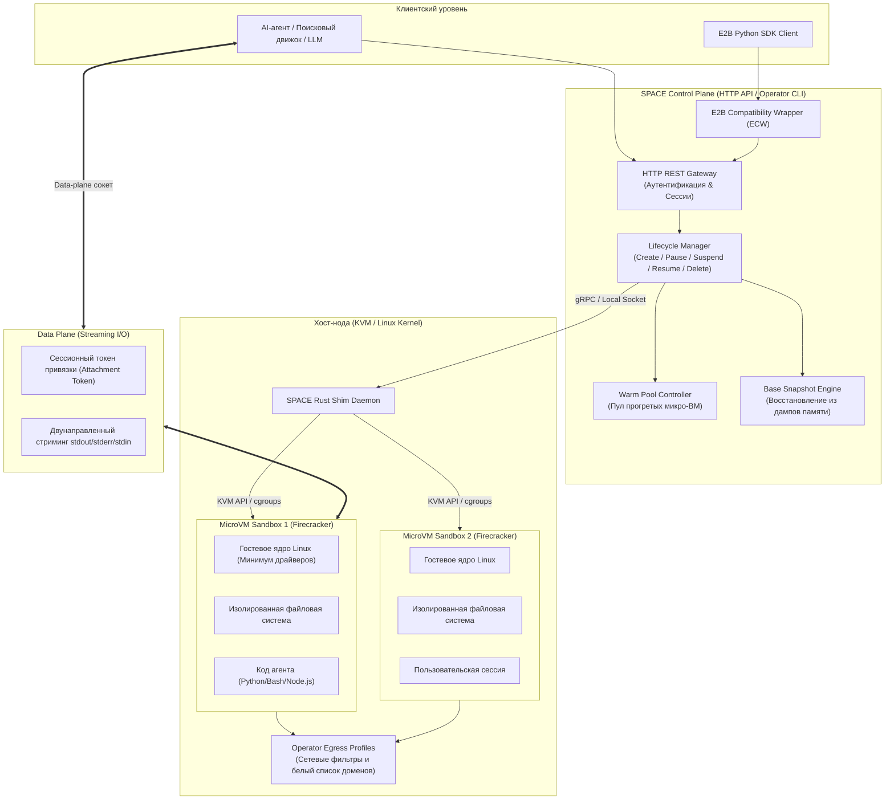

# 🛡️ SPACE: Платформа аппаратной изоляции и исполнения агентного кода в микро-ВМ Firecracker от Perplexity AI

> **Ссылка на репозиторий:** [https://github.com/perplexityai/SPACE](https://github.com/perplexityai/SPACE)  
> **Организация:** Perplexity AI (`perplexityai`)  
> **Документация:** [https://space.docs.perplexity.ai](https://space.docs.perplexity.ai)  
> **Слоган:** *«Sandboxed Platform for Agentic Code Execution: pluggable-runtime sandboxes for running agent and user code in isolation.»*  
> **Звёзды GitHub:** 960+ ★ (#6 в мировом Daily топе Trendshift)  
> **Архитектурный стек:** Rust (ядро и CLI оператора) · Firecracker (KVM microVM) · Kubernetes / Kind · HTTP REST API · gRPC · Docker · Python (E2B Compatibility SDK)  
> **Лицензия:** Apache 2.0  

---

## 🎯 1. Архитектурная проблема: риски исполнения недоверенного агентного кода

Автономные AI-агенты нового поколения (поисковые агенты Perplexity, кодинг-ассистенты, аналитики данных) генерируют и выполняют произвольный код на Python, Bash, Node.js прямо в процессе решения задачи. Исполнение такого кода сопряжено с критическими уязвимостями:

1. **Побег из контейнера (Container Escape):**  
   Традиционная изоляция через Docker/cgroups делит общее ядро хоста (Shared Linux Kernel). Эксплуатация уязвимостей ядра (Dirty Pipe, переполнение буфера в системных вызовах) позволяет вредоносному или галлюцинирующему скрипту скомпрометировать весь сервер.
2. **Неконтролируемый сетевой эгресс (Network Data Exfiltration):**  
   Агентный скрипт может попытаться слить конфиденциальные переменные окружения, ключи API или контекст на удаленные серверы злоумышленников через скрытые HTTP/DNS запросы.
3. **Холодный старт и исчерпание ресурсов:**  
   Полноценные виртуальные машины (QEMU/KVM) грузятся 15–40 секунд, что неприемлемо для интерактивного диалога с LLM. Обычные легковесные песочницы страдают от отсутствия персистентных снимков памяти (Memory Snapshots) и медленного прогрева сред.

**SPACE (Sandboxed Platform for Agentic Code Execution)** — это производственная система безопасности от Perplexity AI, выложенная в открытый доступ. Она обеспечивает аппаратную изоляцию кода в микро-ВМ Firecracker с миллисекундным временем старта, разделением плоскостей управления/данных и полной совместимостью с экосистемой E2B.

---

## 🏗️ 2. Архитектура SPACE: Двухконтурный движок микро-ВМ

В основе SPACE лежит строгое разделение на **Control Plane** (управление жизненным циклом песочниц) и **Data Plane** (высокоскоростная передача I/O потоков команд).



---

## ⚙️ 3. Ключевые возможности и технические решения

### 3.1. Аппаратная виртуализация на базе Firecracker
* В отличие от контейнеров, каждая песочница SPACE запускается в собственной **микро-ВМ Firecracker**, использующей аппаратный модуль Linux KVM.
* Гостевая ОС имеет собственное изолированное ядро Linux, память и виртуальные блочные устройства. Даже получение `root` внутри песочницы не дает злоумышленнику выхода на уровень хоста.

### 3.2. Warm Pools и Base Snapshots (Мгновенный старт)
* **Warm Pools (Пул прогретых машин):** Фоновый контроллер постоянно держит в памяти Kubernetes-кластера заданное количество уже загруженных микро-ВМ. Создание новой песочницы для агента занимает **менее 150 миллисекунд** (происходит выделение готовой ВМ без цикла холодной загрузки ядра).
* **Base Snapshots:** Поддержка создания снапшотов состояния памяти и диска. Песочница с предзагруженными тяжелыми библиотеками (PyTorch, Pandas, Scipy) замораживается и разворачивается за доли секунды.

### 3.3. Разделение плоскостей Control Plane и Data Plane
* Изменение состояний песочницы (запуск, пауза, заморозка, уничтожение) асинхронно: API возвращает `operation_id`, опрашиваемый клиентом.
* Выполнение команд происходит по отдельному высокоскоростному каналу с использованием сессионных токенов привязки (**Attachment Tokens**), что предотвращает блокировку управляющего REST API тяжелым терминальным выводом.

### 3.4. E2B Compatibility Wrapper (ECW)
* SPACE предоставляет встроенный слой совместимости с популярным стандартом облачных песочниц **E2B**.
* Существующие приложения и агентные пайплайны, написанные под `e2b-code-interpreter` или официальный Python SDK E2B, переключаются на собственный self-hosted кластер SPACE изменением одной переменной окружения `E2B_DOMAIN`.

### 3.5. Operator Egress Profiles (Контроль сетевого периметра)
* Администратор задает профили исходящего трафика (Egress Policies) на уровне сети хоста.
* Возможно полное отключение сетевого доступа (Air-Gapped режим), ограничение только разрешенными DNS-именами (например, доступ только к `pypi.org` и `github.com`) или трансляция через корпоративный MITM-прокси с инспекцией пакетов.

---

## 💻 4. Практический пример работы с API SPACE

### Создание песочницы и выполнение скрипта:

```python
import httpx
import time

SPACE_API = "http://space-gateway.internal:8080/v1"
HEADERS = {"Authorization": "Bearer space_sec_token_xyz"}

# 1. Запрос на создание песочницы из шаблона Python 3.12
resp = httpx.post(f"{SPACE_API}/sandboxes", json={"template": "python-data-science"}, headers=HEADERS)
op = resp.json()
sandbox_id = op["sandbox_id"]

# 2. Ожидание готовности (из Warm Pool это занимает ~100-200 мс)
while True:
    status = httpx.get(f"{SPACE_API}/sandboxes/{sandbox_id}", headers=HEADERS).json()
    if status["state"] == "ready":
        break
    time.sleep(0.05)

# 3. Запуск изолированной команды
exec_resp = httpx.post(
    f"{SPACE_API}/sandboxes/{sandbox_id}/commands",
    json={
        "command": ["python3", "-c", "import os; print('Hello from Firecracker MicroVM! UID:', os.getuid())"],
        "timeout_seconds": 10
    },
    headers=HEADERS
)
cmd_data = exec_resp.json()

# 4. Чтение потока выполнения
print("Вывод команды:", cmd_data["stdout"])
# Вывод: Hello from Firecracker MicroVM! UID: 1000

# 5. Остановка и освобождение ресурсов
httpx.delete(f"{SPACE_API}/sandboxes/{sandbox_id}", headers=HEADERS)
```

---

## 📊 5. Сравнение SPACE с альтернативными рантаймами песочниц

| Критерий | Perplexity SPACE | Trail of Bits Coop | Docker Agent | E2B Cloud |
| :--- | :--- | :--- | :--- | :--- |
| **Технология изоляции** | Firecracker MicroVM (KVM) | MicroVM (Cloud-Hypervisor) | OCI Контейнеры (cgroups) | Firecracker MicroVM (AWS) |
| **Развертывание** | Self-hosted (Kubernetes / Kind) | Локальный CLI / Mac/Linux | Локальный Docker Engine | Проприетарное SaaS-облако |
| **Время старта** | 100–250 мс (Warm Pools) | 1–3 секунды | 300–800 мс | 200–500 мс |
| **Сетевые политики** | Egress Profiles (Белые списки) | Локальный фаервол | Docker Bridge Networks | Настройки облака |
| **Совместимость с E2B** | ✅ Нативная (встроенный ECW) | ❌ Нет | ❌ Нет | ✅ Нативная |
| **Лицензия** | Apache 2.0 | Apache 2.0 | Docker Subscription | Закрытое SaaS ядро |

---

## 💡 6. Инженерные выводы для базы знаний

1. **Новый стандарт безопасности для агентных архитектур:**  
   Песочницы на базе аппаратных микро-ВМ окончательно вытесняют небезопасные Docker-рантаймы в задачах выполнения агентного кода. Perplexity доказала жизнеспособность архитектуры Firecracker под колоссальными нагрузками реального поискового трафика.
2. **Zero Vendor-Lock благодаря ECW:**  
   Поддержка E2B Compatibility Wrapper позволяет разработчикам легко уйти от платного SaaS-облака E2B к собственной инфраструктуре на базе недорогих bare-metal серверов с поддержкой аппаратной виртуализации KVM.
3. **Место в стеке персонального AI-стенда:**  
   SPACE идеально закрывает уровень безопасного выполнения недоверенного кода (Safe Execution Tier) в связке с сетевым шлюзом **Magpie** и менеджером окружений **CCBaga**.
