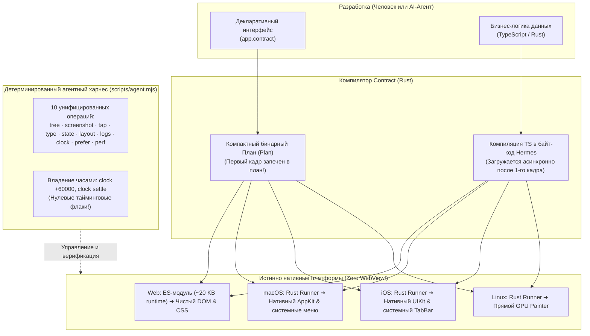

# ⚡ Expo Exact: Истинно нативный кроссплатформенный рантайм нового поколения

> **Ссылка на репозиторий:** [https://github.com/expo/exact](https://github.com/expo/exact)  
> **Разработчик:** Команда ядра Expo (создатели экосистемы Expo / React Native)  
> **Категория:** `06_developer_tools_and_apps`  
> **Звёзды GitHub:** 1,800+ ★ (+1,115 ★ за сутки)  
> **Стек:** Rust, декларативный DSL `Contract`, TypeScript / Hermes bytecode, нативный UIKit (iOS), AppKit (macOS), DOM (Web), тестовый драйвер `scripts/agent.mjs`  
> **Лицензия:** Открытая лицензия Expo  

---

## 🎯 1. В чём кризис современной кроссплатформенной разработки?

На протяжении десятилетия разработчики выбирали между двумя компромиссами:
1. **Тяжелые веб-обертки (Electron, Tauri, Capacitor):** Огромный оверхед по памяти, неестественное поведение системных контролов, высокое энергопотребление и задержка отклика.
2. **Абстрактные движки (React Native, Flutter):** Сложные асинхронные мосты (JS Bridge), непредсказуемый старт приложения (холодный старт > 1.5–2 секунд) и крайняя сложность сквозного тестирования автономными AI-агентами.

### Манифест Expo Exact:
> *"Write an app once. It runs natively on the web, macOS, iOS, and Linux, and an AI agent can build it, run it, see it, and test it on every one of them."*  
> *(«Пишите приложение один раз. Оно нативно работает в Web, macOS, iOS и Linux, и AI-агент может самостоятельно собрать его, запустить, увидеть и протестировать на каждой из платформ»)*.



---

## ⚡ 2. Три фундаментальных архитектурных принципа

### 1. Agent Native (Создан для автономных агентов кодинга)
Архитектура Exact изначально исходит из того, что большую часть кода и тестов будут писать AI-агенты (Claude Code, Antigravity, Cursor):
* **Ровно 10 унифицированных операций:** Драйвер `scripts/agent.mjs` предоставляет одинаковый API для Web, macOS, iOS Simulator и Linux:
  `tree`, `screenshot`, `tap`, `type`, `state`, `layout`, `logs`, `clock`, `prefer`, `perf`.
* **Часы принадлежат агенту (Deterministic Clock):** Агенту больше не нужно ставить случайные `sleep(2000)` в ожидании анимаций. Агент выполняет команду `clock settle` или `clock +60000`, и рантайм мгновенно перематывает состояние. Никаких флакающих тестов!
* **Единые спецификации `app.test.contract`:** Один тестовый сценарий без единой строчки платформозависимого кода исполняется одинаково на всех ОС.

### 2. Speed is King (Экстремальная производительность)
Команда Expo зафиксировала жесткие бюджеты производительности (`rules/RULES.md`), за регресс которых коммит немедленно блокируется:

| Параметр бюджета | Целевое значение | Реализация в Exact |
| :--- | :--- | :--- |
| **Холодный старт до первого кадра** | **< 100 ms p50** | Первый кадр запечен прямо в план компилятора |
| **JS, исполняемый до первого пикселя** | **0 мс (None)** | Ни один байт JS не запускается до отрисовки интерфейса |
| **Горячая перезагрузка (Dev restart)** | **< 100 ms p50** | Мгновенный патчинг бинарного плана |
| **Полный прогон сьюта проверок** | **< 65 секунд** | Параллельные компиляторы на чистом Rust |

### 3. Истинный натив без WebView и тяжелых мостов
* На iOS отрисовка выполняется через нативные компоненты **UIKit**, системные переключатели и системный таббар.
* На macOS окно приложения использует компоненты **AppKit**.
* В браузере план управляет нативным **DOM и CSS** через минималистичный рантайм размером всего **~20 КБ**.

---

## 💻 3. Как пишется код в Exact: DSL Contract + TypeScript

Интерфейс декларируется в файле `.contract`, а логика состояния описывается в типизированном TypeScript:

```contract
// app.contract
view MainTodoList {
  header: Text(value: "Мои задачи", style: title)
  
  input: TextInput(
    placeholder: "Что нужно сделать?",
    on_submit: action.add_item
  )
  
  list: ForEach(items: state.todos, key: "id") { item in
    TodoRow(
      title: item.title,
      done: item.completed,
      on_toggle: action.toggle_item(id: item.id)
    )
  }
}
```

```typescript
// app.ts — логика данных
export class AppState {
  todos: Array<{ id: string; title: string; completed: boolean }> = [];

  addItem(title: string) {
    this.todos.push({ id: crypto.randomUUID(), title, completed: false });
  }

  toggleItem(id: string) {
    const item = this.todos.find(t => t.id === id);
    if (item) item.completed = !item.completed;
  }
}
```

### Автономный запуск тестирования агентом:
```bash
# Агент нажимает на кнопку, вводит текст, перематывает таймер и снимает скриншот
bun scripts/agent.mjs web tree "tap input" "type input 'Купить книгу по Rust'" \
  "clock settle" state "screenshot /tmp/test-out.png"
```

---

## 💡 4. Главные инженерные выводы

1. **Конец эпохи тяжелых WebView в кроссплатформе:** Exact доказывает, что можно иметь единый декларативный код и получать честный нативный UIKit/AppKit с запуском за 100 мс.
2. **Детерминированное время — ключ к надежности агентных тестов:** Контроль виртуальных часов (`clock settle`) устраняет главную боль E2E-тестирования в CI/CD.
3. **Rust как идеальный кроссплатформенный клей:** Ядро лейаута и раннер на Rust обеспечивают одинаковую геометрию блоков на мобильных, десктопных и веб-экранах.
