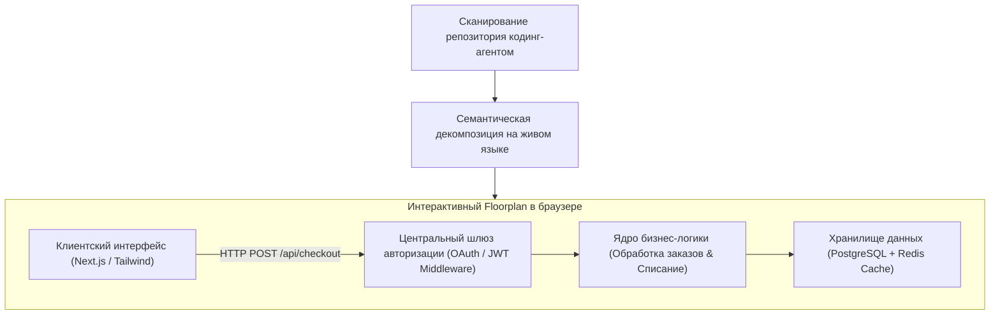

# 🗺️ Floorplan: Интерактивная карта системы от кодинг-агентов

> **Ссылка на репозиторий:** [https://github.com/haydenschmitty/floorplan](https://github.com/haydenschmitty/floorplan)  
> **Автор:** Hayden Schmitt  
> **Категория:** `06_developer_tools_and_apps`  
> **Звёзды GitHub:** 1,100+ ★ (#16 Daily в мировых трендах GitHub, +267 ★ за сутки)  
> **Поддерживаемые агенты:** Claude Code Plugin, Codex CLI, Cursor Skill  
> **Стек:** JavaScript, HTML5 Canvas, Graphviz / WebAssembly, Tailwind CSS  
> **Лицензия:** MIT  

---

## 🎯 1. В чем проблема понимания архитектуры проектов в эпоху AI?

С появлением вайб-кодинга и автономных кодинг-агентов скорость появления новых модулей и файлов выросла в разы. Однако:
1. **Традиционные диаграммы устаревают мгновенно:** Ручные схемы в Miro или Figma никто не обновляет, они теряют актуальность после первого же крупного рефакторинга.
2. **Сгенерированные UML-диаграммы нечитаемы:** Пакеты автоматической генерации создают паутину из сотен классов и стрелок, в которой невозможно понять бизнес-смысл сервисов.
3. **Онбординг человека затягивается:** Новый разработчик не понимает, по какому маршруту проходит сетевой запрос и какие скрытые сайд-эффекты есть у микросервисов.

**Floorplan решает эту проблему через семантическую трансляцию кода в интерактивный «план этажа» (Floorplan):**
* Агент (Claude Code или Codex) проходит по всей кодовой базе проекта.
* Вместо технических имен файлов (`src/api/v2/handlers/u_mw.ts`) каждому модулю присваивается **понятное человеческое описание** («Шлюз авторизации и валидации сессий»).
* В браузере генерируется интерактивная векторная карта: нажатие на любой блок показывает связанные файлы, входные эндпоинты и стек вызовов.

---

## ⚡ 2. Ключевые возможности Floorplan

* **Интерактивный зум и инспекция:** Клик по компоненту раскрывает точные пути к файлам и функции, реализующие логику блока.
* **Трассировка запросов (Request Flow):** Выбор сценария (например, «Регистрация нового пользователя») подсвечивает цепочку вызовов сквозь все слои архитектуры.
* **Автоматическое обновление через Git Hook:** Генерация свежей карты при создании Pull Request гарантирует актуальность документации.

---

## 💡 3. Главные инженерные выводы

1. **Архитектура должна быть объяснима на человеческом языке:** Если сложность системы невозможно выразить простыми смысловыми блоками, архитектура страдает от оверинжиниринга.
2. **Автоматическая визуализация снижает когнитивную нагрузку:** Интерактивные карты сокращают время входа инженера в незнакомый репозиторий с дней до десятков минут.
