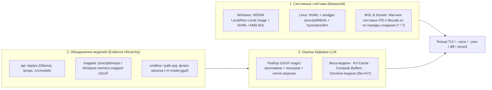

# 📊 gputaskman: Профайлер содержимого GPU — что именно занимает VRAM (веса, KV-cache или браузер)

> **Ссылка на репозиторий:** [https://github.com/shanselman/gputaskman](https://github.com/shanselman/gputaskman)  
> **Автор:** Scott Hanselman (`shanselman`)  
> **Категория:** `06_developer_tools_and_apps`  
> **Звёзды GitHub:** 2,570+ ★ (+545 ★ за сутки)  
> **Стек:** Python 3.11+ (Textual TUI), NVML, WDDM/DXGI, AMD ADL / Linux `amdgpu` (`drm` fdinfo), `i915`, Apple Silicon Metal, `npu-smi` (Ascend 310P)  
> **Лицензия:** MIT

---

## 🎯 1. Проблема: Диспетчер задач говорит «занято 15 GB», но чем именно?

Обычные мониторы вроде `nvidia-smi` или Windows Task Manager показывают либо общую цифру занятой видеопамяти, либо ломаются в ключевых сценариях локального AI:
* Под Windows **WDDM** `nvidia-smi` на GeForce часто выводит `N/A` для памяти процессов, а стандартный `Dedicated Usage` дважды считает общие поверхности у приложения, `dwm.exe` и `csrss.exe` (раздувая сумму до 15+ GB при реальных 1.4 GB).
* Под **WSL** `nvidia-smi` вообще не видит процессы.
* Внутри **Docker/Kubernetes** NVML возвращает PID хоста, которые не совпадают с PID внутри контейнера.
* Ни один системный монитор не отвечает на главный вопрос LLM-инженера: *сколько памяти съели веса модели, сколько — KV-cache, сколько утекло в Spill (системную RAM), и какой именно файл GGUF сейчас крутится?*

**gputaskman (`gtm`)** объединяет низкоуровневую телеметрию драйверов с инспекцией рантаймов и заголовков моделей.

---

## 🏗️ 2. Как устроена декомпозиция памяти и идентификация моделей



### Честная эпистемология доказательств (Evidence Hierarchy)
Чтобы не вводить пользователя в заблуждение (одна лишь загруженная `libcuda.so` не доказывает, какая модель работает), `gputaskman` маркирует источник каждого определения:
1. **`api`** — локальный API рантайма явно сообщает загруженную модель (`Ollama`, `llama-server`, `LM Studio`, `vLLM`).
2. **`mapped`** — файл модели реально замаплен в память процесса (подтверждается статус **confirmed** при сочетании `api`/`mapped`/`cmdline`).
3. **`cmdline`** / **`path-arg`** — путь передан в аргументах запуска.
4. **`installed`** — файл найден в каталоге приложения, но загрузка не доказана.

### Поддерживаемые AI-рантаймы и типы моделей
* **Рантаймы:** `llama.cpp` / `llama-server`, `Ollama`, `LM Studio`, `vLLM` (с проверкой дерева процессов до 2 предков), `stable-diffusion.cpp`, кэш Hugging Face (`models--org--repo`), локальные помощники Handy / WinML.
* **Автоопределение типа модели по GGUF:** LLM (с оценкой KV-cache), embedding/reranker (`pooling_type`), speech (`stt.*`), а также **некаузальные decision-модели** (`decision.type` — включая **Laya**, **OpenJev** и **Kev**, для которых `gputaskman` корректно не оценивает KV-cache, так как они его не выделяют).
* **Аккуратный учёт AMD Linux (`amdgpu`):** корректно обрабатывает разделяемые DRM-клиенты и буферы композитора (`n/a` вместо ложного двойного счёта), различает дискретную VRAM и GTT на APU.

---

## 💻 3. Установка и ключевые сценарии CLI

```bash
# Установка изолированно с PyPI (доступны команды gputaskman и gtm)
uv tool install gputaskman
# или
pipx install gputaskman

# Интерактивный TUI (клавиши: s - сортировка, c - графики, m - slim/full режим, ? - справка)
gputaskman

# Скриптуемые режимы на базе того же коллектора
gputaskman --once                              # разовый текстовый снимок
gputaskman --json                              # снимок в JSON
gputaskman diff before.json after.json         # сравнение памяти до и после запуска модели
gputaskman record -o session.jsonl --duration 300   # запись временного ряда на 5 минут
```

Есть также готовые **портативные сборки** под Windows (`x64` и `arm64`) и Linux (`x64` и `arm64`), не требующие установленного Python или CUDA Toolkit.

---

## 💡 4. Главные инженерные выводы

1. **Анти-галлюцинационный дизайн мониторинга:** `gputaskman` чётко разделяет *измеренные* аппаратные счётчики, *подтверждённые* маппинги и *оценки* по GGUF/логам, возвращая `null` в JSON вместо обманчивого `0`, если драйвер не отдаёт метрику (например, для ROCm/HIP очередей через `/dev/kfd`).
2. **Инструмент `diff before.json after.json`** закрывает важную потребность при отладке локального инференса — точное измерение реального прироста VRAM, Spill и KV-cache при смене контекста или квантизации.
3. **Решение проблемы PID namespace в контейнерах и WSL** через сопоставление `libcuda.so` в порядке создания процессов делает инструмент сразу пригодным для арендованных GPU-боксов (Vast.ai, RunPod, Kubernetes).
