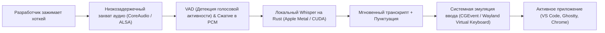

# 🎙️ Hex: Локальная быстрая диктовка голосом на базе Rust

> **Ссылка на репозиторий:** [https://github.com/anomalyco/hex](https://github.com/anomalyco/hex)  
> **Официальный сайт:** [https://anoma.ly/hex/](https://anoma.ly/hex/)  
> **Разработчик:** Anomaly Co.  
> **Категория:** `06_developer_tools_and_apps`  
> **Звёзды GitHub:** 2,400+ ★ (#14 Daily в мировых трендах GitHub, +386 ★ за сутки)  
> **Стек:** Rust, Whisper.cpp / Candle, macOS Accessibility / CGEvent, Linux X11/Wayland  
> **Лицензия:** MIT  

---

## 🎯 1. В чем проблема голосового ввода для разработчиков?

Голосовой ввод текста на компьютере сталкивается с двумя непреодолимыми проблемами:
1. **Утечка приватности в облако:** Проприетарные решения (Wispr Flow, Nuance, облачные ассистенты) отправляют непрерывный аудиопоток с микрофона на чужие серверы. Разработчик не может надиктовывать секретные ключи, промпты или закрытый код компании.
2. **Задержка и оверхед по памяти:** Сервисы на Electron с фоновыми процессами Python потребляют гигабайты оперативной памяти и имеют задержку вставки в 1.5–3 секунды, что сбивает мыслительный поток при кодинге.

**Hex решает эту задачу с бескомпромиссной производительностью:**
* Приложение написано на **чистом Rust** с прямым биндингом к локальной квантованной модели Whisper на движке Candle/Metal.
* Зажимаете глобальный хоткей, говорите фразу, отпускаете — и текст **мгновенно (задержка < 200 мс)** вставляется в активное окно терминала, IDE или браузера через системные API симуляции ввода.
* **100% Local-first:** Ни одного сетевого пакета наружу.

---

## ⚡ 2. Ключевые архитектурные достоинства

* **Потребление ресурсов:** Всего ~40 МБ RAM в режиме ожидания (против 800+ МБ у Electron-аналогов).
* **Мгновенный отклик:** Использование квантованных весов FP16/INT8 с аппаратным ускорением на нейронных сопроцессорах Apple Silicon Neural Engine и GPU.
* **TypeScript SDK:** Возможность встраивания движка диктовки в кастомные терминальные и веб-воркфлоу.

---

## 💡 3. Главные инженерные выводы

1. **Голос стал полноценным интерфейсом кодинга:** В эпоху кодинг-агентов диктовка промптов голосом в 3 раза быстрее набора текста на клавиатуре.
2. **Rust + локальные модели — эталон утилитного софта:** Нулевой сетевой след и моментальный отклик возвращают комфорт работы с локальным ПО.
