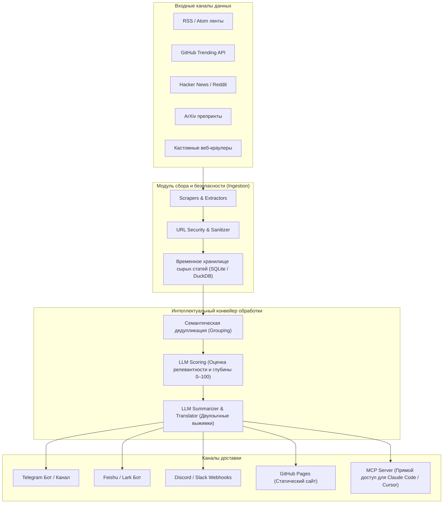

# 🌅 Horizon: Персональный AI-радар новостей, отсева инфошума и автономной доставки дайджестов

> **Ссылка на репозиторий:** [https://github.com/Thysrael/Horizon](https://github.com/Thysrael/Horizon)  
> **Официальный сайт:** [https://www.horizon1123.top](https://www.horizon1123.top)  
> **Демо-дайджест:** [https://thysrael.github.io/Horizon](https://thysrael.github.io/Horizon)  
> **Слоган:** *«Enjoy the News itself. Leave others to Horizon. Your own AI-powered news radar.»*  
> **Звёзды GitHub:** 10,300+ ★ (#8 в мировом Daily топе Trendshift)  
> **Архитектурный стек:** Python (пакетный менеджер `uv`) · Docker / Docker Compose · LLM (Claude, GPT, DeepSeek) · Model Context Protocol (MCP) · RSS / Scraping · Telegram / Feishu / Discord Webhooks  
> **Лицензия:** MIT  

---

## 🎯 1. Архитектурная проблема: информационная перегрузка и инфошум

Современный технический специалист ежедневно тонет в сотнях источников:
1. **Информационная фрагментация:**  
   Следить одновременно за GitHub Trending, препринтами ArXiv, релизами на Hacker News, техническими блогами компаний и профильными каналами отнимает 1.5–2 часа каждый день.
2. **Низкий сигнал/шум (Signal-to-Noise Ratio):**  
   До 90% публикаций представляют собой кликбейтные пересказы одного и того же пресс-релиза, спам или низкокачественный AI-контент.
3. **Отсутствие интеграции в рабочий процесс:**  
   Классические RSS-ридеры просто складывают заголовки в непрочитанные папки, не выделяя суть, не анализируя техническую глубину и не связывая новости с текущими проектами разработчика.

**Horizon автоматизирует полный цикл OSINT-разведки технологий:** агрегирует десятки разнородных каналов, фильтрует дубликаты, ранжирует материалы с помощью LLM и доставляет готовые структурированные дайджесты в привычные мессенджеры и агентные среды.

---

## 🏗️ 2. Архитектура пайплайна Horizon

Система построена по принципу модульного конвейера обработки данных:



---

## ⚙️ 3. Ключевые компоненты и механики под капотом

### 3.1. Многопроходная фильтрация и оценка качества (LLM Scoring)
Вместо простой сортировки по времени публикации Horizon запускает оценку по критериям:
* **Новизна (Novelty):** содержит ли статья принципиально новую информацию или является повтором вчерашней новости.
* **Техническая глубина (Technical Depth):** отсекаются общие маркетинговые статьи; приоритет отдается архитектурным разборам, бенчмаркам и коду.
* **Персональный профиль:** поддержка настраиваемых профилей (`profiles/`), позволяющих сфокусировать радар на конкретных темах (например, *AI Agent Runtimes*, *Rust Infrastructure* или *AppSec*).

### 3.2. Семантическая дедупликация (Clustering)
Если 15 мировых изданий опубликовали новость о выходе новой модели, Horizon объединяет их в единый кластер:
* Выделяется первоисточник.
* Формируется одна емкая карточка с ключевыми фактами.
* Прикрепляются ссылки на различные точки зрения.

### 3.3. Нативная интеграция с протоколом MCP (Model Context Protocol)
Horizon поставляется со встроенным MCP-сервером:
* AI-агенты (Claude Code, Antigravity, Cursor) могут напрямую обращаться к Horizon через вызовы тулов:
  * `get_todays_radar(category="ai_security")`
  * `search_intelligence(query="Firecracker microVM")`
* Это превращает Horizon в **активную базу оперативной памяти агента**, позволяя ему оставаться в курсе актуальных трендов без выхода в открытый поиск.

### 3.4. Мультиплатформенная доставка
* **Мессенджеры:** аккуратные карточки с эмодзи, ключевыми буллетами и временем чтения в Telegram и Feishu.
* **Статический портал:** автоматическая сборка и деплой на GitHub Pages через встроенный workflow.
* **Экспорт:** поддержка Markdown, JSON и RSS для последующей интеграции в Obsidian или Logseq.

---

## 💻 4. Быстрый запуск в Docker Compose

Horizon разворачивается за две минуты с помощью `docker-compose.yml`:

```yaml
version: '3.8'

services:
  horizon:
    image: thysrael/horizon:latest
    container_name: horizon-radar
    restart: unless-stopped
    environment:
      - OPENAI_API_KEY=your_key_or_proxy
      - OPENAI_BASE_URL=https://api.deepseek.com/v1  # Поддержка дешевых моделей
      - MODEL_NAME=deepseek-chat
      - TELEGRAM_BOT_TOKEN=your_bot_token
      - TELEGRAM_CHAT_ID=your_chat_id
      - CRON_SCHEDULE=0 8,20 * * *  # Сбор в 8:00 и 20:00
    volumes:
      - ./data:/app/data
      - ./profiles:/app/profiles
```

Запуск:
```bash
docker compose up -d
```

---

## 💡 5. Выводы и синергия со стеком базы знаний

1. **Автоматизация верхнего уровня воронки знаний:**  
   Horizon закрывает этап **первичного сбора и фильтрации сигналов** технологического фронтира. Отобранные и высоко оцененные им проекты затем попадают на глубокий анализ в персональную базу знаний.
2. **Экономия времени без потери контекста:**  
   Переход от хаотичного чтения соцсетей к двум структурированным утренним и вечерним дайджестам экономит более 10 часов в неделю.
3. **Связка с MCP:**  
   Возможность запросить свежие новости через MCP прямо из консоли Claude Code объединяет локальную разработку с оперативным пульсом мировой индустрии.
