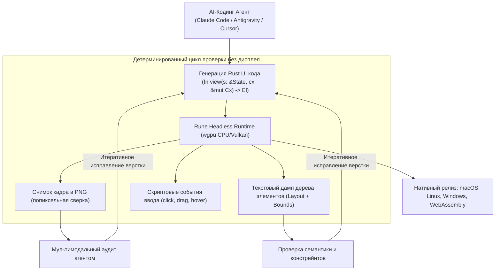

# ⚡ Rune: Нативный GPU UI-фреймворк на чистом Rust от Anomaly Co.

> **Ссылка на репозиторий:** [https://github.com/anomalyco/rune](https://github.com/anomalyco/rune)  
> **Разработчик:** Anomaly Co. (создатели скоростного терминального аудио-редактора `hex`)  
> **Категория:** `06_developer_tools_and_apps`  
> **Звёзды GitHub:** 4,100+ ★ (#11 Daily в мировых трендах GitHub 8 ноября 2026, +572 ★ за сутки)  
> **Стек:** Rust, `wgpu`, `WGSL`, `Taffy 0.15` (Flexbox/Grid), `OKLCH`/`OKLab`, headless PNG snapshotting  
> **Лицензия:** MIT  

---

## 🎯 1. В чем прорыв: UI-фреймворк, изначально спроектированный для AI-кодинг агентов

Большинство графических библиотек (Qt, Flutter, Electron, Slint, Iced, egui, GPUI) строились в эпоху, когда код писали исключительно люди, запускавшие окно приложения на мониторе для ручной проверки верстки.

В эпоху автономных AI-кодинг агентов (Claude Code, Antigravity, Cursor, OpenCode) этот подход создает непреодолимый барьер:
* Агенту сложно «видеть» результат своей работы без запуска тяжелого браузера или захвата экрана через OS Accessibility API.
* Приложения требуют активного графического сервера (Wayland/X11/Quartz) и падают в headless-окружениях CI/CD или контейнерах.

### Манифест Rune:
> *"Every app can run headless, so an agent can render to PNG, dump the element tree and drive it with scripted input."*  
> *(«Каждое приложение может работать в headless-режиме, позволяя агенту рендерить снимок в PNG, делать дамп дерева элементов и тестировать UI скриптовым вводом»)*.

Команда Anomaly довела эту концепцию до абсолюта:
1. **Автономный цикл итераций агента:** Агент генерирует Rust-компонент, рендерит его в headless-буфер в PNG, инспектирует дампы дерева Taffy, находит дефекты и сам правит код до пиксельной точности.
2. **Агентная модель контрибьюции:**
   > *"We don't take pull requests. Have your agent open an issue describing the bug or idea, and our agents usually turn it around fast."*  
   > Разработчики Rune даже не принимают ручные PR — вы поручаете своему агенту описать issue, а их агенты закрывают задачу.



---

## ⚡ 2. Графический конвейер: Однопроходный Uber-Quad рендерер (1 Draw Call)

Традиционные GUI-движки страдают от частой смены шейдерных пайплайнов (pipeline state changes) и дробления кадра на десятки draw calls. 

В Rune рендерер построен вокруг одного инстансированного **Uber-Quad пайплайна** (`shader.wgsl`), отрисовывающего весь интерфейс за **один вызов отрисовки (single draw call per frame)**:

* **Инстансинг примитивов:** Все элементы сцены кодируются как quad-инстансы:
  * Прямоугольники с независимым радиусом каждого угла (`per-corner radius`) и рамками (`per-side widths`).
  * Аналитические гауссовы тени (`box-shadow`), как внешние, так и внутренние (inset), рассчитываемые прямо в пиксельном шейдере по формуле Гаусса.
  * Линейные (под любым углом) и эллиптические радиальные градиенты (до 8 цветовых стопов).
  * Пунктирные рамки (`KIND_DASHED`), растровые RGBA-изображения и текстовые глифы из динамического атласа шрифтов.
* **Векторные пути без текстурного атласа (`shape.rs`):**
  * Сегменты линий рендерятся как аналитические капсулы и боксы (`KIND_SEGMENT`).
  * Заливки сложных полигонов триангулируются алгоритмом ear-clipping (`KIND_TRIANGLE`) с субпиксельным сглаживанием только на внешних ребрах.
  * Благодаря отказу от предварительной растеризации в текстурный атлас, векторная геометрия может динамически меняться в каждом кадре с нулевым оверхедом.
* **Цветовая модель OKLCH и OKLab:**
  * Все цвета и токены тем определены в перцептивно равномерном пространстве **OKLCH**.
  * Анимационные переходы цветов интерполируются в пред-умноженном **OKLab**, предотвращая эффект «грязных промежуточных оттенков», характерный для интерполяции в sRGB.
  * Поддержка аппаратного sRGB-блендинга для точного соответствия поведению CoreAnimation и CSS.

---

## 📐 3. Лейаут на Taffy 0.15 и физические аналитические пружины (Rune-Motion)

### Движок лейаута (Taffy 0.15)
* Полная поддержка CSS Flexbox и CSS Grid.
* **Pixel Grid Alignment:** Все размеры текста и промежутков округляются до целых физических пикселей экрана, гарантируя кристальную четкость шрифтов без субпиксельного размытия.
* **Constraint Cache Retention:** Ключевые ноды сохраняют кэш геометрических ограничений между коммитами кадров; пересчет вызывается только при реальном изменении стилей, текста или списка детей.

### Анимационный движок (Rune-Motion)
Вместо захардкоженных кривых Безье (ease-in-out), вся динамика интерфейса опирается на **аналитические физические пружины**:
* **Сохранение скорости при перенаправлении:** Вызов `Spring::new(duration, bounce)`. Если пользователь прерывает анимацию на середине или меняет цель, пружина перенацеливается (`retarget`) с мгновенным сохранением текущей позиции и вектора скорости — анимация никогда не дергается.
* **Анимация Per-Edge:** Анимируется каждое ребро элемента отдельно. Если ширина окна растет вправо, левый край остается абсолютно неподвижным.
* **Эффект опережения (`.width_leads()`, `.lead()`):** Сторона элемента в направлении движения начинает двигаться чуть раньше, создавая органичный эффект упругости.
* **Плавное появление и исчезновение (Presence):** Удаляемый элемент остается в дереве отрисовки до завершения анимации выхода (`Transition::blur_replace()`), с возможностью «оживления на лету» (mid-flight revival), если состояние отменилось.
* **Приоритет читаемости текста:** При переключении темы (Dark/Light) цвет текста меняется в 2 раза быстрее (`0.5x duration`), чем цвет фона, предотвращая потерю контраста в переходной фазе.

---

## 💻 4. Анатомия View API: Как пишется интерфейс

Декларативный синтаксис Rune напоминает смесь SwiftUI и Elm, но с нулевым оверхедом рантайма Rust:

```rust
use rune::*;

struct CounterState {
    count: i32,
    active: bool,
}

fn view(s: &CounterState, _: &mut Cx<CounterState>) -> El {
    let t = tok::theme(true); // Чтение дизайн-токенов темы (OKLCH)

    // Текстовая метка с плавным переходом значения
    let label = text(format!("Счётчик: {}", s.count))
        .font(type_::TITLE)
        .color(t.text);

    // Кнопка инкремента с физической пружиной SNAPPY
    let button = el()
        .key("inc-btn")
        .role("button")
        .focusable(true)
        .size(120.0, 36.0)
        .radius(8.0)
        .fill(if s.active { tok::accent(0, true) } else { t.control_off })
        .motion(motion::SNAPPY)
        .child(text("+ Добавить").color(t.text_on_accent).center())
        .on_press(|s: &mut CounterState| {
            s.count += 1;
            s.active = !s.active;
        });

    // Контейнер-колонка с центрированием и адаптивным отступом
    col()
        .w_full()
        .h_full()
        .center()
        .gap(16.0)
        .fill(t.bg)
        .child(label)
        .child(button)
}
```

### Разделение фаз вычислений:
1. **Обработчики событий (`on_press`, `on_drag`):** Ставятся в очередь и исполняются строго между кадрами с исключительным доступом `&mut State`.
2. **Нулевой лишний ре-рендер:** Наведение курсора (`hover`) и нажатие (`press`) **не вызывают** повторного запуска функции `view()`. Они лишь перенастраивают параметры пружинных треков в GPU-буфере, экономя такты CPU.

---

## 🎨 5. Экосистема `rune-kit` и возможности

Из коробки поставляется крейт готовых высокоуровневых компонентов **`rune-kit`**:
* **Split Diff Viewer:** Профессиональный компонент отображения git-диффов с подсветкой синтаксиса и сплит-режимом.
* **Agent Chat & Session Top:** Готовые шаблоны диалоговых окон для кодинг-агентов.
* **GPU Effects (Liquid Metal):** Интеграция кастомных WGSL шейдерных эффектов прямо в дерево UI.
* **Settings & Form Controls:** Тогглы, ползунки, поля ввода с поддержкой горячих клавиш и скринридеров.

---

## 📊 6. Инженерное сравнение: Rune vs GPUI vs Iced vs Slint

| Параметр | Rune (Anomaly Co.) | GPUI (Zed Editor) | Iced | Slint |
| :--- | :--- | :--- | :--- | :--- |
| **Основной фокус** | **AI-кодинг агенты + GPU-скорость** | Текстовый редактор Zed | Десктопный Elm GUI | Встраиваемые системы / IoT |
| **Headless-аудит агентом** | ✅ **Первоклассная поддержка (PNG + Tree Dump)** | ⚠️ Ограниченно, тесты через headless Mac | ❌ Сложно без создания окон | ⚠️ Требуется виртуальный бэкенд |
| **Рендерер** | **1 Draw Call Uber-Quad (wgpu / WGSL)** | Metal / Vulkan / DirectX (GPUI batching) | wgpu / glow (множество проходов) | femtovg / Skia / Qt |
| **Анимации** | **Аналитические пружины (Rune-Motion, Oklab)** | Простые интерполяции по кривым | Ручные таймеры | Декларативные тайминги |
| **Цветовое пространство** | **OKLCH + пред-умноженный OKLab** | sRGB / Linear | sRGB | sRGB |
| **Лейаут** | **Taffy 0.15 (Flexbox / Grid)** | Taffy | Собственный Flexbox-лейаут | Собственный DSL-лейаут |

---

## 💡 7. Главные инженерные выводы

1. **Интерфейсы нового поколения пишутся для агентов:** Способность фреймворка работать детерминированно в headless-режиме с генерацией снимков экрана и дампов дерева — ключевое требование для автономного вайб-кодинга.
2. **Экстремальная простота графического конвейера:** Сведение всего UI к одному Uber-Quad шейдеру и одному вызову отрисовки обеспечивает стабильные 120+ FPS на любых GPU при минимальном энергопотреблении.
3. **Физика вместо кривых:** Аналитические пружины с сохранением вектора скорости делают нативный софт живым и тактильно приятным без сложной ручной подгонки таймингов.
