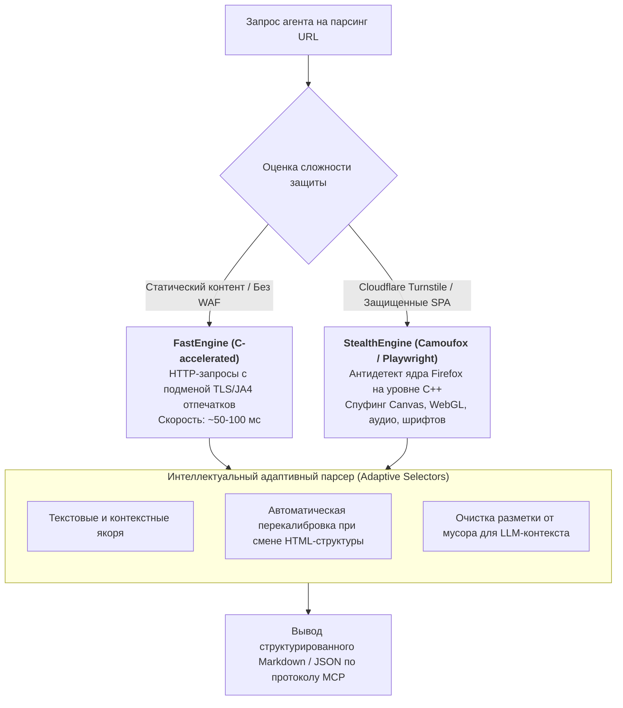

# 🕷️ Scrapling: Сверхбыстрый антидетект-фреймворк веб-скрейпинга и парсинга для AI-агентов

> **Ссылка на репозиторий:** [https://github.com/D4Vinci/Scrapling](https://github.com/D4Vinci/Scrapling)  
> **Автор:** Karim Shoair (D4Vinci)  
> **Категория:** `06_developer_tools_and_apps`  
> **Звёзды GitHub:** 91,400+ ★ (#7 Daily в мировых трендах GitHub, +466 ★ за сутки)  
> **Интеграция:** Нативный сервер Model Context Protocol (FastMCP) для кодинг-агентов  
> **Стек:** Python 3.10+, Playwright, Camoufox (Firefox Stealth), lxml, cchardet  
> **Лицензия:** BSD-3-Clause  

---

## 🎯 1. В чем проблема сбора веб-данных современными AI-агентами?

Когда кодинг-агентам (Claude Code, Cursor, Codex) поручают собрать документацию, спарсить цены конкурентов или исследовать веб-ресурс, стандартные инструменты (`curl`, `requests`, `fetch`) моментально блокируются Cloudflare, Akamai, DataDome или капчами.

Традиционные браузерные средства (Selenium, чистый Puppeteer/Playwright) имеют фундаментальные изъяны:
1. **Легкая детектируемость:** Системы защиты анализируют свойства `navigator.webdriver`, шумы Canvas/WebGL, TLS Client Hello отпечатки (JA3/JA4) и блокируют бота до загрузки контента.
2. **Колоссальный расход ресурсов:** Поднятие десятков тяжелых экземпляров Chromium перегружает память и замедляет работу агента.
3. **Хрупкие селекторы:** Изменение одного класса верстки на сайте на следующий день ломает парсер.

**Scrapling объединил скорость легковесных HTTP-запросов и скрытность глубокого браузерного антидетекта:**

---

## ⚡ 2. Ключевые возможности Scrapling

1. **Адаптивные селекторы (Adaptive Selectors):** Scrapling запоминает семантическое окружение элемента. Если разработчики сайта переименовали CSS-классы, парсер автоматически находит целевой блок по относительным текстовым и структурным связям.
2. **Глубокий C++ антидетект на базе Camoufox:** Модифицированное ядро Firefox с аппаратным спуфингом фингерпринтов без инъекций легко детектируемого JavaScript (`preload scripts`).
3. **Нативная поддержка MCP (Model Context Protocol):** Агенту достаточно вызвать инструмент `scrapling_fetch` или `scrapling_crawl`, чтобы получить идеально очищенный от рекламы и меню контент страницы.

---

## 💡 3. Главные инженерные выводы

1. **Скрейпинг для агентов требует адаптивности:** LLM не должна писать хрупкие XPath-селекторы. Фреймворк обязан брать на себя компенсацию изменений верстки.
2. **Двухуровневая стратегия экономит ресурсы:** Сначала быстрый HTTP-запрос со спуфингом TLS, и только при обнаружении WAF — переход к полноценному headless-браузеру.
